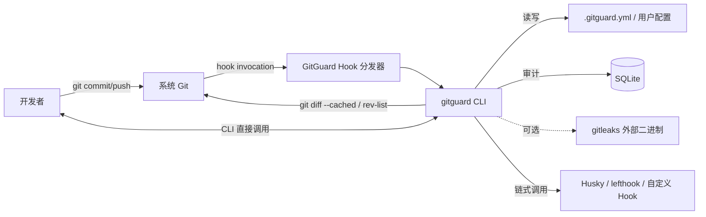
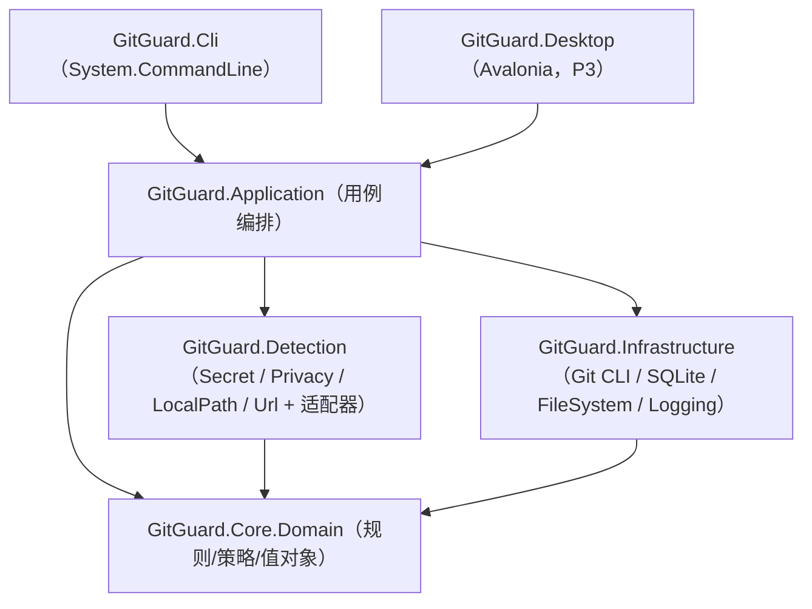
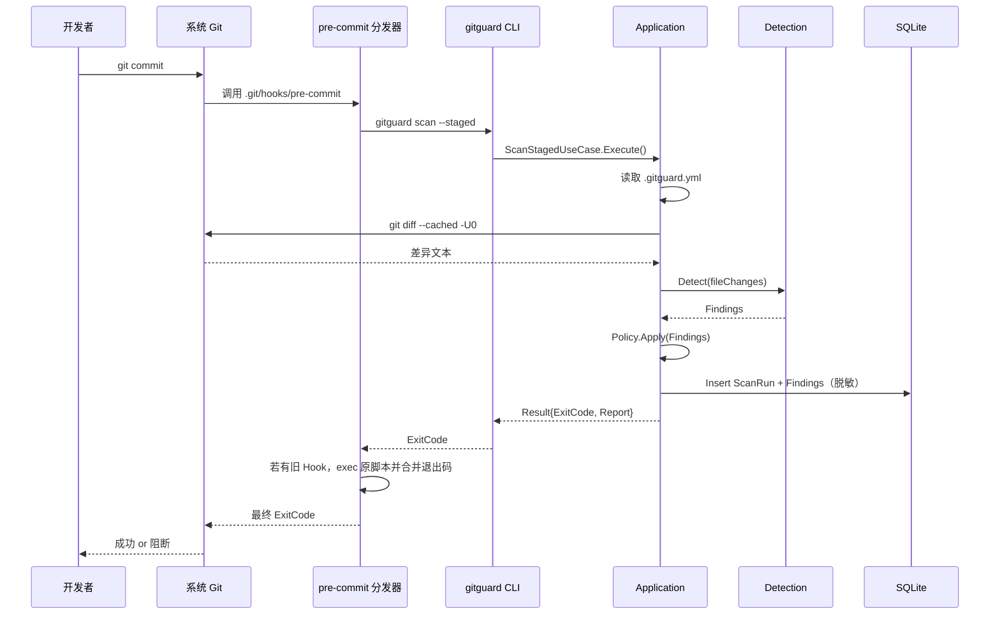
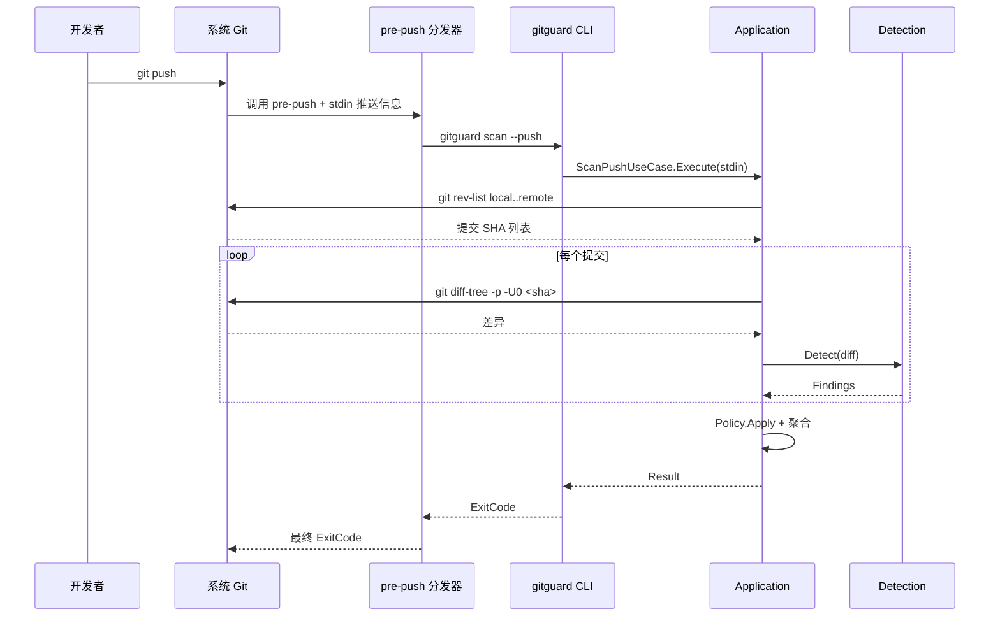
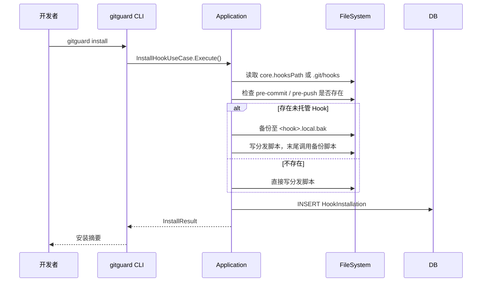
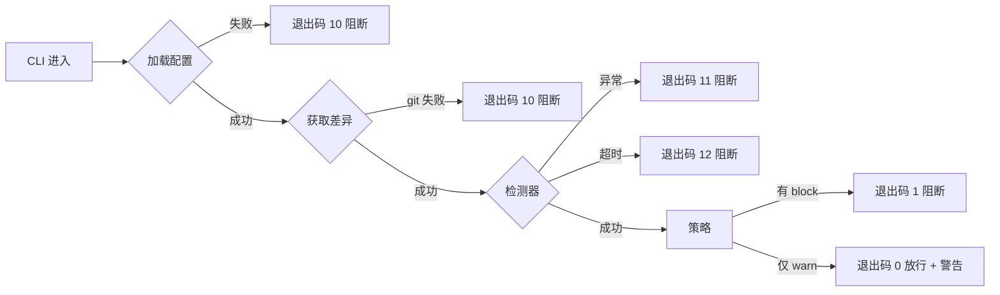

# 系统架构设计（SAD）

## 1. 架构目标

- **本地独立运行**：无网络依赖，无服务器依赖；仅依赖本机 Git 与 SQLite 文件。
- **可拆插的检测器**：Secret/Privacy/LocalPath/Url 四类检测器与未来的 GitleaksAdapter 共享 `IDetector` 契约，可独立启用/禁用/替换。
- **FailClosed 优先于性能**：任何异常路径默认阻断；只在明确安全的分支（如纯警告级发现）才允许放行。
- **启动极快**：目标 Native AOT 单文件冷启动 ≤ 150ms，使 Hook 调用对用户几乎无感。
- **可演进为桌面端**：核心逻辑与 CLI 层解耦；Avalonia 桌面端（P3）复用同一套 `GitGuard.Core`。
- **文档优先**：规则 ID / 配置 Schema / 退出码等外部契约在设计文档中锁定后再写代码。

## 2. 技术选型（SSOT）

### 2.1 技术基线一览

| 层级 | 技术 | 版本 | 选型理由 | 关联 ADR |
| --- | --- | --- | --- | --- |
| 核心语言与运行时 | C# / .NET | 10.0 LTS | 开发者本机技术栈匹配；LTS 支持周期长；Native AOT 稳定；跨平台单一代码库 | ADR-0002 |
| 发行形态 | Native AOT 单文件 + `dotnet tool` | 10.0 | 最小化开发者分发摩擦，无需额外运行时；`dotnet tool` 提供可选 SDK 用户路径 | ADR-0002 |
| CLI 框架 | `System.CommandLine` | 预览版（Microsoft 官方维护） | 与 .NET 生态一致；支持 `--help`、补全、嵌套命令 | ADR-0002 |
| Git 交互 | 调用系统 `git` CLI（通过 `Process`） | 兼容 Git ≥ 2.9 | 兼容既有仓库、hooks、远程；不引入 LibGit2Sharp 的 Native 绑定复杂度 | ADR-0002 |
| 本地存储 | SQLite（嵌入） via `Microsoft.Data.Sqlite` | 最新稳定 | 单文件、零运维、跨平台；满足审计规模 | - |
| 配置解析 | `YamlDotNet` | 最新稳定 | `.gitguard.yml` 友好；社区成熟 | - |
| 秘密检测补强（可选，P2） | Gitleaks（外部二进制） | 最新稳定 | 规则库成熟；MIT 许可证；通过适配器隔离 | ADR-0003 |
| 日志 | `Microsoft.Extensions.Logging` + 自写 Sink（SQLite + 控制台） | 10.0 | 标准接口；自写 Sink 可强制脱敏 | - |
| 单元测试 | xUnit v3 | 最新稳定 | 与 .NET 10 兼容；并行执行好 | - |
| 集成测试 | xUnit v3 + 临时 Git 仓库 Fixture | - | 集成测试直接 fork Git CLI 验证 Hook 行为 | - |
| 桌面 UI（P3） | Avalonia UI | 11.x+ | 跨平台 XAML；社区活跃；与 .NET 同源 | ADR-0002 |
| 容器 / Docker | 仅 CI 构建用（`mcr.microsoft.com/dotnet/sdk:10.0`） | - | 本工具运行时无 Docker 依赖；Docker 只做 CI 多平台构建 | - |

> **AI / LLM**：本项目不集成任何 AI 能力；未来若需要辅助规则生成，走独立 ADR 评审。

### 2.2 技术选型原则

1. **成熟稳定优先于前沿**：所有依赖必须有官方或广泛社区维护。
2. **跨平台单一代码库**：Windows / macOS / Linux 共享同一个 `src/`，差异仅在发行脚本。
3. **可独立运行**：发行物不要求用户额外安装 .NET 运行时（Native AOT 兜底）。
4. **可降级运行**：外部依赖（Gitleaks）缺失时降级为内置规则，而非阻断。
5. **安全不与性能冲突**：所有性能优化不得牺牲 `FailClosed` 与 `零明文留存`。

### 2.3 未选中的候选

| 候选 | 用途 | 未选理由 |
| --- | --- | --- |
| Node.js + TypeScript | CLI 实现 | 与团队 .NET 技术栈不匹配；分发需 Node 运行时 |
| Go | CLI 实现 | 跨平台好，但团队学习成本高；放弃 .NET 生态优势 |
| LibGit2Sharp | Git 交互 | 引入 Native 绑定与许可证复杂度；系统 git 已满足需要 |
| PostgreSQL / MySQL | 审计存储 | 本地单用户场景下，SQLite 已完全够用；避免引入服务 |
| gRPC | 组件通信 | 单进程架构下无必要；二期桌面端如果需要再评估 |
| 自写秘密检测 | 全部检测 | 规则库维护成本高；二期用 Gitleaks 补强更务实 |
| MAUI | 桌面 UI | 当前对 Linux 支持不足；选择 Avalonia 覆盖面更广 |

## 3. 架构原则

1. **模块化单体（Modular Monolith）**：MVP 以单一进程、模块化分层交付；详见 ADR-0001。
2. **依赖倒置**：检测器 / 存储 / Git 访问均通过接口暴露；核心逻辑不依赖具体实现。
3. **保守降级**：外部依赖故障、规则加载异常、Git 命令失败 → FailClosed；拒绝「优雅忽略」。
4. **规则优先于代码**：所有检测规则在配置中声明（Builtin / User / Gitleaks），禁止硬编码规则在业务代码中。
5. **边界清晰**：CLI 层只做参数解析和退出码；Application 层只做用例编排；Domain 层只有规则判定和不变式。
6. **可测试性优先**：Git 交互与文件 IO 封装在 Infrastructure 层，核心规则逻辑用纯函数实现，可直接单测。

## 4. 系统上下文



## 5. 逻辑架构



> **依赖方向**：仅允许 `Cli / Desktop → Application → Core`；`Infrastructure` 作为端口实现对 `Application` 暴露接口；`Detection` 既实现 `IDetector`（Core 定义）又可依赖 `Infrastructure`（如调用 Gitleaks）。

### 5.1 解决方案结构

```text
GitGuard/
├─ GitGuard.sln
├─ src/
│  ├─ GitGuard.Core/              # Domain Model、Rule、Finding、Policy、不变式
│  │  ├─ Model/                   # Finding、ScanRun、Severity、Fingerprint
│  │  ├─ Rules/                   # IDetectionRule、BuiltinRules
│  │  ├─ Policy/                  # SeverityPolicy、Allowlist
│  │  └─ Abstractions/            # IDetector、IGitAccess、IAuditStore、IClock
│  ├─ GitGuard.Detection/         # 实现 IDetector
│  │  ├─ Secret/
│  │  ├─ Privacy/
│  │  ├─ LocalPath/
│  │  ├─ Url/
│  │  └─ Adapters/                # GitleaksAdapter（P2）
│  ├─ GitGuard.Application/       # 用例：ScanStaged / ScanPush / Install / Uninstall
│  │  ├─ Scanning/
│  │  ├─ Hooks/
│  │  └─ Allowlist/
│  ├─ GitGuard.Infrastructure/
│  │  ├─ Git/                     # IGitAccess 实现（Process + git CLI）
│  │  ├─ Sqlite/                  # IAuditStore 实现
│  │  ├─ FileSystem/
│  │  └─ Logging/                 # 带脱敏的 Sink
│  ├─ GitGuard.Cli/               # Program.cs + System.CommandLine
│  └─ GitGuard.Desktop/           # Avalonia（P3，仓库中保留目录占位）
├─ tests/
│  ├─ GitGuard.Core.Tests/
│  ├─ GitGuard.Detection.Tests/
│  ├─ GitGuard.Application.Tests/
│  ├─ GitGuard.Infrastructure.Tests/
│  └─ GitGuard.E2E.Tests/         # 调起 git CLI 的集成测试
├─ benchmarks/
│  └─ GitGuard.Benchmarks/        # BenchmarkDotNet（可选）
├─ docs/                           # 本仓库文档
├─ scripts/
│  ├─ build-aot.ps1
│  ├─ build-aot.sh
│  └─ hook-template.sh
├─ .editorconfig
├─ Directory.Build.props          # 统一 LangVersion / Nullable / TreatWarningsAsErrors
├─ Directory.Packages.props       # Central Package Management
└─ README.md
```

## 6. 模块职责

| 模块 | 职责 | 不允许依赖 |
| --- | --- | --- |
| `Core.Domain` | Finding / Policy / Rule 建模；DR-* 不变式 | 任何其他模块；无 IO、无 Logging |
| `Detection` | 具体检测器实现；返回 Finding | `Cli` / `Desktop` / `Application` |
| `Application` | 用例编排：ScanStaged、ScanPush、InstallHook、Allowlist | `Cli` / `Desktop` |
| `Infrastructure` | Git CLI 调用、SQLite 读写、文件 IO、日志 Sink | `Cli` / `Desktop` / `Application` |
| `Cli` | 参数解析、退出码、终端渲染 | `Infrastructure`（不允许直接依赖 Infra，必须经 Application） |
| `Desktop` | Avalonia UI；复用 `Application` | `Infrastructure`（不允许直接依赖，必须经 Application） |

> 边界由 Analyzer 规则强制：`Cli` / `Desktop` 项目的 `csproj` 不得引用 `Infrastructure` 项目。

## 7. 关键流程

### 7.1 `git commit` 拦截



### 7.2 `git push` 拦截



### 7.3 Hook 分发器初次安装



### 7.4 FailClosed 默认阻断分支



## 8. 数据流与一致性

- 差异数据：Git CLI → Application（内存流式处理）→ Detection（逐文件、逐 Hunk）→ 内存 Finding 列表。
- 发现项落库：扫描结束后一次事务写入 ScanRun + Findings；避免高频小事务。
- 配置读取：进程启动时一次性加载，整个运行周期不重读；避免中途改配置导致判定漂移。
- 一致性：本地单进程、单写入点，使用 SQLite 默认 WAL 模式；对审计表读写不要求强一致（无并发查询场景）。

## 9. 质量属性策略

| 质量属性 | 架构策略 | 关联 NFR |
| --- | --- | --- |
| 性能 | Native AOT；按文件/Hunk 流式扫描；规则正则编译缓存；大文件早停跳过 | NFR-P-001 ~ 004 |
| 安全 | 严禁明文落日志；Logging Sink 内置掩码；SQLite 字段 Schema 不含原文列 | NFR-S-001 ~ 004 |
| 可用性 | 跨平台单源；CI 多平台矩阵；Hook 分发器单元/集成测试覆盖 | NFR-A-001, 002 |
| 可维护性 | 模块化单体 + Analyzer 边界检查；规则在配置声明；文档 SSOT | NFR-M-001, 002 |
| 可演化性 | `IDetector` 适配器插槽；Avalonia 复用 `Application` | - |

## 10. 可观测性

- **日志**：`Microsoft.Extensions.Logging` + 自写 Sink，默认写到控制台（stderr）与 SQLite 的 `AuditLogs` 表。默认级别 `Information`，`--verbose` 升到 `Debug`。
- **指标**（本地）：每次扫描结束时在日志中打一行结构化 Summary `scan.summary{duration_ms, rule_hits, blocked, warned, skipped}`。
- **追踪**：本地单进程无需分布式追踪；长期考虑用 ActivitySource 便于 BenchmarkDotNet 集成。
- 详细规范见 `09-日志设计.md`。

## 11. 安全架构

- **本地化隔离**：无出站网络；`System.Net.Http` 不进入发行物（通过 Linker 剪裁 + 单测校验）。
- **文件权限**：SQLite 文件默认权限 `0600`（Unix）；Windows 下 ACL 仅 CurrentUser 可读写。
- **脱敏流水线**：所有敏感原文在 `Detection` 层产生后，必须经过 `Fingerprinter`（SHA-256 + Salt）与 `Masker`（保留前后 2 字符，中间星号）后才能进入 Logging / SQLite。
- **输入边界**：Git CLI 输出按行限长；正则匹配设超时（.NET 内置 Regex.MatchTimeout）。
- 详细规范见 `08-权限设计.md`。

## 12. 可演化性

- **扩展点**：
  - `IDetector`：新增检测类别（如 `JwtDetector`、`GitleaksAdapter`）。
  - `IAuditStore`：未来可能把 SQLite 替换为团队共享的 LiteDB / 远程 Audit API。
  - `IRuleSource`：当前为 YAML；未来可加 JSON / 远程只读 API。
- **可能的演进路径**：
  - **MVP → P2**：引入 GitleaksAdapter，不改 Core。
  - **P2 → P3**：Avalonia 桌面端复用 `Application`，Infra 保持不变。
  - **远期**：若需要团队协作，可将审计表从 SQLite 升级到 LiteDB（仍为本地文件），再往后考虑加 CLI 导出到团队内部 API。

## 13. 变更记录

| 版本 | 日期 | 变更说明 |
| --- | --- | --- |
| 0.1.0 | 2026-10-15 | 初始化：锁定技术栈、分层、扩展点与 Native AOT 发行形态 |
