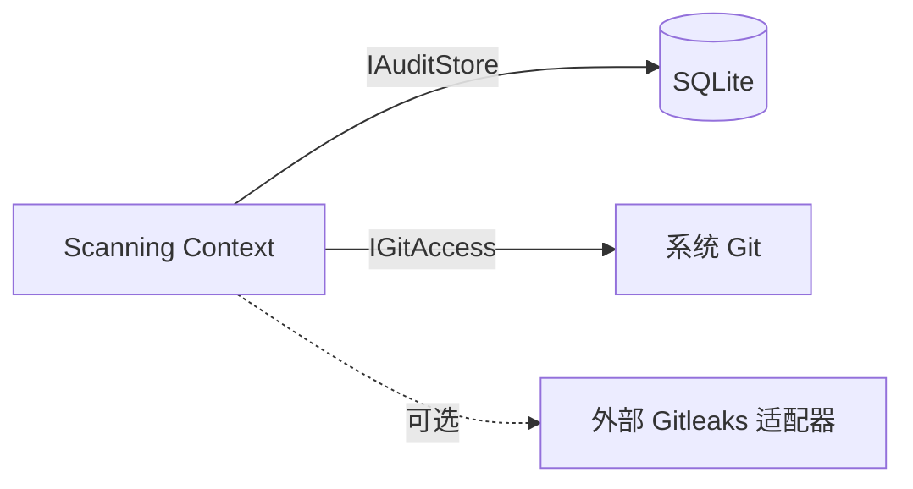

# 领域模型设计（DDD）

## 1. 建模策略

- **方法**：用例驱动（Use-Case Driven）+ 四类检测规则作为天然的子域边界。
- **粒度**：聚合粒度与持久化记录一一对应（ScanRun 聚合内含 Findings）。
- **代码映射**：
  - 本文件定义的中文术语 ↔ `GitGuard.Core.Model` 下的类名（见 §8 领域语言）。
  - DR-NNN 在 `GitGuard.Core.Domain` 的常量 / 守卫方法里显式验证；禁止散落在上层。
  - 不写贫血模型：Finding 的 `Fingerprint`、`SnippetMasked` 由构造函数在聚合内生成。

## 2. 限界上下文（Bounded Context）

MVP 为单一限界上下文（Scanning Context），内部按模块组织。将来桌面端若引入「仓库管理」等协作能力，可能分出 Management Context。

| 上下文 | 职责 | 集成模式 | 对接方 |
| --- | --- | --- | --- |
| Scanning Context（唯一） | 规则定义、扫描执行、策略判定、审计记录 | - | 通过 `IAuditStore` 对接本地 SQLite；通过 `IGitAccess` 对接 Git CLI |

## 3. 聚合（Aggregate）

### 3.1 ScanRun（扫描运行聚合）

- **聚合根**：`ScanRun`
- **成员**：`Finding`（1..N）、`ScanType`（值对象）、`ScanResult`（值对象）
- **不变式**：
  - `DR-02`：Finding 的 `Snippet` 必须以 `SnippetMasked` 形式存储，构造函数拒绝原文。
  - `DR-03`：若 `Result = Failed`，`ExitCode` 必须 ≥ 10 且终端输出必须有具体错误原因。
  - `Findings` 列表不可为空「同时」`Result = Clean`——相互矛盾时抛 `InvariantViolation`。
  - `SRS FR-020`：`ExitCode` 与 `Result` 一致——`Clean / Warned ⇒ 0`，`Blocked ⇒ 1` 且至少一条 Finding，`Failed ⇒ ≥ 10`。
  - `RepoPath` 必须是规范化的绝对路径（去除尾部分隔符）；`StartedAt` 等时间字段一律 UTC。
  - 被 allowlist 忽略的 Finding 仍计入 `Findings`；全部 Finding 均被忽略的扫描记为 `Warned` + `ExitCode 0`（2026-10-15 决策）。
- **生命周期**：Created → Running → (Completed | Failed | BypassDetected) → Persisted（终态）。
- **关联聚合**：`DetectionRule`（仅通过 RuleId 引用）、`Allowlist`（仅通过 Fingerprint/Rule/Path 匹配时引用）。

### 3.2 DetectionRule（检测规则聚合）

- **聚合根**：`DetectionRule`
- **成员**：`RulePattern`（值对象，含正则/上下文/文件 glob/声明式校验器）、`Severity`、`Source`
- **不变式**：
  - `RuleId` 必须符合 `^(GGD|USR|GLK)/[A-Z]+/[A-Z0-9_-]+$`。
  - `Pattern` 必须可编译；编译失败时拒绝加载。
  - `Severity = Critical` 的内置规则不允许用户降级到 `Allow`（硬下限，参见 FR-022）。
- **生命周期**：Loaded → Compiled → (Enabled | Disabled) → Executed（无状态执行）。

### 3.3 Allowlist（白名单聚合）

- **聚合根**：`AllowlistEntry`
- **不变式**：
  - 至少包含 `RuleId / PathPattern / Fingerprint` 三者之一（否则没有匹配条件）。
  - `Reason` 必填且 ≥ 5 字符。
  - `ExpiresAt` 若存在必须晚于 `CreatedAt`；到期（`now ≥ ExpiresAt`）条目不再参与匹配。
  - 新增 / 删除需要记录 `ChangedAt` 与 `ChangedBy`（本机用户名）。

### 3.4 HookInstallation（Hook 安装聚合）

- **聚合根**：`HookInstallation`
- **不变式**：
  - 同一仓库 + Hook 类型仅一条记录（复合主键 `(RepoPath, HookType)`）；重新安装 upsert 刷新字段并翻转为 `Active`，卸载翻转为 `Uninstalled`（`Replaced` 为预留状态，当前实现无写入方，GGD-0008 修正原「重装覆盖旧记录为 Replaced」设想）。
  - 若原仓库有未托管 Hook，安装时 `OriginalHookBackupPath` 记录备份文件名（与分发脚本同目录）；无原 Hook 时为 `null`。
  - `RepoPath` 为规范化绝对路径；`InstalledAt` 为 UTC；`OriginalHookBackupPath` 非空时必须是纯文件名且以 `.local.bak` 结尾（GGD-0008）。

## 4. 实体与值对象

### 4.1 实体

| 实体 | 身份标识 | 关键属性 | 所属聚合 |
| --- | --- | --- | --- |
| `ScanRun` | `Guid Id` | `RepoPath, ScanType, StartedAt, DurationMs, Result, ExitCode` | ScanRun |
| `Finding` | `Guid Id` | `RuleId, FilePath, LineNumber, Severity, Fingerprint, SnippetMasked, CommitSha?` | ScanRun |
| `DetectionRule` | `string RuleId` | `Name, Pattern, Severity, Enabled, Source` | DetectionRule |
| `AllowlistEntry` | `Guid Id` | `RuleId?, PathPattern?, Fingerprint?, Reason, CreatedAt, CreatedBy` | Allowlist |
| `HookInstallation` | `(RepoPath, HookType)` | `InstalledAt, Version, OriginalHookBackupPath?, Status` | HookInstallation |

### 4.2 值对象

| 值对象 | 关键属性 | 单位 / 约束 | 不变式 |
| --- | --- | --- | --- |
| `Severity` | `Critical / High / Medium / Low` | 枚举 | 排序：Critical > High > Medium > Low |
| `ScanType` | `PreCommit / PrePush / Manual / Bypass` | 枚举 | `Bypass` 的 `ScanRun` 无 Finding |
| `Fingerprint` | `string(64)` | SHA-256 hex | 固定 64 字符；禁止从 Finding 外部直接构造 |
| `SnippetMasked` | `string(≤32)` | 掩码片段 | 必须包含至少 50% 的 `*`；禁止含原始敏感 token |
| `RulePattern` | `Regex, string[]? ContextKeywords, string[]? FilePathGlobs, string[]? Validators` | 编译后 Regex | `Regex.MatchTimeout = 200ms`；禁止灾难性回溯；`Validators` 仅允许支撑检测器登记的名称（`shannon-entropy` / `luhn` / `cn-id-checksum`），未知名称在检测器构造期拒绝（FailClosed） |
| `ScanResult` | `Clean / Warned / Blocked / Failed` | 枚举 | `Failed ⇒ ExitCode ≥ 10` |
| `PolicyAction` | `Allow / Warn / Block` | 枚举 | `Critical` 不允许映射为 `Allow`（硬下限，FR-022） |
| `PolicyDecision` | `Action, IgnoredByAllowlist, Severity` | record | `IgnoredByAllowlist ⇒ Action = Allow`（FR-040） |
| `RuleSource` | `Builtin / User / Gitleaks` | 枚举 | 记录规则来源，用于审计 |

## 5. 领域事件

| 事件 | 触发条件 | 载荷字段 | 消费方 |
| --- | --- | --- | --- |
| `ScanCompleted` | 一次 `ScanRun` 聚合落库完成 | `{ RunId, Type, Result, ExitCode, FindingsCount, BlockedCount }` | 本地审计 Sink、未来桌面端通知面板 |
| `BypassDetected` | `post-commit` 判定提交未经过扫描的 `GITGUARD_SKIP=1`（`GitGuardSkip`）或 `--no-verify`（`NoVerify`） | `{ RunId, CommitSha, DetectedAt, Reason }` | 审计 Sink |
| `HookInstalled` | `InstallHookUseCase` 成功 | `{ RepoPath, HookType, Version, HadLegacyHook }` | 审计 Sink |
| `HookUninstalled` | `UninstallHookUseCase` 成功 | `{ RepoPath, HookType, RestoredLegacyHook }` | 审计 Sink |
| `AllowlistChanged` | 白名单 Add / Remove | `{ EntryId, Action, RuleId?, PathPattern?, Fingerprint?, Reason }` | 审计 Sink |

> **实现约束**：事件总线 MVP 内不引入异步（本地单进程），直接调用 `IAuditStore` 同步落库。保留事件抽象是为桌面端二期做准备。

## 6. 领域服务

| 服务 | 职责 | 依赖 |
| --- | --- | --- |
| `PolicyEvaluator` | 将 Finding 的 `Severity` + 配置映射到 `Block/Warn/Allow` 动作；白名单命中（未过期）优先于严重度映射 | `SeverityPolicy`（配置）、`AllowlistEntry` 列表、当前时间 |
| `Fingerprinter` | 对敏感原文做 SHA-256 + Salt（HMAC-SHA256）生成 `Fingerprint`；Salt 来自用户机器的随机密钥（首次运行生成） | `ISecretRandom`（生成盐）；盐值由调用方注入 |
| `Masker` | 把原文裁剪为 `SnippetMasked`（保留前后 2 字符，中间 `*`，总长不超 32） | - |
| `SanitizingLogger` | 日志脱敏流水线：敏感字段经 `Masker` 掩码、文本经 `TerminalSanitizer` 去控制字符、路径经 `PathAnonymizer` 匿名化；由 Infrastructure 日志 Sink 调用 | - |
| `HookScriptBuilder` | 根据 Hook 类型渲染 POSIX sh 分发脚本（嵌入式模板 + `{{VERSION}}` / `{{GITGUARD_BIN}}` / `{{HOOK_NAME}}` 替换，LF + 无 BOM 归一化；PowerShell 变体已撤销，GGD-0008）。实现落在 `GitGuard.Application.Hooks`（依赖嵌入资源，属应用关注点而非纯领域逻辑） | - |
| `PendingScanRecorder` | pre-commit 记录待提交预测：读取 HEAD（可为空）与 `git write-tree`，写入 `PendingScan`（或按 `GITGUARD_SKIP=1` 标记 `skipped`） | `IGitAccess`、`IPendingScanStore`、`IClock` |
| `BypassDetectionService` | post-commit 判定绕过：读取 HEAD 提交的树与首个父提交，与待提交预测比对；匹配且未跳过 → 消费标记；否则登记 `BypassDetected`（`NoVerify` / `GitGuardSkip`） | `IGitAccess`、`IAuditStore`、`IPendingScanStore`、`IClock` |
| `AllowlistMatcher` | 判断一个 Finding 是否命中白名单（三条件组合） | - |

## 7. 领域规则（DR）

> 对 `02-SRS §6` 的每条 `DR-NN` 在此展开到可实现粒度。

### 7.1 `DR-01` 本地化

- **规则描述**：任何扫描、规则匹配、审计写入都必须在本机完成；进程中不得创建出站 Socket。
- **适用聚合**：全部。
- **违反处理**：代码审查阻断；CI 静态分析禁止引用 `System.Net.Http` / `System.Net.Sockets`。
- **关联测试**：`TC-DR-01-01`（启动期 strace / netstat 验证）。

### 7.2 `DR-02` 零明文留存

- **规则描述**：Finding 聚合内禁止持久化原文；Logging Sink 必须在写入前强制脱敏。
- **适用聚合**：ScanRun → Finding。
- **违反处理**：`Finding` 的构造函数要求 `SnippetMasked` 值对象，无法传入原文；运行时断言。
- **实现细化（2026-10-15，GGD-0003）**：
  - `Fingerprinter` 使用 HMAC-SHA256（盐为密钥、UTF-8 原文为消息）；盐为 32 字节 `fingerprint.salt`，由调用方注入以保证跨 run 稳定（Infrastructure 首次运行生成 / 读入后原子写回）。
  - `Masker` 保留位数取 `min(2, L/4)`：原文长度 L ≥ 8 保留前后各 2 字符；L < 8 收缩为 1 或 0 个，保证「掩码占比 ≥ 50%」不变式恒成立。
  - `SanitizingLogger`（含 `TerminalSanitizer` 与 `PathAnonymizer`）落实 09-日志设计 §9.2 的三步流水线。
- **关联测试**：`TC-DR-02-01`（金丝雀 Token 注入后扫描 SQLite 与日志文件验证不存在）。

### 7.3 `DR-03` 失败关闭（FailClosed）

- **规则描述**：所有异常路径（配置错误、Git 失败、检测器异常、超时）必须返回 ≥ 10 的退出码，不允许 catch 之后以 0 退出。
- **适用聚合**：ScanRun。
- **违反处理**：`PolicyEvaluator` 对 `Result = Failed` 强制 `ExitCode ≥ 10`；代码评审 + 契约测试。
- **关联测试**：`TC-DR-03-01` ~ `TC-DR-03-04`（故障注入）。

### 7.4 `DR-04` 暂存区真实

- **规则描述**：`PreCommit` 类型 ScanRun 的差异来源必须是 `git diff --cached`；禁止读取工作区文件。
- **适用聚合**：ScanRun。
- **违反处理**：`IGitAccess.GetStagedDiff` 为唯一入口；`ScanStagedUseCase` 不得注入 `IFileSystem` 读文件。
- **关联测试**：`TC-DR-04-01`（未暂存文件含金丝雀 Token，`gitguard scan --staged` 不触发命中）。

### 7.5 `DR-05` Hook 兼容

- **规则描述**：安装不得静默覆盖已有 Hook；必须备份原文件并链式调用。
- **适用聚合**：HookInstallation。
- **违反处理**：`InstallHookUseCase` 在覆盖前强制检查 `# gitguard-managed` 标记（前两行内）；缺标记的普通文本 Hook 复制备份后包裹，二进制 / 符号链接需 `--force` 才接管，遗留备份冲突一律拒绝（GGD-0008）。
- **关联测试**：`TC-DR-05-01`（含 Husky 的仓库安装后 Husky Hook 仍被触发）。

### 7.6 `DR-06` 绕过留痕

- **规则描述**：`--no-verify` 和 `GITGUARD_SKIP=1` 都必须被审计。
- **适用聚合**：ScanRun（`Bypass` 类型）。
- **实现细化（2026-10-21，GGD-0013）**：
  - 预测身份为 `PendingScan { ParentSha?, TreeSha, Skipped, RecordedAt }`：提交 SHA 在 pre-commit 阶段不可预测，改以「父提交 + `git write-tree` 暂存树」比对实际提交的首个父提交与树。
  - 标记位于 `<git-dir>/gitguard/pending-scan.json`（每个 worktree 独立），原子写、UTF-8 无 BOM、Unix `0600`；读取失败或内容损坏按「无标记」处理——宁可把提交登记为 `NoVerify`，也不漏记。
  - 判定矩阵：匹配且 `Skipped = false` → 正常提交（消费标记、不写审计）；匹配且 `Skipped = true` → `GitGuardSkip`；无标记 / 树或父提交不匹配 → `NoVerify`。`--no-verify` + `GITGUARD_SKIP=1` 因无标记而只登记一次 `NoVerify`。
  - 绕过事件落库为 `ScanType.Bypass` 的 `ScanRun`（`Clean` / 退出码 0 / `DurationMs = null` / 无 Finding）+ `BypassDetected` 事件；审计写入失败 FailClosed（退出码 14）。
  - `GITGUARD_SKIP=1` 仅在 Hook 模式（`scan --staged --record-pending`）识别，手动扫描不受影响。
- **关联测试**：`TC-DR-06-01`（`BypassDetectionServiceTests` / `CliBypassTests` / `HookEndToEndTests` / E2E S8）。

## 8. 领域语言（术语 ↔ 代码命名）

| 中文术语 | 英文命名（C# 类） | 命名空间 |
| --- | --- | --- |
| 发现项 | `Finding` | `GitGuard.Core.Model` |
| 扫描运行 | `ScanRun` | `GitGuard.Core.Model` |
| 严重度 | `Severity`（enum） | `GitGuard.Core.Model` |
| 扫描类型 | `ScanType`（enum） | `GitGuard.Core.Model` |
| 扫描结果 | `ScanResult`（enum） | `GitGuard.Core.Model` |
| 指纹 | `Fingerprint`（record struct） | `GitGuard.Core.Model` |
| 脱敏片段 | `SnippetMasked`（record struct） | `GitGuard.Core.Model` |
| 检测规则 | `DetectionRule` | `GitGuard.Core.Rules` |
| 规则模式 | `RulePattern`（record） | `GitGuard.Core.Rules` |
| 规则来源 | `RuleSource`（enum） | `GitGuard.Core.Rules` |
| 策略 | `SeverityPolicy` | `GitGuard.Core.Policy` |
| 白名单 | `AllowlistEntry` | `GitGuard.Core.Policy` |
| 策略评估器 | `PolicyEvaluator` | `GitGuard.Core.Policy` |
| 白名单匹配器 | `AllowlistMatcher` | `GitGuard.Core.Policy` |
| 策略动作 | `PolicyAction`（enum） | `GitGuard.Core.Policy` |
| 策略判定 | `PolicyDecision`（record） | `GitGuard.Core.Policy` |
| 指纹器 | `Fingerprinter` | `GitGuard.Core.Services` |
| 脱敏器 | `Masker` | `GitGuard.Core.Services` |
| 脱敏流水线 | `SanitizingLogger` | `GitGuard.Core.Services` |
| 终端清洗器 | `TerminalSanitizer` | `GitGuard.Core.Services` |
| 路径匿名器 | `PathAnonymizer` | `GitGuard.Core.Services` |
| 随机源抽象 | `ISecretRandom` | `GitGuard.Core.Abstractions` |
| 时钟抽象 | `IClock` | `GitGuard.Core.Abstractions` |
| 检测器 | `IDetector` | `GitGuard.Core.Abstractions` |
| Hook 安装 | `HookInstallation` | `GitGuard.Core.Model` |
| Hook 分发器脚本构建 | `HookScriptBuilder` | `GitGuard.Application.Hooks` |
| 待提交扫描标记 | `PendingScan` | `GitGuard.Core.Model` |
| 绕过原因 | `BypassReason`（enum：`NoVerify` / `GitGuardSkip`） | `GitGuard.Core.Model` |
| 待提交标记存储 | `IPendingScanStore` / `FilePendingScanStore` | `GitGuard.Core.Abstractions` / `GitGuard.Infrastructure.FileSystem` |
| 待提交预测记录器 | `PendingScanRecorder` | `GitGuard.Application.Bypass` |
| 绕过检测服务 | `BypassDetectionService` | `GitGuard.Application.Bypass` |

## 9. 反模式提醒

- **贫血 Finding**：禁止直接 `new Finding { Snippet = originalRaw }`；必须经 `Masker` + `Fingerprinter`。
- **跨层直接访问**：`Cli` 不得直接 `new GitAccess()`；一律通过 Application 层注入。
- **规则硬编码**：禁止在 `Detection/Secret.cs` 中写死正则；必须从 `BuiltinRules.yaml` 载入，便于审查与演进。
- **把 FailClosed 做成「尽量 FailClosed」**：禁止 `catch (Exception) { ... return 0; }`；一旦异常必须 FailClosed。
- **白名单无 Reason**：禁止通过代码路径跳过 Reason 必填检查。

## 10. 变更记录

| 版本 | 日期 | 变更说明 |
| --- | --- | --- |
| 0.1.0 | 2026-10-15 | 初始化：锁定 4 大聚合、6 条 DR、术语↔类名映射 |
| 0.1.1 | 2026-10-15 | 与 GGD-0002 实现同步：补全 ScanRun 退出码/路径/UTC 派生不变式与 Allowlist 过期不变式；新增 PolicyAction / PolicyDecision 值对象 |
| 0.1.2 | 2026-10-15 | 与 GGD-0003 实现同步：指纹算法定为 HMAC-SHA256（盐值由调用方注入），`Fingerprinter` 依赖修正为 `ISecretRandom`（`IClock` 待使用方引入）；`Masker` 短串保留位数细化；新增 SanitizingLogger / TerminalSanitizer / PathAnonymizer / ISecretRandom 术语 |
| 0.1.3 | 2026-10-16 | 与 GGD-0006 实现同步：DetectionRule 成员与 `RulePattern` 值对象补入声明式校验器（`Validators`；未知名称在检测器构造期拒绝，FailClosed） |
| 0.1.4 | 2026-10-16 | 与 GGD-0007 实现同步：`IClock` 抽象（`GitGuard.Core.Abstractions`）与 `SystemClock`（`GitGuard.Infrastructure.Time`）落地；`PolicyEvaluator` 落地于 `GitGuard.Core.Policy`（白名单优先、过期条目不生效），§6 依赖列同步；术语表补「时钟抽象」 |
| 0.1.5 | 2026-10-16 | 与 GGD-0008 实现同步：§3.4 修正重装语义为 upsert（`Replaced` 预留无写入方）、补备份文件名 / 路径 / UTC 约束；§6 `HookScriptBuilder` 更正为仅渲染 POSIX sh 分发脚本（撤销 PowerShell 变体），注明落地于 Application 层 |
| 0.1.6 | 2026-10-21 | 与 GGD-0013 实现同步：§5 `BypassDetected` 载荷补 `Reason` 并区分 `GitGuardSkip` / `NoVerify`；§6 新增 `PendingScanRecorder` / `BypassDetectionService`；§7.6 展开 DR-06 预测身份、标记文件语义、判定矩阵与落库形态；§8 术语表补 `PendingScan` / `BypassReason` / `IPendingScanStore` 等 |
