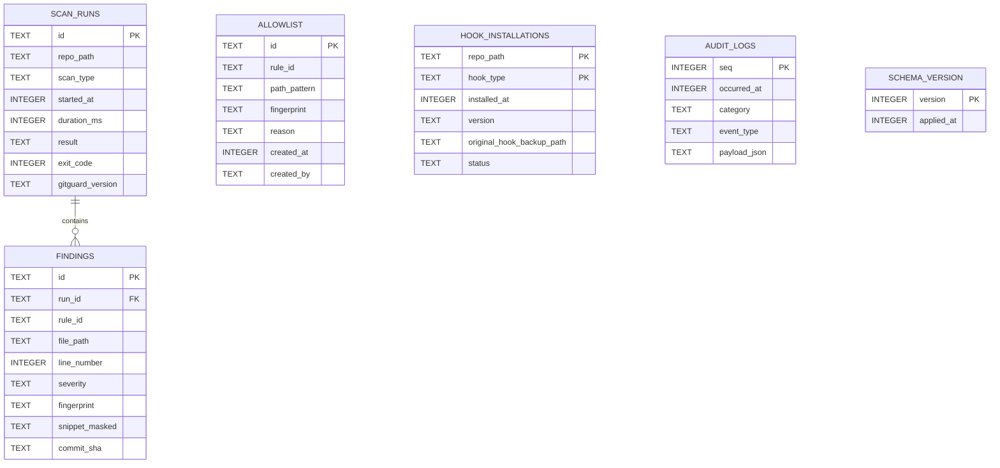

# 数据库设计

## 1. 数据库选型

GitGuard 使用 **SQLite（嵌入文件）** 作为本地审计存储。选型理由与详细技术选型见 [`03-系统架构设计(SAD).md`](<./03-系统架构设计(SAD).md>) §2。关联决策：无（SQLite 作为 MVP 默认存储，未来替换需走 ADR）。

**文件位置**（按平台）：

| 平台 | 路径 |
| --- | --- |
| Windows | `%LOCALAPPDATA%\GitGuard\audit.db` |
| macOS | `~/Library/Application Support/GitGuard/audit.db` |
| Linux | `$XDG_DATA_HOME/gitguard/audit.db`（默认 `~/.local/share/gitguard/audit.db`） |

**文件权限**：Unix 为 `0600`；Windows 用 ACL 仅 CurrentUser 可读写。详见 `08-权限设计.md` §4。

## 2. 数据模型概览

## 3. Schema 分层策略

单数据库文件、单 schema，不做 schema 隔离。多仓库数据通过 `repo_path` 列区分。

- **原因**：本地单用户工具；多 schema 带来复杂度无收益。
- **多用户隔离**：按操作系统用户目录隔离（每个用户一份 audit.db），不在数据库内部做隔离。

## 4. 表结构

### 4.1 `scan_runs`

- **用途**：一次 `gitguard scan` 的汇总。
- **主键**：`id`（UUIDv7）
- **关键字段**：

| 字段 | 类型 | 可空 | 默认 | 含义 | 单位 |
| --- | --- | --- | --- | --- | --- |
| id | TEXT | N | - | UUIDv7 字符串 | - |
| repo_path | TEXT | N | - | 规范化后的绝对路径（去尾 `/`） | - |
| scan_type | TEXT | N | - | `PreCommit / PrePush / Manual / Bypass` | - |
| started_at | INTEGER | N | - | Unix epoch | 毫秒 |
| duration_ms | INTEGER | Y | NULL | 扫描耗时 | 毫秒 |
| result | TEXT | N | - | `Clean / Warned / Blocked / Failed` | - |
| exit_code | INTEGER | N | 0 | CLI 进程退出码 | - |
| gitguard_version | TEXT | N | - | 本次扫描使用的 GitGuard 版本 | SemVer |
| git_version | TEXT | Y | NULL | 探测到的 Git 版本 | SemVer |
| summary_json | TEXT | Y | NULL | 聚合统计（文件数、规则命中数等） | JSON |

- **约束**：
  - `CHECK (scan_type IN ('PreCommit','PrePush','Manual','Bypass'))`
  - `CHECK (result IN ('Clean','Warned','Blocked','Failed'))`
  - `CHECK (result <> 'Failed' OR exit_code >= 10)`（DR-03 落 CHECK）
- **Bypass 行语义（GGD-0013）**：绕过事件不是一次真实扫描——`scan_type = 'Bypass'`、`result = 'Clean'`、`exit_code = 0`、`duration_ms = NULL`、`summary_json = NULL`，且**不写 `findings`**。事件细节（提交 SHA 与原因）在 `audit_logs` 的 `BypassDetected` 载荷中。

### 4.2 `findings`

- **用途**：发现项明细（已脱敏）。
- **主键**：`id`
- **关键字段**：

| 字段 | 类型 | 可空 | 默认 | 含义 | 单位 |
| --- | --- | --- | --- | --- | --- |
| id | TEXT | N | - | UUIDv7 | - |
| run_id | TEXT | N | - | 关联 `scan_runs.id` | - |
| rule_id | TEXT | N | - | 规则 ID，形如 `GGD/SECRET/AWS-AKID` | - |
| file_path | TEXT | N | - | 相对仓库根的路径 | - |
| line_number | INTEGER | N | - | 1-based 行号 | - |
| severity | TEXT | N | - | `Critical / High / Medium / Low` | - |
| fingerprint | TEXT | N | - | SHA-256 hex（64 字符） | - |
| snippet_masked | TEXT | N | - | 已脱敏片段，≤ 32 字符 | - |
| commit_sha | TEXT | Y | NULL | PrePush 时所属提交 SHA | - |
| action | TEXT | N | - | `Block / Warn / Allow / AllowedByAllowlist` | - |

- **约束**：
  - `FOREIGN KEY (run_id) REFERENCES scan_runs(id) ON DELETE CASCADE`
  - `CHECK (length(fingerprint) = 64)`
  - `CHECK (length(snippet_masked) <= 32)`
  - `CHECK (severity IN ('Critical','High','Medium','Low'))`

### 4.3 `allowlist`

- **用途**：白名单条目。
- **主键**：`id`
- **关键字段**：

| 字段 | 类型 | 可空 | 默认 | 含义 | 单位 |
| --- | --- | --- | --- | --- | --- |
| id | TEXT | N | - | UUIDv7 | - |
| rule_id | TEXT | Y | NULL | 规则 ID 匹配（nullable 表示通配） | - |
| path_pattern | TEXT | Y | NULL | glob | - |
| fingerprint | TEXT | Y | NULL | 指纹（精确匹配） | - |
| reason | TEXT | N | - | 必填，≥ 5 字符 | - |
| created_at | INTEGER | N | - | Unix epoch | 毫秒 |
| created_by | TEXT | N | - | 本机用户名 | - |
| expires_at | INTEGER | Y | NULL | 可选过期（毫秒） | 毫秒 |

- **约束**：
  - `CHECK (rule_id IS NOT NULL OR path_pattern IS NOT NULL OR fingerprint IS NOT NULL)`（至少一个条件）
  - `CHECK (length(reason) >= 5)`
  - `CHECK (fingerprint IS NULL OR length(fingerprint) = 64)`

### 4.4 `hook_installations`

- **用途**：Hook 安装状态与原 Hook 备份路径。
- **复合主键**：`(repo_path, hook_type)`
- **关键字段**：

| 字段 | 类型 | 可空 | 默认 | 含义 | 单位 |
| --- | --- | --- | --- | --- | --- |
| repo_path | TEXT | N | - | 规范化绝对路径 | - |
| hook_type | TEXT | N | - | `pre-commit / pre-push / post-commit` | - |
| installed_at | INTEGER | N | - | Unix epoch | 毫秒 |
| version | TEXT | N | - | GitGuard 版本 | SemVer |
| original_hook_backup_path | TEXT | Y | NULL | 原 Hook 备份文件名（与分发脚本同目录，如 `pre-commit.local.bak`） | - |
| status | TEXT | N | 'Active' | `Active / Replaced / Uninstalled` | - |

- **约束**：
  - `CHECK (hook_type IN ('pre-commit','pre-push','post-commit'))`
  - `CHECK (status IN ('Active','Replaced','Uninstalled'))`
- **写入语义（GGD-0008）**：安装 / 重装为 **upsert**——`(repo_path, hook_type)` 冲突时刷新 `version` / `installed_at` / `original_hook_backup_path` 并翻转为 `Active`（不新增行）；卸载翻转为 `Uninstalled` 且保留安装字段。`Replaced` 为 CHECK 预留值，当前实现无写入方（原「重装产生 Replaced 新行」设想未采用）。

### 4.5 `audit_logs`

- **用途**：领域事件扁平化日志（`ScanCompleted`、`BypassDetected`、`HookInstalled`、`HookUninstalled` 等）。
- **主键**：`seq AUTOINCREMENT`
- **关键字段**：

| 字段 | 类型 | 可空 | 默认 | 含义 | 单位 |
| --- | --- | --- | --- | --- | --- |
| seq | INTEGER | N | AUTOINCREMENT | 序列号 | - |
| occurred_at | INTEGER | N | - | Unix epoch | 毫秒 |
| category | TEXT | N | - | `Scan / Hook / Allowlist / Bypass / Error` | - |
| event_type | TEXT | N | - | 事件名（如 `ScanCompleted`） | - |
| payload_json | TEXT | N | - | 事件载荷（已脱敏） | JSON |

- **约束**：
  - `CHECK (category IN ('Scan','Hook','Allowlist','Bypass','Error'))`
- **`BypassDetected` 载荷（GGD-0013）**：`{"RunId":"<uuid>","CommitSha":"<40/64 hex>","DetectedAt":<epoch ms>,"Reason":"NoVerify|GitGuardSkip"}`；`RunId` 指向同事务写入的 `scan_runs` 行，`DetectedAt` 与 `scan_runs.started_at` 一致。`occurred_at` 取事件时间。

### 4.6 `schema_version`

- **用途**：迁移版本记录。
- **主键**：`version`
- **字段**：`version INTEGER PK, applied_at INTEGER NOT NULL`

### 4.7 `detection_rules`（可选，MVP 保留，暂不使用）

> MVP 阶段检测规则从 `BuiltinRules.yaml` 加载到内存；二期若支持运行时增删，再启用此表。保留 DDL 但 MVP 不写入。
>
> 实现说明（GGD-0005）：本节未定义列结构，故 V001 暂不建表；P2 启用时以新迁移脚本（`VNNN_*.sql`）引入。

## 5. 索引策略

| 索引 | 字段 | 类型 | 服务场景 | 预估写放大 |
| --- | --- | --- | --- | --- |
| `ix_findings_run_id` | `(run_id)` | 普通 | 根据 run_id 列出发现项 | 低 |
| `ix_findings_fingerprint` | `(fingerprint)` | 普通 | 白名单查找、按指纹去重 | 低 |
| `ix_findings_rule_severity` | `(rule_id, severity)` | 复合 | 按规则统计命中 | 低 |
| `ix_scan_runs_repo_time` | `(repo_path, started_at DESC)` | 复合 | 按仓库查询最近扫描 | 低 |
| `ix_allowlist_fingerprint` | `(fingerprint)` | 普通 | 按指纹匹配白名单 | 低 |
| `ix_allowlist_rule_path` | `(rule_id, path_pattern)` | 复合 | 按规则 + 路径匹配 | 低 |

> SQLite 对主键自动建索引，故 `scan_runs.id`、`findings.id`、`hook_installations.(repo_path, hook_type)` 无需显式索引。

## 6. 迁移策略

- **工具**：自写轻量迁移器（避免 EF Core Migration 对 Native AOT 的运行时反射依赖）。
- **位置**：`src/GitGuard.Infrastructure/Sqlite/Migrations/VNNN_<description>.sql`
- **命名**：`V001_initial_schema.sql`、`V002_add_action_column.sql`。
- **执行**：进程启动时读取 `schema_version` 表；按序执行未应用的脚本；每个脚本在单事务内执行。
- **禁用操作**：
  - 禁止 `DROP COLUMN`（SQLite 直接 DROP COLUMN 支持有限）；改列用新表 + 复制数据。
  - 禁止在迁移中执行可能长锁的全表更新（审计表量级小，当前不构成问题）。
- **幂等**：所有迁移脚本以 `CREATE TABLE IF NOT EXISTS` / `CREATE INDEX IF NOT EXISTS` 开头，便于崩溃重放。

## 7. 数据保留与清理

| 数据域 | 保留周期 | 清理方式 | 合规要求 |
| --- | --- | --- | --- |
| `scan_runs` + `findings` | 默认 180 天 | 启动时触发 `DELETE FROM scan_runs WHERE started_at < ?`；级联删除 findings | 不涉及个人数据原文（已脱敏），仅为用户本机审计 |
| `audit_logs` | 默认 180 天 | 同上 | 同上 |
| `allowlist` | 永久保留 | 用户显式删除 | - |
| `hook_installations` | 永久保留 | 用户卸载时更新 `status='Uninstalled'`，不删行（保留历史） | - |

- 清理周期和阈值可通过 `~/.config/gitguard/config.yml` 中 `audit.retention_days` 覆写。
- **强约束**：清理动作不会跨仓库聚合，不会把数据导出到任何位置。

## 8. 备份与恢复

- **全量备份**：由用户自行决定；工具提供 `gitguard audit export --output <path>` 命令导出已脱敏 JSON，供用户自备份。
- **工具不做自动远程备份**（DR-01）。
- **恢复 RTO/RPO**：
  - 本地文件损坏 → 从用户本地备份文件恢复，或接受从头开始（审计是辅助用途，丢失不影响核心防护）。
  - RTO：手动，用户自定。
  - RPO：取决于用户备份频率；GitGuard 不承诺。

## 9. 性能基线

| 查询 | 预期行数 | 目标响应 | 备注 |
| --- | --- | --- | --- |
| 启动时读 `schema_version` | 1 行 | < 5ms | 冷启动关键路径 |
| 写 ScanRun + N Findings 事务 | N ≤ 50 | < 20ms | MVP 常规扫描 |
| 查询仓库最近 20 次扫描 | 20 行 | < 15ms | 桌面端或 `gitguard status --history` |
| 白名单匹配查询（按 fingerprint） | 1 行 | < 5ms | 扫描热路径 |
| 180 天清理 | ≤ 10 万行 | < 1s | 启动时后台任务 |

> 容量规划：假设日均 50 次 `pre-commit` + 10 次 `pre-push` + 平均每次 2 个 findings，180 天数据量约 2 万 ScanRun / 4 万 Finding；SQLite 完全无压力。

## 10. 变更记录

| 版本 | 日期 | 变更说明 |
| --- | --- | --- |
| 0.1.0 | 2026-10-15 | 初始化：6 张核心表、6 条索引、180 天保留策略 |
| 0.1.1 | 2026-10-16 | GGD-0005：`SqliteAuditStore` + `SchemaMigrator` + V001 落地；§4.2 `findings.action` 取值补 `Allow`（非白名单放行，与 `AllowedByAllowlist` 区分）；§4.7 `detection_rules` 因列结构未定义 V001 暂不建表；BUSY 等待由连接串 `Default Timeout` + 应用层 50/100/200ms 退避实现（已实测 `PRAGMA busy_timeout` 对 Microsoft.Data.Sqlite 无效） |
| 0.1.2 | 2026-10-16 | GGD-0008：§4.4 明确备份字段为纯文件名、补充 upsert 写入语义（`Replaced` 为预留值无写入方）；§4.5 事件示例补 `HookUninstalled` |
| 0.1.3 | 2026-10-21 | GGD-0013：§4.1 补充 `Bypass` 行语义（Clean / 退出码 0 / `duration_ms` 与 `summary_json` 为 NULL / 无 Finding）；§4.5 补充 `BypassDetected` 载荷字段（`RunId` / `CommitSha` / `DetectedAt` / `Reason`）与事务关系 |
