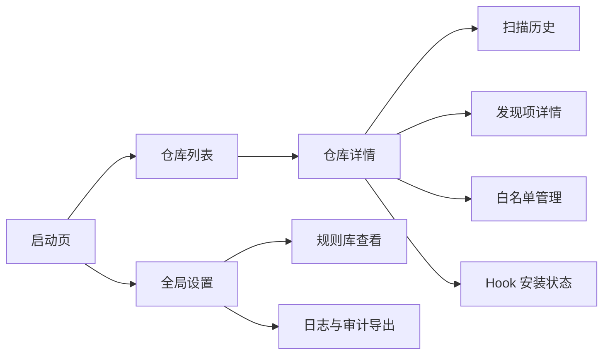
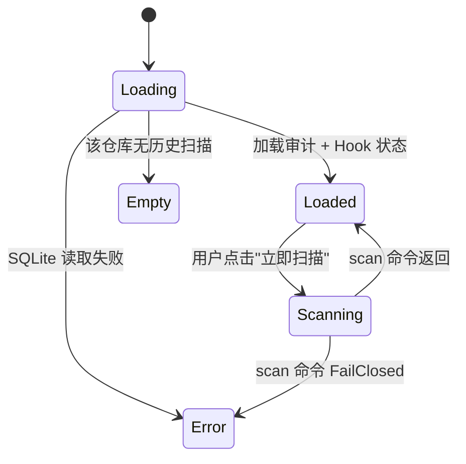
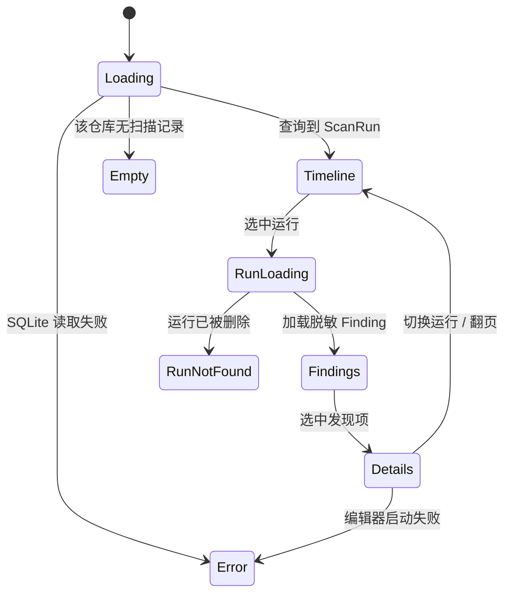

# 桌面 UI 设计（Avalonia，P3 阶段）

> **交付阶段**：本文件描述的是 **v0.3** 阶段的 Avalonia 桌面管理工具。MVP (v0.1) 与规则升级期 (v0.2) 均不包含桌面端；v0.3 已于 2026-10-23 提前启动，工程骨架与导航壳（`GGD-0041`）已落地，业务页面按 `GGD-0042` ~ `GGD-0046` 推进。

## 1. 信息架构

一级导航：**仓库 / 规则 / 日志 / 设置**。

**v0.3 实施状态（`GGD-0042` / `GGD-0043`，2026-10-23）**：`GGD-0041` 已落地 240px 绿色侧边栏 + 内容区外壳，四区导航可切换，页面实例在会话内缓存，侧边栏底部提供中 / 英切换与版本行。`GGD-0042` 已将「仓库」页替换为真实业务页：左侧登记入口与已登记仓库列表，右侧详情展示 GitGuard / Git 版本、Hooks 目录、三类 Hook 状态与最近扫描摘要，支持登记、移除（二次确认）、立即扫描与语言即时切换。`GGD-0043` 已落地扫描历史与发现项详情：仓库详情可打开三栏历史页（20 条分页时间线 / 脱敏 Finding 列表 / 详情），展示 `SnippetMasked` 与 HMAC 指纹并支持跳转外部编辑器，金丝雀原文不进入 UI。规则 / 日志 / 设置页仍为骨架，由 `GGD-0044` ~ `GGD-0046` 推进。

## 2. 页面清单

| 路径 | 用途 | 入口 | 权限 | 关联 FR |
| --- | --- | --- | --- | --- |
| `/launch` | 启动页：检测 CLI 版本、提示未安装仓库 | 应用启动 | 本机用户 | FR-100 |
| `/repos` | 已登记的仓库列表 | 一级导航 | 同上 | FR-100 |
| `/repos/:id` | 仓库详情：最近扫描摘要、Hook 状态、规则覆写 | 列表点击 | 同上 | FR-100 |
| `/repos/:id/history` | 该仓库的 ScanRun 时间线 | 仓库详情 | 同上 | - |
| `/repos/:id/findings/:runId` | 单次扫描的发现项详情 | 时间线点击 | 同上 | - |
| `/repos/:id/allowlist` | 白名单管理（CRUD） | 仓库详情 | 同上 | FR-040 |
| `/rules` | 规则库总览（Builtin / User / Gitleaks 分类） | 一级导航 | 同上 | - |
| `/logs` | 跨仓库审计日志浏览 + 导出 | 一级导航 | 同上 | - |
| `/settings` | 全局设置：日志级别、保留天数、Gitleaks 路径 | 一级导航 | 同上 | - |

## 3. 页面状态机

### 3.1 仓库详情

**实现说明（`GGD-0042`）**：仓库页为单窗口左右分栏，不引入 URL 路由，列表选中项即 `/repos/:id`。首次进入自动加载列表并选中首项；切换选中时异步加载详情，并通过请求版本号防止快速切换时旧响应覆盖新选择。目录已不存在的登记在列表中显示「目录不存在」徽标；详情加载失败以详情区消息呈现。立即扫描执行 HEAD 全量树扫描（`ScanAllOptions.Default`）并写入审计库，完成后原地刷新最近扫描摘要。

### 3.2 Hook 安装状态

- `Missing` → 显示「未安装」；本任务只展示状态，安装按钮随后续 Hook 管理能力补齐。
- `Managed` → 显示「已托管」与固定版本（如 `v0.3.0`）。
- `Legacy` / `Binary` / `SymbolicLink` → 显示「未托管脚本 / 二进制 / 符号链接」并提示需要接管；接管动作尚未接线。

### 3.3 扫描历史与发现项详情

**实现说明（`GGD-0043`）**：历史页以覆盖层形式铺满仓库页内容区，返回按钮回到仓库详情；三栏布局为「扫描时间线 / 发现项列表 / 发现项详情」。时间线按仓库分页查询（每页 20 条，`AuditQuery.RepoPath` 下推 SQLite 过滤），选中运行后加载该次扫描的全部 Finding 并默认选中首条。详情仅展示 `SnippetMasked` 与 HMAC `Fingerprint`，以及规则 ID、严重度、文件位置与提交 SHA；金丝雀原文不进入任何 UI 属性。外部编辑器按 `GITGUARD_EDITOR` → `VISUAL` → `EDITOR` 选择，已知编辑器附带行号，未配置时回退操作系统文件关联；文件缺失 / 路径逃逸 / 启动失败以页内本地化消息呈现，不回显进程原始错误。页面与运行级请求均以版本号丢弃过期响应。

## 4. 响应式与多端适配

Avalonia 桌面端目标分辨率：

| 断点 | 范围 | 布局策略 |
| --- | --- | --- |
| 桌面小 | ≥ 1024px × 720px | 侧边导航 + 主内容区 |
| 桌面标准 | ≥ 1440px × 900px | 侧边导航 + 主内容 + 右侧详情面板 |

**不做**：移动端 / 平板 / Web / 小程序适配。

## 5. 交互模式

- **全局 Loading**：顶部进度条（非模态），避免阻塞。
- **扫描触发**：异步 Task，不阻塞 UI；完成后 Toast 提示 + 自动刷新列表。
- **错误弹层**：使用通用 `ErrorDialog`，包含 `error_code / trace_id / 复制到剪贴板` 按钮。
- **确认对话框**：所有「删除」操作必须二次确认；白名单变更追加「原因」输入框。
- **深色模式**：跟随操作系统主题；可在设置中强制明/暗。

**实现说明（`GGD-0042`）**：仓库页当前以列表 / 详情区内联消息呈现操作结果与错误，尚未引入 Toast 与 `ErrorDialog`；移除登记使用页内二次确认条。扫描在后台线程执行，不阻塞 UI，完成后刷新最近扫描摘要；扫描不会重建列表，当前选中项保持不变。

## 6. 可访问性

- 键盘导航：所有操作可用 `Tab` 到达；主要操作有快捷键（`Ctrl+N` 新建白名单、`Ctrl+R` 重新扫描）。
- 高对比度：满足 WCAG 2.1 AA 对比度 4.5:1。
- 屏幕阅读器：所有图标按钮带 `AutomationProperties.Name`。

## 7. 国际化与本地化

- 默认中文；界面文案集中在 `GitGuard.Desktop/Localization/DesktopText.cs` 的中 / 英 switch 文案表，与 CLI 的枚举键式方案一致，不引入 `.resx` / 资源 axaml 的反射加载。
- 语言切换即时生效：`AppState.Language` 变更触发属性通知，`MainViewModel` 就地刷新外壳、导航项与当前页面文案，不重建窗口。
- 日期按用户区域设置显示；审计 payload 内部仍为 UTC epoch。
- 规则名称与建议默认提供中文；原始规则 ID 保持英文。

## 8. 性能预算

| 指标 | 目标 | 测量条件 |
| --- | --- | --- |
| 启动到可交互 | ≤ 2.5s | Native AOT；Windows 11 NVMe |
| 仓库列表加载 | ≤ 300ms（100 仓库 / 1 万 ScanRun） | SQLite 本地 |
| 单次扫描动作到结果呈现 | ≤ 2.5s（≤ 500 行差异） | 包含 CLI 子进程调用 |

## 9. 设计规范来源

- MVP 阶段无 UI 设计稿；进入 P3 前用 Figma / Excalidraw 补齐。
- 基础 Token：参考 Avalonia FluentTheme 默认设计 Token，仅覆写品牌主色（`#2E7D32`，象征「守卫绿」）。`GGD-0041` 已在 `App.axaml` 的 Light / Dark `ThemeDictionaries` 中定义侧边栏、选中态、悬停态、内容面板、边框与文字画刷，跟随系统主题。
- 图标：首发使用 Fluent System Icons（MIT）。

## 10. 变更记录

| 版本 | 日期 | 变更说明 |
| --- | --- | --- |
| 0.1.0 | 2026-10-15 | 初始化：定义 P3 桌面端的信息架构骨架，MVP 不交付 |
| 0.1.1 | 2026-10-23 | `GGD-0041`：记录导航壳、主题画刷、集中式中英文案表与语言切换的实施状态 |
| 0.1.2 | 2026-10-23 | `GGD-0042`：仓库页实施状态（登记 / 列表 / 详情 / Hook 状态 / 最近扫描 / 立即扫描 / 移除二次确认）；§3 补左右分栏与状态映射；§5 记录内联消息与后台扫描的实现取舍 |
| 0.1.3 | 2026-10-23 | `GGD-0043`：补扫描历史 / 发现项详情的实施状态与 §3.3 状态机；记录三栏布局、每页 20 条分页、脱敏片段 / 指纹、编辑器环境变量与金丝雀隔离 |
