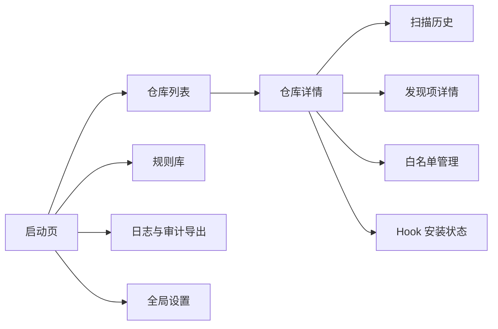
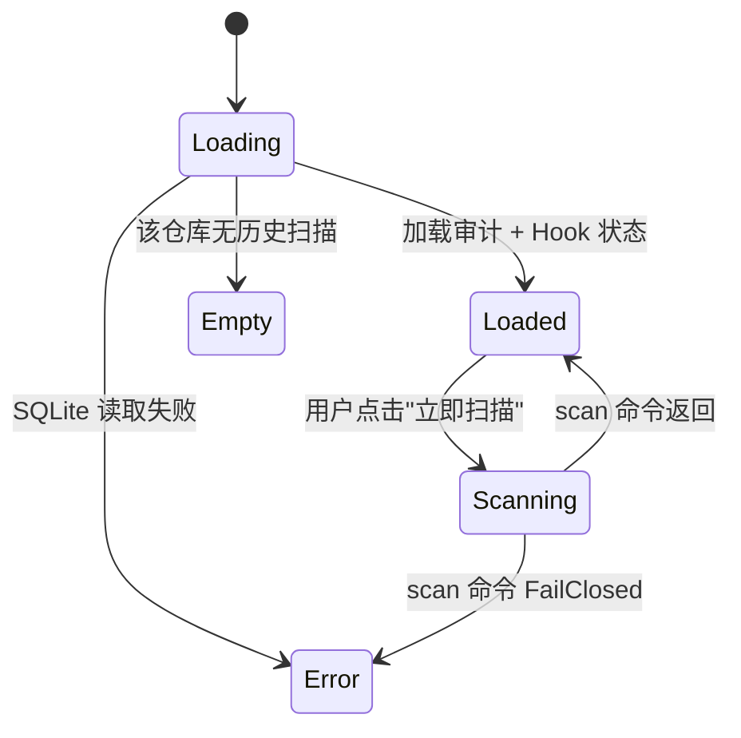
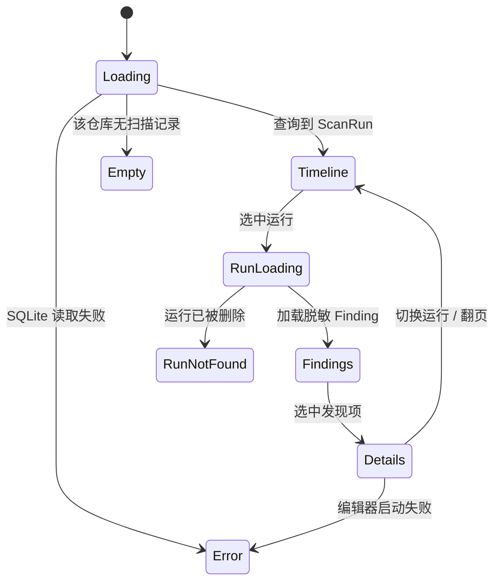
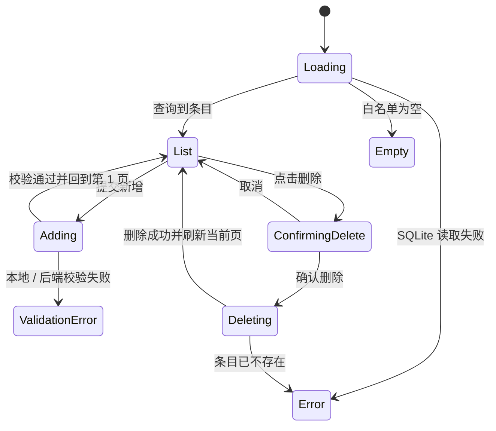
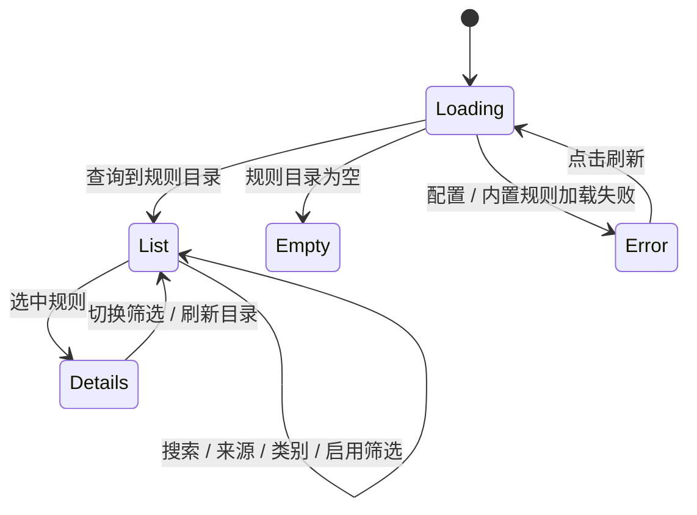
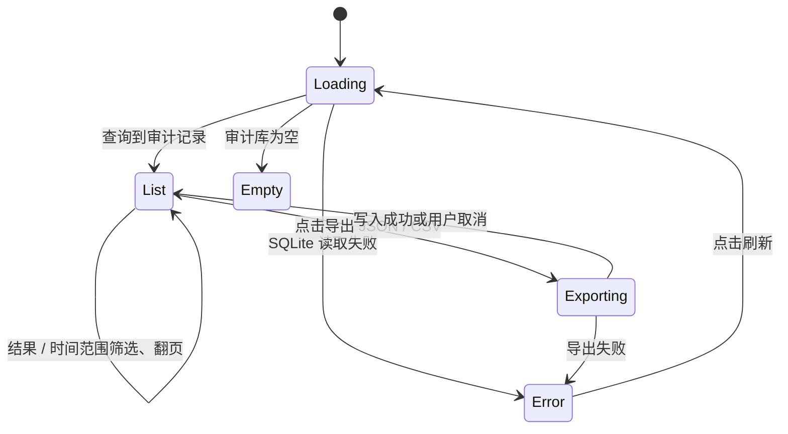
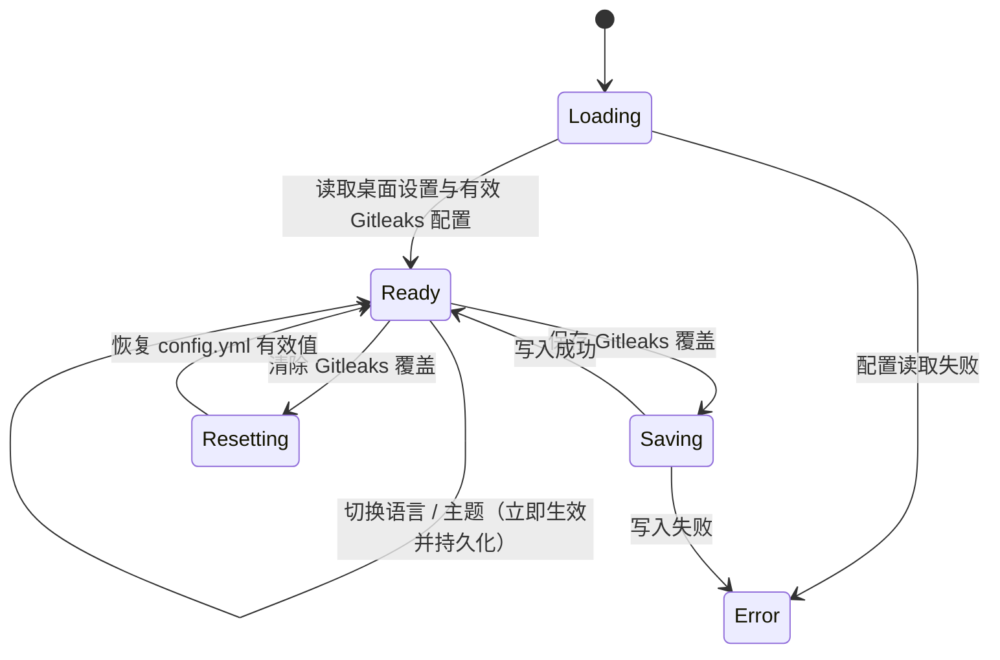

# 桌面 UI 设计（Avalonia，P3 阶段）

> **交付阶段**：本文件描述的是 **v0.3** 阶段的 Avalonia 桌面管理工具。MVP (v0.1) 与规则升级期 (v0.2) 均不包含桌面端；v0.3 已于 2026-10-23 提前启动，工程骨架与导航壳（`GGD-0041`）已落地，业务页面按 `GGD-0042` ~ `GGD-0046` 推进。

## 1. 信息架构

一级导航：**仓库 / 规则 / 日志 / 设置**。

**v0.3 实施状态（`GGD-0042` ~ `GGD-0046`，2026-10-23）**：`GGD-0041` 已落地 240px 绿色侧边栏 + 内容区外壳，四区导航可切换，页面实例在会话内缓存，侧边栏底部提供中 / 英切换与版本行。`GGD-0042` 已将「仓库」页替换为真实业务页：左侧登记入口与已登记仓库列表，右侧详情展示 GitGuard / Git 版本、Hooks 目录、三类 Hook 状态与最近扫描摘要，支持登记、移除（二次确认）、立即扫描与语言即时切换。`GGD-0043` 已落地扫描历史与发现项详情：仓库详情可打开三栏历史页（20 条分页时间线 / 脱敏 Finding 列表 / 详情），展示 `SnippetMasked` 与 HMAC 指纹并支持跳转外部编辑器，金丝雀原文不进入 UI。`GGD-0044` 已落地全局白名单管理：仓库详情可打开分页条目列表与新增表单，支持规则 / 路径 / 指纹三种条件、原因 ≥ 5 字符校验与删除二次确认，变更与 CLI 共用同一用例。`GGD-0045` 已将「规则」一级导航替换为真实规则库：左侧目录 + 右侧详情，支持来源 / 类别 / 有效启用筛选与 200ms 搜索节流，正则默认隐藏并可显式展开；Gitleaks 分类展示动态规则说明与适配器状态，静态条目与 `gitguard rules list` 完全同源。`GGD-0046` 已落地「日志」与「设置」：日志页跨仓库分页浏览审计记录，支持结果 / 时间范围筛选与 JSON / CSV 导出（与 `gitguard audit export` 同契约）；设置页提供语言、主题（跟随系统 / 浅色 / 深色）与 Gitleaks 覆盖并持久化到桌面端 JSON 设置文件。v0.3 规划内的四个一级页面至此全部落地。

## 2. 页面清单

| 路径 | 用途 | 入口 | 权限 | 关联 FR |
| --- | --- | --- | --- | --- |
| `/launch` | 启动页：检测 CLI 版本、提示未安装仓库 | 应用启动 | 本机用户 | FR-100 |
| `/repos` | 已登记的仓库列表 | 一级导航 | 同上 | FR-100 |
| `/repos/:id` | 仓库详情：最近扫描摘要、Hook 状态、规则覆写 | 列表点击 | 同上 | FR-100 |
| `/repos/:id/history` | 该仓库的 ScanRun 时间线 | 仓库详情 | 同上 | - |
| `/repos/:id/findings/:runId` | 单次扫描的发现项详情 | 时间线点击 | 同上 | - |
| `/repos/:id/allowlist` | 白名单管理（CRUD） | 仓库详情 | 同上 | FR-040 |
| `/rules` | 规则库总览（Builtin / User / Gitleaks 分类） | 一级导航 | 同上 | - |
| `/logs` | 跨仓库审计日志浏览 + 结果 / 时间范围筛选 + JSON / CSV 导出 | 一级导航 | 同上 | - |
| `/settings` | 全局设置：语言、主题（跟随系统 / 强制明暗）、Gitleaks 启用与路径 | 一级导航 | 同上 | - |

## 3. 页面状态机

### 3.1 仓库详情

**实现说明（`GGD-0042`）**：仓库页为单窗口左右分栏，不引入 URL 路由，列表选中项即 `/repos/:id`。首次进入自动加载列表并选中首项；切换选中时异步加载详情，并通过请求版本号防止快速切换时旧响应覆盖新选择。目录已不存在的登记在列表中显示「目录不存在」徽标；详情加载失败以详情区消息呈现。立即扫描执行 HEAD 全量树扫描（`ScanAllOptions.Default`）并写入审计库，完成后原地刷新最近扫描摘要。

### 3.2 Hook 安装状态与快捷安装（`GGD-0055`）

- `Missing` → 显示「未安装」；右侧操作区提供「安装 Hook」，按配置中的 `hooks` 子集安装。
- `Managed` → 显示「已托管」与固定版本（如 `v0.3.0`）；按钮变为「重新安装 Hook」，并显示「卸载 Hook」。
- `Legacy` / `Binary` / `SymbolicLink` → 显示「未托管脚本 / 二进制 / 符号链接」并提示需要接管；点击「安装 Hook」时，若目标为二进制 / 符号链接或存在遗留备份，先展示强制接管确认条，确认后以 `force` 语义安装并备份为 `<hook>.local.bak`。
- **CLI 路径**：桌面端按 `hooks.gitguard_executable_path` → PATH → 已知安装位置解析 GitGuard CLI；未找到时弹出文件选择器，安装成功后写入 `desktop-settings.json` 的 `hookExecutablePath`（不写回项目配置）。安装 / 卸载在 Application 层复用与 CLI 相同的 `HookManagementService`，错误按 `HookException` / 配置错误映射为本地化消息。
- **卸载**：仅当至少一个 Hook 为 `Managed` 时可用，点击后展示二次确认；确认后卸载全部三类 GitGuard Hook 并还原备份，未托管 Hook 不受影响。

### 3.3 扫描历史与发现项详情

**实现说明（`GGD-0043`）**：历史页以覆盖层形式铺满仓库页内容区，返回按钮回到仓库详情；三栏布局为「扫描时间线 / 发现项列表 / 发现项详情」。时间线按仓库分页查询（每页 20 条，`AuditQuery.RepoPath` 下推 SQLite 过滤），选中运行后加载该次扫描的全部 Finding 并默认选中首条。详情仅展示 `SnippetMasked` 与 HMAC `Fingerprint`，以及规则 ID、严重度、文件位置与提交 SHA；金丝雀原文不进入任何 UI 属性。外部编辑器按 `GITGUARD_EDITOR` → `VISUAL` → `EDITOR` 选择，已知编辑器附带行号，未配置时回退操作系统文件关联；文件缺失 / 路径逃逸 / 启动失败以页内本地化消息呈现，不回显进程原始错误。页面与运行级请求均以版本号丢弃过期响应。

### 3.4 白名单管理

**实现说明（`GGD-0044`）**：白名单页以覆盖层形式铺满仓库页内容区，从仓库详情进入，返回按钮回到仓库详情。条目为全局白名单（`allowlist` 表不含仓库列），页面显式提示「对所有已登记仓库生效」。左栏分页展示条目（每页 20 条），右栏为新增表单与删除确认。新增要求规则 ID / 路径 glob / 指纹至少填一项，原因去空白后 5–256 字符，规则 ID 与 SHA-256 指纹在本地预检；校验失败优先显示本地化消息，后端 `AllowlistException` 按错误码映射。新增成功后回到第 1 页并刷新；删除需二次确认，删除当前页最后一条时自动回退一页。页面请求以版本号丢弃过期响应。

### 3.5 规则库

**实现说明（`GGD-0045`）**：规则页为左侧目录 + 右侧详情，不引入 URL 路由，由一级导航「规则」进入。目录复用 `GitGuardSession.GetRuleCatalog()`，与 `gitguard rules list` 同源（内置规则 + `rules.custom` 自定义规则），并读取 `rules.secrets.use_gitleaks` 与 `gitleaks_path` 展示适配器状态。搜索框默认 200ms 节流，按规则 ID / 名称大小写不敏感过滤；来源筛选区分全部 / 内置 / 自定义 / Gitleaks，类别筛选覆盖 Secret / Privacy / LocalPath / Url，另提供「仅启用」有效启用筛选。Gitleaks 规则由外部引擎在扫描期动态产生，静态目录无对应条目，分类下展示适配器说明与空状态。正则默认隐藏，切换选中规则自动重置，仅「显示正则」显式展开后展示原文；刷新失败以页内本地化消息呈现。

### 3.6 跨仓库日志与导出

**实现说明（`GGD-0046`）**：日志页为一级导航「日志」，以 `AuditListUseCase` 分页读取所有已登记仓库的审计运行（每页 20 条，与 `AuditQuery.DEFAULT_LIMIT` 一致），展示时间、仓库、结果与扫描类型 / 发现数 / 耗时 / 退出码摘要；结果筛选（全部 / Clean / Warned / Blocked / Failed）与时间范围（全部 / 7 / 30 / 180 天）在查询层下推，切换即回到第 1 页。导出复用 `AuditExportUseCase`，JSON / CSV 与 `gitguard audit export` 完全同契约（脱敏片段 + HMAC 指纹、CSV UTF-8 BOM + CRLF + 公式注入前缀）；保存路径由系统文件选择器提供，用户取消时不写文件也不提示。页面请求以版本号丢弃过期响应，翻页越界自动回退，导出期间禁用导出按钮。

### 3.7 全局设置

**实现说明（`GGD-0046`）**：设置页为一级导航「设置」。语言与主题选择即时写入 `AppState` 并持久化到 `<UserDataDirectory>/desktop-settings.json`（原子替换、UTF-8 无 BOM、带 schema 版本；缺失 / 损坏 / 版本不匹配回退默认值）。主题「跟随系统」映射 Avalonia `ThemeVariant.Default`，浅色 / 深色强制覆盖并立即作用于整个窗口。Gitleaks 设置提供启用开关与可执行文件路径，保存后通过 `GitGuardConfigOverrides` 在配置合并之后覆盖 `rules.secrets.use_gitleaks` / `gitleaks_path`，不写回 `config.yml`；仓库扫描与规则库展示均使用该覆盖，CLI 仍按 `config.yml` 运行。清除覆盖恢复 `config.yml` 有效值。设置页首次进入加载一次，读写失败以页内本地化消息呈现。

## 4. 响应式与多端适配

Avalonia 桌面端目标分辨率：

| 断点 | 范围 | 布局策略 |
| --- | --- | --- |
| 桌面小 | ≥ 1024px × 720px | 侧边导航 + 主内容区 |
| 桌面标准 | ≥ 1440px × 900px | 侧边导航 + 主内容 + 右侧详情面板 |

**不做**：移动端 / 平板 / Web / 小程序适配。

## 5. 交互模式

- **全局 Loading**：顶部进度条（非模态），避免阻塞。
- **扫描触发**：异步 Task，不阻塞 UI；完成后 Toast 提示 + 自动刷新列表。
- **错误弹层**：使用通用 `ErrorDialog`，包含 `error_code / trace_id / 复制到剪贴板` 按钮。
- **确认对话框**：所有「删除」操作必须二次确认；白名单变更追加「原因」输入框。
- **深色模式**：跟随操作系统主题；可在设置中强制明/暗。

**实现说明（`GGD-0042`）**：仓库页当前以列表 / 详情区内联消息呈现操作结果与错误，尚未引入 Toast 与 `ErrorDialog`；移除登记使用页内二次确认条。扫描在后台线程执行，不阻塞 UI，完成后刷新最近扫描摘要；扫描不会重建列表，当前选中项保持不变。

**实现说明（`GGD-0046`）**：主题选择写入 `AppState.ThemeMode`，`MainWindow` 通过 `RequestedThemeVariant` 绑定即时切换；「跟随系统」使用 `ThemeVariant.Default`，浅色 / 深色强制覆盖。语言与主题选择均持久化到桌面设置文件，重启后恢复；侧边栏语言切换与设置页下拉框双向同步。

**实现说明（`GGD-0047`）**：三平台安装包（Windows MSIX / macOS DMG / Linux AppImage）自包含发布，界面与交互不变；`Program.Main` 增加 `--smoke-test` 无界面入口，在 Avalonia 初始化前读取并导出 CLI 已记录的审计数据，供 CI / Release 验证发行形态。

## 6. 可访问性

- 键盘导航：所有操作可用 `Tab` 到达；主要操作有快捷键（`Ctrl+N` 新建白名单、`Ctrl+R` 重新扫描）。
- 高对比度：满足 WCAG 2.1 AA 对比度 4.5:1。
- 屏幕阅读器：所有图标按钮带 `AutomationProperties.Name`。

## 7. 国际化与本地化

- 默认中文；界面文案集中在 `GitGuard.Desktop/Localization/DesktopText.cs` 的中 / 英 switch 文案表，与 CLI 的枚举键式方案一致，不引入 `.resx` / 资源 axaml 的反射加载。
- 语言切换即时生效：`AppState.Language` 变更触发属性通知，`MainViewModel` 就地刷新外壳、导航项与当前页面文案，不重建窗口。
- 语言选择持久化到桌面设置文件（`GGD-0046`），重启后恢复；设置页下拉框与侧边栏切换保持同步。
- 日期按用户区域设置显示；审计 payload 内部仍为 UTC epoch。
- 规则名称与建议默认提供中文；原始规则 ID 保持英文。

## 8. 性能预算

| 指标 | 目标 | 测量条件 |
| --- | --- | --- |
| 启动到可交互 | ≤ 2.5s | Native AOT；Windows 11 NVMe |
| 仓库列表加载 | ≤ 300ms（100 仓库 / 1 万 ScanRun） | SQLite 本地 |
| 单次扫描动作到结果呈现 | ≤ 2.5s（≤ 500 行差异） | 包含 CLI 子进程调用 |

## 9. 设计规范来源

- MVP 阶段无 UI 设计稿；进入 P3 前用 Figma / Excalidraw 补齐。
- 基础 Token：参考 Avalonia FluentTheme 默认设计 Token，仅覆写品牌主色（`#2E7D32`，象征「守卫绿」）。`GGD-0041` 已在 `App.axaml` 的 Light / Dark `ThemeDictionaries` 中定义侧边栏、选中态、悬停态、内容面板、边框与文字画刷，跟随系统主题。
- 图标：首发使用 Fluent System Icons（MIT）。

## 10. 变更记录

| 版本 | 日期 | 变更说明 |
| --- | --- | --- |
| 0.1.0 | 2026-10-15 | 初始化：定义 P3 桌面端的信息架构骨架，MVP 不交付 |
| 0.1.1 | 2026-10-23 | `GGD-0041`：记录导航壳、主题画刷、集中式中英文案表与语言切换的实施状态 |
| 0.1.2 | 2026-10-23 | `GGD-0042`：仓库页实施状态（登记 / 列表 / 详情 / Hook 状态 / 最近扫描 / 立即扫描 / 移除二次确认）；§3 补左右分栏与状态映射；§5 记录内联消息与后台扫描的实现取舍 |
| 0.1.3 | 2026-10-23 | `GGD-0043`：补扫描历史 / 发现项详情的实施状态与 §3.3 状态机；记录三栏布局、每页 20 条分页、脱敏片段 / 指纹、编辑器环境变量与金丝雀隔离 |
| 0.1.4 | 2026-10-23 | `GGD-0044`：补全局白名单管理的实施状态与 §3.4 状态机；记录分页列表、规则 / 路径 / 指纹新增、原因 ≥ 5 字符校验、删除二次确认与「对所有已登记仓库生效」提示 |
| 0.1.5 | 2026-10-23 | `GGD-0045`：补规则库的实施状态与 §3.5 状态机；记录与 `gitguard rules list` 同源、来源 / 类别 / 有效启用筛选、200ms 搜索节流、正则默认隐藏及 Gitleaks 分类说明 |
| 0.1.6 | 2026-10-23 | `GGD-0046`：补跨仓库日志与全局设置的实施状态、§3.6 / §3.7 状态机；记录分页 / 筛选 / JSON / CSV 导出、桌面设置持久化、主题跟随系统与 Gitleaks 覆盖语义 |
| 0.1.7 | 2026-10-23 | `GGD-0047`：§5 记录三平台安装包自包含发行与 `--smoke-test` 无界面发行冒烟，界面布局与交互不变 |
