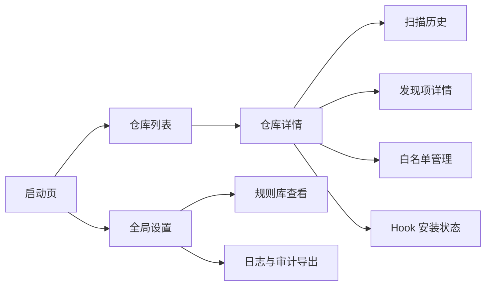
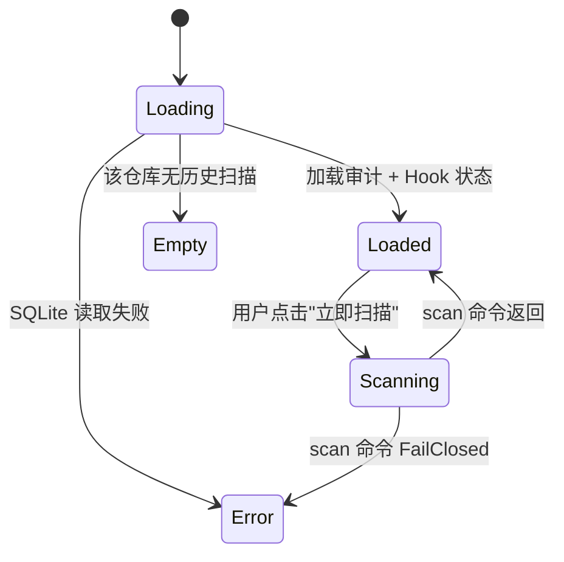

# 桌面 UI 设计（Avalonia，P3 阶段）

> **交付阶段**：本文件描述的是 **v0.3** 阶段的 Avalonia 桌面管理工具。MVP (v0.1) 与规则升级期 (v0.2) 均不包含桌面端；本文件在 MVP 阶段作为「设计意图」保留，正式启动 P3 时再细化。

## 1. 信息架构

一级导航：**仓库 / 规则 / 日志 / 设置**。

## 2. 页面清单

| 路径 | 用途 | 入口 | 权限 | 关联 FR |
| --- | --- | --- | --- | --- |
| `/launch` | 启动页：检测 CLI 版本、提示未安装仓库 | 应用启动 | 本机用户 | FR-100 |
| `/repos` | 已登记的仓库列表 | 一级导航 | 同上 | FR-100 |
| `/repos/:id` | 仓库详情：最近扫描摘要、Hook 状态、规则覆写 | 列表点击 | 同上 | FR-100 |
| `/repos/:id/history` | 该仓库的 ScanRun 时间线 | 仓库详情 | 同上 | - |
| `/repos/:id/findings/:runId` | 单次扫描的发现项详情 | 时间线点击 | 同上 | - |
| `/repos/:id/allowlist` | 白名单管理（CRUD） | 仓库详情 | 同上 | FR-040 |
| `/rules` | 规则库总览（Builtin / User / Gitleaks 分类） | 一级导航 | 同上 | - |
| `/logs` | 跨仓库审计日志浏览 + 导出 | 一级导航 | 同上 | - |
| `/settings` | 全局设置：日志级别、保留天数、Gitleaks 路径 | 一级导航 | 同上 | - |

## 3. 页面状态机

### 3.1 仓库详情

### 3.2 Hook 安装状态

- `NotInstalled` → 显示「安装」按钮，点击执行 `gitguard install`。
- `InstalledByUs` → 显示版本、链式调用的下游 Hook 列表。
- `UnmanagedHook` → 显示警告「检测到未托管 Hook，是否接管？」+ 执行 `gitguard install`（普通文本 Hook 自动备份包裹；二进制 / 符号链接需 `--force`）。

## 4. 响应式与多端适配

Avalonia 桌面端目标分辨率：

| 断点 | 范围 | 布局策略 |
| --- | --- | --- |
| 桌面小 | ≥ 1024px × 720px | 侧边导航 + 主内容区 |
| 桌面标准 | ≥ 1440px × 900px | 侧边导航 + 主内容 + 右侧详情面板 |

**不做**：移动端 / 平板 / Web / 小程序适配。

## 5. 交互模式

- **全局 Loading**：顶部进度条（非模态），避免阻塞。
- **扫描触发**：异步 Task，不阻塞 UI；完成后 Toast 提示 + 自动刷新列表。
- **错误弹层**：使用通用 `ErrorDialog`，包含 `error_code / trace_id / 复制到剪贴板` 按钮。
- **确认对话框**：所有「删除」操作必须二次确认；白名单变更追加「原因」输入框。
- **深色模式**：跟随操作系统主题；可在设置中强制明/暗。

## 6. 可访问性

- 键盘导航：所有操作可用 `Tab` 到达；主要操作有快捷键（`Ctrl+N` 新建白名单、`Ctrl+R` 重新扫描）。
- 高对比度：满足 WCAG 2.1 AA 对比度 4.5:1。
- 屏幕阅读器：所有图标按钮带 `AutomationProperties.Name`。

## 7. 国际化与本地化

- 默认中文；界面文案资源在 `GitGuard.Desktop/Resources/zh-CN.axaml` 与 `en-US.axaml`。
- 日期按用户区域设置显示；审计 payload 内部仍为 UTC epoch。
- 规则名称与建议默认提供中文；原始规则 ID 保持英文。

## 8. 性能预算

| 指标 | 目标 | 测量条件 |
| --- | --- | --- |
| 启动到可交互 | ≤ 2.5s | Native AOT；Windows 11 NVMe |
| 仓库列表加载 | ≤ 300ms（100 仓库 / 1 万 ScanRun） | SQLite 本地 |
| 单次扫描动作到结果呈现 | ≤ 2.5s（≤ 500 行差异） | 包含 CLI 子进程调用 |

## 9. 设计规范来源

- MVP 阶段无 UI 设计稿；进入 P3 前用 Figma / Excalidraw 补齐。
- 基础 Token：参考 Avalonia FluentTheme 默认设计 Token，仅覆写品牌主色（`#2E7D32`，象征「守卫绿」）。
- 图标：首发使用 Fluent System Icons（MIT）。

## 10. 变更记录

| 版本 | 日期 | 变更说明 |
| --- | --- | --- |
| 0.1.0 | 2026-10-15 | 初始化：定义 P3 桌面端的信息架构骨架，MVP 不交付 |
