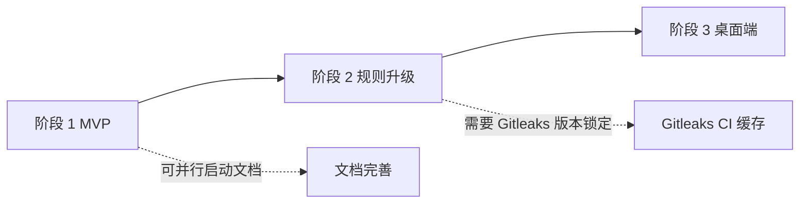

# 开发 RoadMap

## 1. 版本规划

| 版本 | 主题 | 目标用户 | 关键功能 | 退出条件 |
| --- | --- | --- | --- | --- |
| v0.1 MVP | CLI + Hook 分发 + 四类检测器 | 开发者（单人） | FR-010 ~ FR-032、FR-040、FR-041、FR-050、FR-070、FR-071（FR-042 配置文件级；白名单 CLI 于 `GGD-0030` 提前落地；FR-060~061 属 v0.2） | §12 `16-测试方案.md` 的 8 条必过场景全部通过 |
| v0.2 | 规则升级 + 全量扫描 + Gitleaks 适配 | 开发者 + 小团队 | FR-042 增强、FR-060 ~ FR-061、FR-080、FR-090 | 真实项目接入，首周误报率 ≤ 10% |
| v0.3 | Avalonia 桌面端 | 偏好图形化的用户 | FR-100 | 桌面端覆盖所有 CLI 核心能力 |
| v1.0（候选）| 规则库沉淀 + 文档稳定 | 公开发布 | - | 规则库 ≥ 60 条，稳定运行 3 个月，无 P0 Bug |

## 2. 阶段划分

### 2.1 阶段 1：MVP（v0.1）

- **周期**：2026-10-15 ~ 2026-12-31（约 11 周）
- **目标**：在本机 CLI 层形成完整的 commit/push 拦截闭环，`16-测试方案.md` §12 的 8 条场景全通过。
- **交付物**：
  - `GitGuard.sln` 项目骨架（Core / Detection / Application / Infrastructure / Cli / tests）。
  - `gitguard install / uninstall / status / scan / audit list / audit export / allowlist add / allowlist remove / allowlist list / version` 命令集。
  - 四类检测器（Secret / Privacy / LocalPath / Url）内置规则共 21 条（Secret 8 / Privacy 5 / LocalPath 4 / Url 4）；「各 ≥ 10 条」目标顺延到 v0.2 规则升级。
  - SQLite 审计 Schema v1；迁移器可用。
  - CI Windows 单平台构建矩阵（跨平台矩阵不再计划，`GGD-0028` 已取消）；Native AOT 发行物。
  - 文档：00 ~ 18、模块设计、ADR-0001 ~ 0004 全部到位。
- **依赖**：无前置阶段。
- **风险**：
  - Hook 兼容性与各家框架的差异 → 通过真实 Fixture 测试覆盖。
  - Native AOT 下某些反射依赖包不可用 → 启动期用 trim-safe 包，必要时自写序列化。
- **退出条件**：
  - [x] 8 条 MVP 必过场景全部通过（S1~S8）。
  - [-] NFR-P-001 ~ 003 达标（P-002 / P-003 已达标：P-003 经 `GGD-0023` 批量取差异复测 P95 669.78 ms；P-001 实测 P95 200.44 ms，仍受宿主进程创建基线约 170 ms 影响）。**由用户亲自验收，不需要 Agent 执行。**
  - [-] 开发者（本人）在 2 个真实仓库中启用 ≥ 2 周，无数据丢失、无误伤。**由用户亲自验收，不需要 Agent 执行。**

### 2.2 阶段 2：规则升级（v0.2）

- **周期**：2026-10-22 提前启动 ~ 2027-03-15（约 20 周，原计划 10 周）
- **目标**：完善白名单治理、引入全量扫描与 GitleaksAdapter；可以让一个 10 人团队平稳使用。
- **交付物**：
  - `gitguard scan --all`（已于 `GGD-0031` 落地）与基线文件（FR-061，已于 `GGD-0032` 落地） / `gitguard rules`（`gitguard allowlist` 已于 `GGD-0030` 提前落地）。
  - `GitleaksAdapter` 实现（ADR-0003 落地，已于 `GGD-0035` 落地）。
  - 内置规则扩充至 40 条（已于 `GGD-0033` 落地：Secret 16 / Privacy 9 / LocalPath 7 / Url 8）。
  - 规则分级与项目自定义正则。
  - 误报治理指南文档（已于 `GGD-0037` 落地：[`19-误报治理指南.md`](./19-误报治理指南.md)）。
  - URL 公共主机名白名单 `rules.url.public_hostname_whitelist`（已于 `GGD-0039` 落地）。
  - LocalPath Markdown 围栏代码块感知（已于 `GGD-0040` 落地）。
- **依赖**：阶段 1 完成。
- **风险**：
  - Gitleaks 规则 ID 与 GGD 命名冲突 → 用 `GLK/` 前缀隔离。
  - 自定义正则引入 ReDoS → 用例集 + Regex.MatchTimeout 兜底。
- **退出条件**：
  - [ ] 在至少 1 个真实中等规模项目（10+ 开发者）试用，首周误报率 ≤ 10%。
  - [x] 规则数量 ≥ 40（`GGD-0033`：40 条，Secret 16 / Privacy 9 / LocalPath 7 / Url 8）。

### 2.3 阶段 3：桌面端（v0.3）

- **周期**：2026-10-23 提前启动 ~ 2027-06-30（功能开发先于 v0.2 真实项目试用验收启动）
- **目标**：Avalonia 桌面管理工具可独立运行；多仓库统一浏览审计与白名单。
- **交付物**：
  - `GitGuard.Desktop` 项目完整实现（`GGD-0041` 工程骨架与导航壳已完成、`GGD-0042` 仓库登记 / 列表 / 详情已完成、`GGD-0043` 扫描历史与发现项已完成、`GGD-0044` 白名单管理已完成、`GGD-0045` 规则库已完成、`GGD-0046` 设置与日志导出）。
  - Windows / macOS / Linux 三平台安装包（`GGD-0047`）。
  - 桌面端覆盖 §11 页面清单。
- **依赖**：阶段 2 开发交付物完成（真实项目试用验收由用户并行执行，不阻塞开发）。
- **风险**：
  - Avalonia 新版 breaking changes → 锁定 11.3 LTS 版本。
  - 桌面端被当作「必选项」误解 → README 显式说明「桌面端可选」。
- **退出条件**：
  - [ ] 桌面端 Smoke 测试在三平台通过。
  - [ ] 桌面端能展示 CLI 已记录的全部审计数据。

## 3. 任务分解

> 粒度：0.5 ~ 3 天完成。所有任务登记在 `AGENT-GUIDE.md` §8。

| 阶段 | 任务 ID | 任务 | 优先级 | 预估 |
| --- | --- | --- | --- | --- |
| 1 | `GGD-0001` | 创建 .NET 10 解决方案与项目骨架、Analyzer、.editorconfig、Directory.Packages | P0 | 2d |
| 1 | `GGD-0002` | 实现 `Core.Model` 聚合（Finding / ScanRun / Policy / Allowlist 等值对象） | P0 | 2d |
| 1 | `GGD-0003` | 实现 `Masker` / `Fingerprinter` / `SanitizingLogger` + 金丝雀 Token 单测 | P0 | 2d |
| 1 | `GGD-0004` | 实现 `GitAccess`（Process 调用 Git） + 集成测试 | P0 | 2d |
| 1 | `GGD-0005` | 实现 `SqliteAuditStore` + 迁移器 V001 | P0 | 2d |
| 1 | `GGD-0006` | 实现四类 `IDetector` + 内置规则 YAML | P0 | 5d |
| 1 | `GGD-0007` | 实现 `ScanStagedUseCase` / `ScanPushUseCase` | P0 | 3d |
| 1 | `GGD-0008` | 实现 `HookDispatcher` 脚本生成 + `InstallHookUseCase` / `UninstallHookUseCase` | P0 | 4d |
| 1 | `GGD-0009` | 实现 `gitguard` CLI 入口（System.CommandLine）+ 退出码表 | P0 | 3d |
| 1 | `GGD-0010` | 完成 8 条 MVP 必过场景的 E2E 测试 Fixture | P0 | 5d |
| 1 | `GGD-0011` | GitHub Actions 多平台构建 + Native AOT 产物 | P0 | 2d |
| 1 | `GGD-0012` | 文档回填：对比实现与 PRD / SRS 差异 | P0 | 2d |
| 2 | `GGD-0031` | FR-060 全量扫描 `gitguard scan --all`（HEAD / 历史 / 续扫） | P1 | 5d |
| 2 | `GGD-0032` | FR-061 基线文件生成与消费 | P1 | 3d |
| 2 | `GGD-0033` | 内置规则扩充至 ≥40 条 | P1 | 4d |
| 2 | `GGD-0034` | FR-080 自定义正则规则与 `gitguard rules` | P2 | 4d |
| 2 | `GGD-0035` | FR-090 GitleaksAdapter（已完成） | P2 | 3d |
| 2 | `GGD-0036` | `gitguard audit view <run-id>`（已完成） | P2 | 2d |
| 2 | `GGD-0037` | 误报治理指南与 v0.2 验收支撑（已完成） | P2 | 1d |
| 2 | `GGD-0038` | 配置接线补齐：`hooks.*` 与 `scan.pre_commit` / `scan.pre_push`（已完成） | P1 | 1d |
| 2 | `GGD-0039` | URL 误报降噪：`rules.url.public_hostname_whitelist` 主机白名单（已完成） | P2 | 1d |
| 2 | `GGD-0040` | LocalPath 误报降噪：Markdown 围栏代码块感知（已完成） | P2 | 1d |
| 3 | `GGD-0041` | 桌面端工程骨架与导航壳（Avalonia 11.3 LTS + MVVM，已完成） | P1 | 2d |
| 3 | `GGD-0042` | 仓库登记、列表与详情（多仓库、Hook 状态、立即扫描，已完成） | P1 | 4d |
| 3 | `GGD-0043` | 扫描历史与发现项详情（已完成） | P1 | 3d |
| 3 | `GGD-0044` | 白名单管理 UI（已完成） | P1 | 2d |
| 3 | `GGD-0045` | 规则库视图（已完成） | P2 | 2d |
| 3 | `GGD-0046` | 全局设置、跨仓库日志与导出 | P2 | 3d |
| 3 | `GGD-0047` | 三平台打包、CI 冒烟与文档 | P2 | 3d |

## 4. 里程碑

| 里程碑 | 日期 | 功能集 | 对内/对外 |
| --- | --- | --- | --- |
| M1：骨架可运行 | 2026-10-31 | GGD-0001 ~ 0005 | 对内（自用） |
| M2：commit 拦截闭环 | 2026-11-21 | GGD-0006 ~ 0007 | 对内 |
| M3：Hook 一键安装 | 2026-12-10 | GGD-0008 ~ 0009 | 对内 |
| M4：MVP 完成 | 2026-12-31 | GGD-0010 ~ 0012 + 8 场景通过 | 对外 v0.1 |
| M5：Gitleaks 适配器就绪 | 2027-02-15 | FR-090 落地（2026-10-22 提前完成，`GGD-0035`） | 对外 v0.2 PR 预览 |
| M6：v0.2 发布 | 2027-03-15 | 阶段 2 全部交付 | 对外 |
| M7：桌面端预览 | 2027-05-30 | 桌面端核心页面可用 | 对外预览 |
| M8：v0.3 发布 | 2027-06-30 | 阶段 3 全部交付 | 对外 |

## 5. 依赖图

## 6. 风险跟踪

| # | 风险 | 影响 | 概率 | 应对 | Owner | 状态 |
| --- | --- | --- | --- | --- | --- | --- |
| R-01 | Native AOT 下 YAML / SQLite 依赖反射兼容性问题 | 高 | 中 | 启动期用 trim-safe 包；CI 冒烟验证 | 项目负责人 | 缓解中（trim-safe 已落地；`release.yml` 原生平台冒烟已接线） |
| R-02 | Husky / lefthook / pre-commit 的 Hook 格式差异导致兼容失败 | 高 | 中 | 真实 Fixture + CI `hook-compat`（Windows） | 项目负责人 | 已缓解（`GGD-0021`：三框架真实安装矩阵 `TC-COMPAT-01~04` + CI `hook-compat` 作业；期间发现并修复 Husky `$0` 推导导致备份不执行的问题；跨平台矩阵不再计划，`GGD-0028` 已取消） |
| R-03 | 中国手机号检测误报率过高 | 中 | 高 | 结合上下文关键字（如 `phone`, `mobile`, `tel`） | 项目负责人 | Open |
| R-04 | 用户习惯 `--no-verify` 导致 Hook 价值被架空 | 中 | 高 | 文档宣讲 + 服务端扫描是互补 | 项目负责人 | Open |
| R-05 | 单人维护进度延迟 | 中 | 中 | 文档优先，范围克制；MVP 不追求覆盖所有规则 | 项目负责人 | Open |

## 7. 变更记录

| 版本 | 日期 | 变更说明 |
| --- | --- | --- |
| 0.1.0 | 2026-10-15 | 初始化：三阶段路线、12 条 MVP 任务、8 个里程碑 |
| 0.1.1 | 2026-10-18 | GGD-0012 文档回填：§1 v0.1 范围与 PRD 对齐（FR-071 纳入、FR-050 顺延、FR-040~042 CLI / FR-060~061 归 v0.2）；§2.1 交付物校正为 21 条规则（8/5/4/4）并更新退出条件进度；§6 R-01 / R-02 标注缓解状态 |
| 0.1.2 | 2026-10-21 | GGD-0013：§1 v0.1 范围纳入 FR-050；§2.1 退出条件「8 条 MVP 必过场景」勾选（S1~S8 全部通过） |
| 0.1.3 | 2026-10-21 | GGD-0020：§2.1 性能退出条件回填实测状态（P-002 达标；P-001 / P-003 受宿主进程创建开销影响未达标，登记 `GGD-0023`） |
| 0.1.4 | 2026-10-21 | GGD-0023：§2.1 性能退出条件回填——P-003 经批量取差异优化后 P95 669.78 ms 达标；P-001 仍需正常宿主复测 |
| 0.1.5 | 2026-10-21 | GGD-0022：§2.1 交付物补 `audit list` / `audit export`（审计查询与脱敏导出提前落地） |
| 0.1.6 | 2026-10-21 | GGD-0021：§6 R-02 标记已缓解（Husky / lefthook / pre-commit 真实安装矩阵 + CI `hook-compat`） |
| 0.1.7 | 2026-10-22 | GGD-0027：CI 收敛为 Windows 单平台（macOS / Ubuntu 矩阵与 Linux DR-01 作业暂缓 `GGD-0028`），§6 R-02 应对措施与状态同步 |
| 0.1.8 | 2026-10-22 | GGD-0030：FR-040 / FR-041 白名单 CLI 与 SQLite 管理提前落地，§1 v0.1 / v0.2 范围与 §2.1 / §2.2 交付物同步调整 |
| 0.1.9 | 2026-10-22 | GGD-0031：取消 `GGD-0028`（Windows 单平台为最终 CI 范围）；v0.1 验收项标记为用户亲自执行；提前启动 v0.2 并登记 `GGD-0031` ~ `GGD-0037` 任务分解 |
| 0.1.10 | 2026-10-22 | GGD-0031：FR-060 全量扫描落地（HEAD 空树差异快照 / `--include-history` 历史扫描 / `--since` 续扫 / `--max-files` 提交边界软截断 + `next_since_sha`）；§2.2 交付物同步；新增 36 项测试（Application 16 / Infrastructure 8 / CLI 12），全量 1112 项通过 |
| 0.1.11 | 2026-10-22 | GGD-0032：FR-061 基线文件落地（`gitguard.baseline.v1` / `--baseline` 生成 / 默认消费 / `AllowedByBaseline` / 13、31 错误码）；§2.2 交付物同步；新增 20 项测试，全量 1132 项通过（1123 通过 + 9 跳过） |
| 0.1.12 | 2026-10-22 | GGD-0033：内置规则扩充至 40 条（Secret 16 / Privacy 9 / LocalPath 7 / Url 8），每条规则夹具 ≥3 正 / ≥3 负 / 边界正反各 ≥1；§2.2 交付物与退出条件同步 |
| 0.1.13 | 2026-10-22 | GGD-0035：GitleaksAdapter 提前落地（启动探测 / 逐文件暂存 / `detect --no-git` 报告映射 / `GLK/` 命名空间 / 跨引擎去重），§2.2 交付物、任务表与 M5 里程碑同步 |
| 0.1.14 | 2026-10-22 | GGD-0036：`gitguard audit view <run-id>` 落地（单次运行摘要 + Finding 明细、文本 / JSON、退出码 7 / 30），§3 任务表标记完成 |
| 0.1.15 | 2026-10-22 | GGD-0037：新增 `19-误报治理指南.md`（误报判定口径、规则分级、白名单治理、误报率统计、真实项目试用模板、40 条规则与基准数据）；§2.2 交付物与 §3 任务表标记完成，真实项目试用退出条件仍由用户执行 |
| 0.1.16 | 2026-10-23 | GGD-0038：§3 任务表新增配置接线任务并标记完成（`hooks.*` 安装期子集 / 可执行文件路径，`scan.pre_commit` / `scan.pre_push` Hook 模式扫描开关） |
| 0.1.17 | 2026-10-23 | GGD-0039：§2.2 交付物补 URL 公共主机名白名单；§3 任务表新增并标记完成 |
| 0.1.18 | 2026-10-23 | GGD-0040：§2.2 交付物补 LocalPath Markdown 围栏代码块感知；§3 任务表新增并标记完成 |
| 0.1.19 | 2026-10-23 | v0.3 桌面端提前启动（用户指令）：§2.3 周期与依赖更新，§3 登记 `GGD-0041` ~ `GGD-0047` 阶段 3 任务分解；v0.2 仅剩真实项目试用用户验收项 |
| 0.1.20 | 2026-10-23 | `GGD-0041` 完成：Avalonia 11.3 LTS 工程骨架、四区导航壳、中英切换、主题画刷与 ViewModel 测试；§3 标记任务完成 |
| 0.1.21 | 2026-10-23 | `GGD-0042` 完成：V003 `repositories` 仓库注册表、登记 / 移除 / 列表 / 最近扫描用例、桌面仓库页（列表 / 详情 / Hook 状态 / 立即全量扫描 / 移除二次确认）；§2.3 交付物与 §3 任务表标记完成，新增 63 例测试 |
| 0.1.22 | 2026-10-23 | `GGD-0043` 完成：`AuditQuery` 仓库过滤与 SQLite 分页、桌面扫描历史三栏页（20 条分页时间线 / 脱敏发现项 / 详情）、外部编辑器跳转与金丝雀隔离；§2.3 交付物与 §3 任务表标记完成，新增 22 例测试 |
| 0.1.23 | 2026-10-23 | `GGD-0044` 完成：桌面全局白名单页（20 条分页列表、规则 / 路径 / 指纹新增、原因 ≥ 5 字符校验、删除二次确认、与 CLI 共用用例）；§2.3 交付物与 §3 任务表标记完成，新增 18 例测试 |
| 0.1.24 | 2026-10-23 | `GGD-0045` 完成：桌面规则库（与 `gitguard rules list` 同源、内置 / 自定义 / Gitleaks 分类、200ms 搜索节流、有效启用筛选、正则默认隐藏）；§2.3 交付物与 §3 任务表标记完成，新增 19 例测试 |
