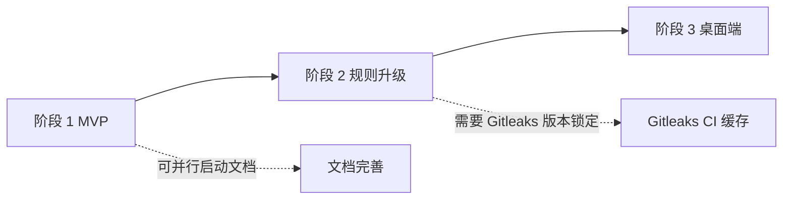

# 开发 RoadMap

## 1. 版本规划

| 版本 | 主题 | 目标用户 | 关键功能 | 退出条件 |
| --- | --- | --- | --- | --- |
| v0.1 MVP | CLI + Hook 分发 + 四类检测器 | 开发者（单人） | FR-010 ~ FR-032、FR-050、FR-070、FR-071（白名单仅配置文件级；FR-040~042 CLI / FR-060~061 属 v0.2） | §12 `16-测试方案.md` 的 8 条必过场景全部通过 |
| v0.2 | 规则升级 + 白名单 + Gitleaks 适配 | 开发者 + 小团队 | FR-040 ~ FR-061、FR-080、FR-090 | 真实项目接入，首周误报率 ≤ 10% |
| v0.3 | Avalonia 桌面端 | 偏好图形化的用户 | FR-100 | 桌面端覆盖所有 CLI 核心能力 |
| v1.0（候选）| 规则库沉淀 + 文档稳定 | 公开发布 | - | 规则库 ≥ 60 条，稳定运行 3 个月，无 P0 Bug |

## 2. 阶段划分

### 2.1 阶段 1：MVP（v0.1）

- **周期**：2026-10-15 ~ 2026-12-31（约 11 周）
- **目标**：在本机 CLI 层形成完整的 commit/push 拦截闭环，`16-测试方案.md` §12 的 8 条场景全通过。
- **交付物**：
  - `GitGuard.sln` 项目骨架（Core / Detection / Application / Infrastructure / Cli / tests）。
  - `gitguard install / uninstall / status / scan / version` 五条命令。
  - 四类检测器（Secret / Privacy / LocalPath / Url）内置规则共 21 条（Secret 8 / Privacy 5 / LocalPath 4 / Url 4）；「各 ≥ 10 条」目标顺延到 v0.2 规则升级。
  - SQLite 审计 Schema v1；迁移器可用。
  - CI 多平台构建矩阵；Native AOT 发行物。
  - 文档：00 ~ 18、模块设计、ADR-0001 ~ 0004 全部到位。
- **依赖**：无前置阶段。
- **风险**：
  - Hook 兼容性与各家框架的差异 → 通过真实 Fixture 测试覆盖。
  - Native AOT 下某些反射依赖包不可用 → 启动期用 trim-safe 包，必要时自写序列化。
- **退出条件**：
  - [x] 8 条 MVP 必过场景全部通过（S1~S8）。
  - [ ] NFR-P-001 ~ 003 达标（`GGD-0020` 已实测：P-002 达标；P-001 / P-003 在当前宿主受进程创建基线影响未达标，需正常宿主复测；P-003 批量取差异优化登记 `GGD-0023`）。
  - [ ] 开发者（本人）在 2 个真实仓库中启用 ≥ 2 周，无数据丢失、无误伤。

### 2.2 阶段 2：规则升级（v0.2）

- **周期**：2027-01-05 ~ 2027-03-15（约 10 周）
- **目标**：引入白名单、全量扫描、GitleaksAdapter；可以让一个 10 人团队平稳使用。
- **交付物**：
  - `gitguard allowlist` / `gitguard scan --all` / `gitguard rules`。
  - `GitleaksAdapter` 实现（ADR-0003 落地）。
  - 规则分级与项目自定义正则。
  - 误报治理指南文档。
- **依赖**：阶段 1 完成。
- **风险**：
  - Gitleaks 规则 ID 与 GGD 命名冲突 → 用 `GLK/` 前缀隔离。
  - 自定义正则引入 ReDoS → 用例集 + Regex.MatchTimeout 兜底。
- **退出条件**：
  - [ ] 在至少 1 个真实中等规模项目（10+ 开发者）试用，首周误报率 ≤ 10%。
  - [ ] 规则数量 ≥ 40。

### 2.3 阶段 3：桌面端（v0.3）

- **周期**：2027-04-01 ~ 2027-06-30（约 13 周）
- **目标**：Avalonia 桌面管理工具可独立运行；多仓库统一浏览审计与白名单。
- **交付物**：
  - `GitGuard.Desktop` 项目完整实现。
  - Windows / macOS / Linux 三平台安装包。
  - 桌面端覆盖 §11 页面清单。
- **依赖**：阶段 2 完成。
- **风险**：
  - Avalonia 新版 breaking changes → 锁定 LTS 版本。
  - 桌面端被当作「必选项」误解 → README 显式说明「桌面端可选」。
- **退出条件**：
  - [ ] 桌面端 Smoke 测试在三平台通过。
  - [ ] 桌面端能展示 CLI 已记录的全部审计数据。

## 3. 任务分解

> 粒度：0.5 ~ 3 天完成。所有任务登记在 `AGENT-GUIDE.md` §8。

| 阶段 | 任务 ID | 任务 | 优先级 | 预估 |
| --- | --- | --- | --- | --- |
| 1 | `GGD-0001` | 创建 .NET 10 解决方案与项目骨架、Analyzer、.editorconfig、Directory.Packages | P0 | 2d |
| 1 | `GGD-0002` | 实现 `Core.Model` 聚合（Finding / ScanRun / Policy / Allowlist 等值对象） | P0 | 2d |
| 1 | `GGD-0003` | 实现 `Masker` / `Fingerprinter` / `SanitizingLogger` + 金丝雀 Token 单测 | P0 | 2d |
| 1 | `GGD-0004` | 实现 `GitAccess`（Process 调用 Git） + 集成测试 | P0 | 2d |
| 1 | `GGD-0005` | 实现 `SqliteAuditStore` + 迁移器 V001 | P0 | 2d |
| 1 | `GGD-0006` | 实现四类 `IDetector` + 内置规则 YAML | P0 | 5d |
| 1 | `GGD-0007` | 实现 `ScanStagedUseCase` / `ScanPushUseCase` | P0 | 3d |
| 1 | `GGD-0008` | 实现 `HookDispatcher` 脚本生成 + `InstallHookUseCase` / `UninstallHookUseCase` | P0 | 4d |
| 1 | `GGD-0009` | 实现 `gitguard` CLI 入口（System.CommandLine）+ 退出码表 | P0 | 3d |
| 1 | `GGD-0010` | 完成 8 条 MVP 必过场景的 E2E 测试 Fixture | P0 | 5d |
| 1 | `GGD-0011` | GitHub Actions 多平台构建 + Native AOT 产物 | P0 | 2d |
| 1 | `GGD-0012` | 文档回填：对比实现与 PRD / SRS 差异 | P0 | 2d |

阶段 2、3 任务待 MVP 完成后再拆解登记。

## 4. 里程碑

| 里程碑 | 日期 | 功能集 | 对内/对外 |
| --- | --- | --- | --- |
| M1：骨架可运行 | 2026-10-31 | GGD-0001 ~ 0005 | 对内（自用） |
| M2：commit 拦截闭环 | 2026-11-21 | GGD-0006 ~ 0007 | 对内 |
| M3：Hook 一键安装 | 2026-12-10 | GGD-0008 ~ 0009 | 对内 |
| M4：MVP 完成 | 2026-12-31 | GGD-0010 ~ 0012 + 8 场景通过 | 对外 v0.1 |
| M5：Gitleaks 适配器就绪 | 2027-02-15 | FR-090 落地 | 对外 v0.2 PR 预览 |
| M6：v0.2 发布 | 2027-03-15 | 阶段 2 全部交付 | 对外 |
| M7：桌面端预览 | 2027-05-30 | 桌面端核心页面可用 | 对外预览 |
| M8：v0.3 发布 | 2027-06-30 | 阶段 3 全部交付 | 对外 |

## 5. 依赖图

## 6. 风险跟踪

| # | 风险 | 影响 | 概率 | 应对 | Owner | 状态 |
| --- | --- | --- | --- | --- | --- | --- |
| R-01 | Native AOT 下 YAML / SQLite 依赖反射兼容性问题 | 高 | 中 | 启动期用 trim-safe 包；CI 冒烟验证 | 项目负责人 | 缓解中（trim-safe 已落地；`release.yml` 原生平台冒烟已接线） |
| R-02 | Husky / lefthook / pre-commit 的 Hook 格式差异导致兼容失败 | 高 | 中 | 真实 Fixture + CI 矩阵 | 项目负责人 | 部分缓解（Husky 形态文本 Hook 已由 E2E S6 / TC-DR-05-01 覆盖；lefthook / pre-commit 待 `GGD-0021`） |
| R-03 | 中国手机号检测误报率过高 | 中 | 高 | 结合上下文关键字（如 `phone`, `mobile`, `tel`） | 项目负责人 | Open |
| R-04 | 用户习惯 `--no-verify` 导致 Hook 价值被架空 | 中 | 高 | 文档宣讲 + 服务端扫描是互补 | 项目负责人 | Open |
| R-05 | 单人维护进度延迟 | 中 | 中 | 文档优先，范围克制；MVP 不追求覆盖所有规则 | 项目负责人 | Open |

## 7. 变更记录

| 版本 | 日期 | 变更说明 |
| --- | --- | --- |
| 0.1.0 | 2026-10-15 | 初始化：三阶段路线、12 条 MVP 任务、8 个里程碑 |
| 0.1.1 | 2026-10-18 | GGD-0012 文档回填：§1 v0.1 范围与 PRD 对齐（FR-071 纳入、FR-050 顺延、FR-040~042 CLI / FR-060~061 归 v0.2）；§2.1 交付物校正为 21 条规则（8/5/4/4）并更新退出条件进度；§6 R-01 / R-02 标注缓解状态 |
| 0.1.2 | 2026-10-21 | GGD-0013：§1 v0.1 范围纳入 FR-050；§2.1 退出条件「8 条 MVP 必过场景」勾选（S1~S8 全部通过） |
| 0.1.3 | 2026-10-21 | GGD-0020：§2.1 性能退出条件回填实测状态（P-002 达标；P-001 / P-003 受宿主进程创建开销影响未达标，登记 `GGD-0023`） |
