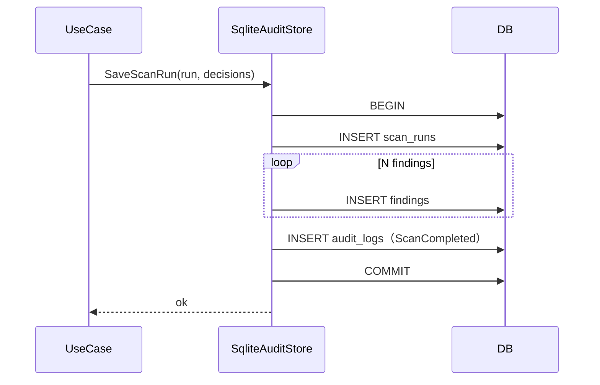
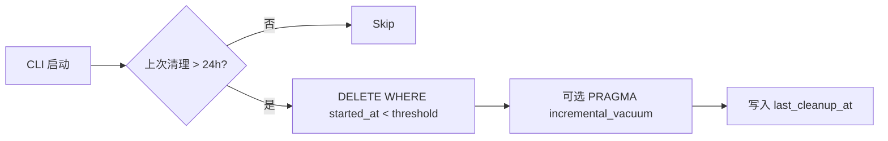

# Audit 模块设计

## 1. 模块定位

- **一句话定位**：GitGuard 本机审计子系统——把扫描、安装、白名单、绕过事件以**脱敏指纹**写入本地 SQLite，用于用户事后复盘，且**仅限本机访问**。
- **所属限界上下文**：Scanning Context
- **承担 FR**：`FR-023, FR-040, FR-050`
- **承担 DR**：`DR-01`（本地化）、`DR-02`（零明文留存）
- **关联 ADR**：无

## 2. 输入输出契约

### 2.1 输入

| 来源 | 内容 |
| --- | --- |
| `ScanStagedUseCase` / `ScanPushUseCase` / `ScanManualUseCase` | `ScanRun` + `Findings[]` |
| `InstallHookUseCase` / `UninstallHookUseCase` | `HookInstallation` |
| `AllowlistUseCase` | `AllowlistEntry` 变更 |
| `BypassDetectionService` | `BypassEvent` |

### 2.2 输出

| 消费方 | 内容 |
| --- | --- |
| CLI `gitguard audit list/view/export` | 查询结果 |
| 桌面端（P3） | 同上，经 Application 层 |
| 清理任务 | 按保留期删除旧数据 |

## 3. 核心规则

| 规则 | 要点 |
| --- | --- |
| 全写事务 | ScanRun + Findings 必须单事务提交；避免孤儿记录 |
| 脱敏强制 | `Finding.snippet_masked` 构造函数拒绝原文；写入 SQLite 前 CHECK 约束兜底 |
| 保留期清理 | 启动期后台任务清理 180 天前数据；可通过 `audit.retention_days` 覆写 |
| 导出脱敏 | `audit export` 必须保持脱敏，不恢复原文 |
| 并发安全 | WAL 模式 + 短写锁；对 `BUSY` 做指数退避 3 次 |

## 4. 外部依赖

| 依赖 | 用途 | 失败降级 |
| --- | --- | --- |
| `Microsoft.Data.Sqlite` | SQLite 访问 | 存储层失败上抛 `SqliteException`（FailClosed，含 BUSY 退避耗尽）；扫描管线捕获后降级：扫描结果照常返回并置 `AuditWriteFailed` 标志（补写机制待后续任务） |

## 5. 数据模型

见 `05-数据库设计.md` §4：

- `scan_runs`
- `findings`
- `allowlist`
- `hook_installations`
- `audit_logs`
- `schema_version`

## 6. 关键流程

### 6.1 写入 ScanRun

### 6.2 启动期保留清理

## 7. 配置项

| 配置项 | 类型 | 默认 | 说明 |
| --- | --- | --- | --- |
| `audit.enabled` | bool | true | 禁用后仍记录 FailClosed 事件（安全起见） |
| `audit.retention_days` | int | 180 | 保留天数 |
| `audit.max_file_bytes` | int | 104857600 | 100 MiB，软上限超出启动期清理 |
| `audit.database_path` | string? | 自动按平台 | 覆盖默认位置 |

## 8. 质量属性

| 属性 | 目标 |
| --- | --- |
| 写事务耗时 | ≤ 20ms（50 findings） |
| 查询最近 20 次 | ≤ 15ms |
| 清理 10 万行 | ≤ 1s |
| 数据安全性 | 无原文、无 salt、无 Token |

## 9. 测试要点

- [ ] 金丝雀 Token 不入库（DR-02）。
- [ ] `BUSY` 重试逻辑：3 次指数退避；仍失败则发 `AuditWriteFailed`。
- [ ] 清理阈值生效。
- [ ] `audit export` 输出不含原文。
- [ ] 迁移 V001 幂等执行。

## 10. 演进与扩展位

- `IAuditStore` 抽象：未来可能替换为 LiteDB（跨平台单文件）或内嵌 DuckDB。
- 导出格式：MVP 支持 JSON；P2 增加 CSV / SARIF（代码扫描标准）。

## 11. 变更记录

| 版本 | 日期 | 变更说明 |
| --- | --- | --- |
| 0.1.0 | 2026-10-15 | 初始化：事务模型、保留清理、脱敏约束 |
| 0.1.1 | 2026-10-16 | GGD-0005：`SqliteAuditStore` 落地（WAL、ScanRun + Findings + ScanCompleted 事件单事务、BUSY 3 次退避后 FailClosed）；Unix 0600 与符号链接路径拒绝（08-权限设计 §5.1/§9），Windows ACL 加固延后至 CLI 路径解析任务；`ScanRun.Restore` / `Finding.Restore` 支持读回原始身份标识 |
| 0.1.2 | 2026-10-16 | 与 GGD-0007 实现同步：扫描管线经 `IAuditStore.SaveScanRun(run, decisions)` 单事务落库（`findings.action` 取 `PolicyDecision`）；存储层 `SqliteException` 在管线内被捕获并降级为 `AuditWriteFailed` 标志，扫描结果照常返回（§4 / §6.1） |
