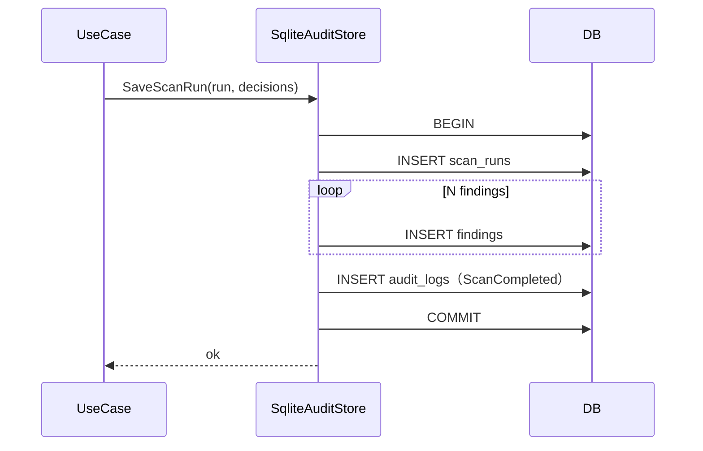
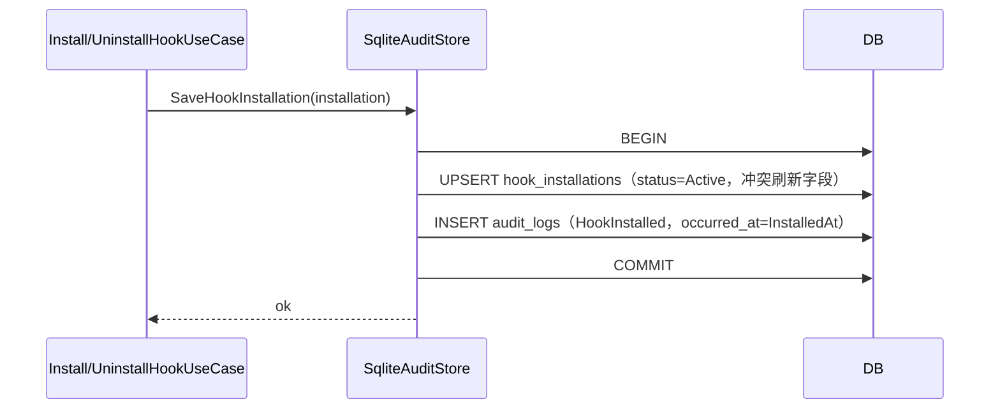
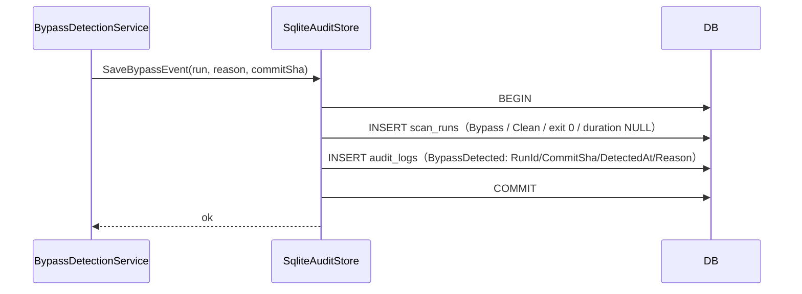
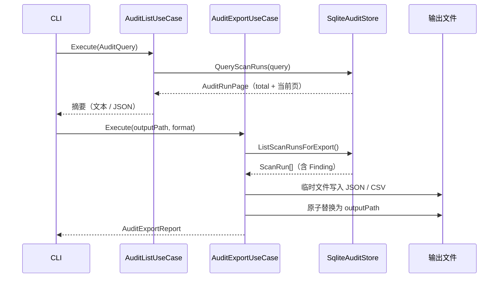
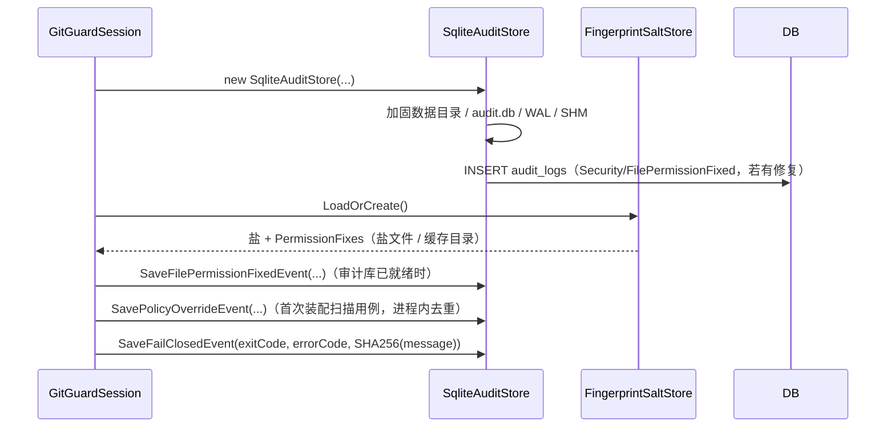
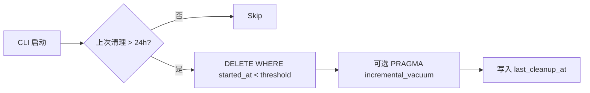

# Audit 模块设计

## 1. 模块定位

- **一句话定位**：GitGuard 本机审计子系统——把扫描、安装、白名单、绕过事件以**脱敏指纹**写入本地 SQLite，用于用户事后复盘，且**仅限本机访问**。
- **所属限界上下文**：Scanning Context
- **承担 FR**：`FR-023, FR-040, FR-050`
- **承担 DR**：`DR-01`（本地化）、`DR-02`（零明文留存）
- **关联 ADR**：无

## 2. 输入输出契约

### 2.1 输入

| 来源 | 内容 |
| --- | --- |
| `ScanStagedUseCase` / `ScanPushUseCase` / `ScanManualUseCase` | `ScanRun` + `Findings[]` |
| `InstallHookUseCase` / `UninstallHookUseCase` | `HookInstallation` + `HookInstalled` / `HookUninstalled` 事件（卸载附 `RestoredLegacyHook`） |
| `AllowlistAddUseCase` / `AllowlistRemoveUseCase` | `AllowlistEntry` 变更（新增 / 删除） |
| `BypassDetectionService` | `ScanRun`（`ScanType.Bypass`）+ `BypassDetected` 事件（载荷含 `Reason`） |
| `GitGuardSession` | `PolicyOverride`（配置降级）、`FilePermissionFixed`（启动期权限修复）、`FailClosed`（退出码 ≥ 10） |

### 2.2 输出

| 消费方 | 内容 |
| --- | --- |
| CLI `gitguard audit list/export`（`GGD-0022`；`view` 仍为 v0.2） | 分页查询结果 / 脱敏导出文件 |
| 桌面端（P3） | 同上，经 Application 层 |
| 清理任务 | 按保留期删除旧数据 |

## 3. 核心规则

| 规则 | 要点 |
| --- | --- |
| 全写事务 | ScanRun + Findings 必须单事务提交；避免孤儿记录 |
| Hook 写事务 | `hook_installations` upsert 与 `HookInstalled` / `HookUninstalled` 事件同事务提交（`SaveHookInstallation` / `SaveHookUninstallation`，GGD-0008）；`occurred_at` 安装取 `InstalledAt`、卸载取当前时刻 |
| 绕过写事务 | `SaveBypassEvent(run, reason, commitSha)`：`scan_runs`（Bypass / Clean / 退出码 0 / 无 Finding）+ `BypassDetected` 事件同事务提交，`occurred_at` 取 `run.StartedAt`（GGD-0013）；写入失败不吞异常，CLI 映射退出码 14 |
| 白名单写事务 | `AddAllowlistEntry` / `RemoveAllowlistEntry`：`allowlist` 行变更 + `AllowlistChanged` 事件同事务提交（`category = Allowlist`，载荷 `EntryId` / `Action` / `RuleId` / `PathPattern` / `Fingerprint` / `Reason`，GGD-0030）；删除不存在的 ID 返回 `false` 且不写事件；读取损坏行抛 `SqliteException`（CLI 退出码 14） |
| 脱敏强制 | `Finding.snippet_masked` 构造函数拒绝原文；写入 SQLite 前 CHECK 约束兜底 |
| 保留期清理 | 启动期后台任务清理 180 天前数据；可通过 `audit.retention_days` 覆写 |
| 导出脱敏 | `audit export` 只写 `snippet_masked` / HMAC 指纹，不恢复原文；JSON / CSV 两种格式共用同一脱敏字段集 |
| 导出原子性 | 同目录临时文件写完后再 `File.Move(overwrite)`；失败清理临时文件并抛 `AuditExportException`（CLI 退出码 31） |
| CSV 防护 | UTF-8 BOM + CRLF；字段含 `,` / `"` / CR / LF 时按 RFC 4180 转义；以 `= + - @ \t \r` 开头时前置 `'` 防公式注入 |
| 查询分页 | `started_at DESC, rowid DESC`；`--since` / `--result` 在 SQL 层筛选；`total` 为筛选后总数 |
| 并发安全 | WAL 模式 + 短写锁；对 `BUSY` 做指数退避 3 次 |
| 独立事件事务 | `PolicyOverride` / `FilePermissionFixed` / `FailClosed` 各自单事务写入；分类固定为 `Policy` / `Security` / `Error`（GGD-0015） |
| 权限加固 | 打开审计库时加固数据目录（Unix `0700` / Windows 仅 CurrentUser）与 `audit.db` / WAL / SHM（Unix `0600`）；修复结果在同一次初始化中写入 `FilePermissionFixed`。指纹盐加载先于审计库时，修复记录暂存于组合根，待审计库可用后补写 |
| FailClosed 留痕 | `TryRecordFailClosed(exitCode, errorCode, message)` 只写 SHA-256 摘要；审计库不可用（SQLite / IO / 权限异常）返回 `false`，CLI 输出警告，不递归失败 |

## 4. 外部依赖

| 依赖 | 用途 | 失败降级 |
| --- | --- | --- |
| `Microsoft.Data.Sqlite` | SQLite 访问 | 存储层失败上抛 `SqliteException`（FailClosed，含 BUSY 退避耗尽）；扫描管线捕获后降级：扫描结果照常返回并置 `AuditWriteFailed` 标志（补写机制待后续任务）；Hook 安装 / 卸载用例不捕获（磁盘变更已先行生效，异常上抛由 CLI 分类映射） |

## 5. 数据模型

见 `05-数据库设计.md` §4：

- `scan_runs`
- `findings`
- `allowlist`
- `hook_installations`
- `audit_logs`
- `schema_version`

## 6. 关键流程

### 6.1 写入 ScanRun

### 6.2 写入 Hook 安装 / 卸载

> 卸载对称使用 `SaveHookUninstallation(installation, restoredLegacyHook)`：upsert 保留 `installed_at` / `version` / 备份路径并翻转为 `Uninstalled`，事件 `HookUninstalled`。Hook 用例**不捕获** `SqliteException`（FailClosed 上抛）；磁盘变更先于审计写入，审计失败时盘上脚本已生效（可能产生「已安装未留痕」，由重复安装 upsert 自然修复）。

### 6.3 写入绕过事件

> 绕过事件不是扫描：不写 `findings`，`duration_ms` / `summary_json` 均为 `NULL`；提交 SHA 与原因只存在于 `audit_logs` 载荷。

### 6.4 查询与导出

> 查询范围为整个审计库（所有仓库），只读且不要求当前目录是 Git 仓库；不触发配置加载与检测器装配。读取 / 写入失败分别映射退出码 14 / 31。原启动期清理流程顺延为 §6.5。

### 6.5 独立安全事件与启动期加固

> 盐加载早于审计库创建时，修复记录暂存于 `GitGuardSession`，在 `CreateAuditStore()` 后统一补写。`PolicyOverride` 由 `DetectorAssembly` 计算：严重度映射低于默认值记 `SEVERITY/<Severity>`；被 `disabled_rules` 或类别禁用剔除的规则记 `<RuleId>` → `Allow`；未知禁用 ID 只产生配置警告、不写覆盖事件。

### 6.6 启动期保留清理

## 7. 配置项

| 配置项 | 类型 | 默认 | 说明 |
| --- | --- | --- | --- |
| `audit.enabled` | bool | true | 禁用后仍记录 FailClosed 事件（安全起见） |
| `audit.retention_days` | int | 180 | 保留天数 |
| `audit.max_file_bytes` | int | 104857600 | 100 MiB，软上限超出启动期清理 |
| `audit.database_path` | string? | 自动按平台 | 覆盖默认位置 |

## 8. 质量属性

| 属性 | 目标 |
| --- | --- |
| 写事务耗时 | ≤ 20ms（50 findings） |
| 查询最近 20 次 | ≤ 15ms |
| 清理 10 万行 | ≤ 1s |
| 数据安全性 | 无原文、无 salt、无 Token |

## 9. 测试要点

- [x] Hook 安装 / 卸载状态行与事件同事务落库（GGD-0008：`SqliteAuditStoreHookTests` 直读校验 + `HookEndToEndTests` 真实库端到端）。
- [x] 绕过事件行与 `BypassDetected` 同事务落库；`NoVerify` / `GitGuardSkip` 载荷字段与非法输入拒绝（GGD-0013：`SqliteAuditStoreBypassTests` + E2E S8 直读）。
- [x] 白名单行与 `AllowlistChanged` 同事务落库，Add / Remove 载荷字段、分页排序与损坏行 FailClosed（GGD-0030：`SqliteAuditStoreAllowlistTests`）。
- [ ] 金丝雀 Token 不入库（DR-02）。
- [ ] `BUSY` 重试逻辑：3 次指数退避；仍失败则发 `AuditWriteFailed`。
- [ ] 清理阈值生效。
- [x] `audit list` 分页、排序（`started_at DESC, rowid DESC`）与 `--since` / `--result` 筛选（GGD-0022：`SqliteAuditStoreQueryTests` + `CliAuditCommandTests`）。
- [x] `audit export` 输出不含原文；JSON / CSV 脱敏字段、CSV 转义与公式注入防护、原子覆盖（GGD-0022：`AuditUseCaseTests` + `CliAuditCommandTests`）。
- [x] `AuditExportException` → CLI 退出码 31（`ExitCodeMapperTests`）。
- [x] `PolicyOverride` / `FilePermissionFixed` / `FailClosed` 分类与载荷落库、非法参数拒绝；FailClosed 不含原文（GGD-0015：`SqliteAuditStoreEventTests` / `AuditEventWiringTests`）。
- [x] Unix `0644 → 0600`、目录 `0755 → 0700` 修复与事件；Windows 预置 Everyone Allow 后重置为仅 CurrentUser 并留痕（GGD-0015：`SqliteAuditStoreEventTests` / `FingerprintSaltStoreTests`）。
- [x] V001 → V002 迁移后既有审计行与 `seq` 保留；空库创建全部表 / 索引（`SqliteAuditStoreMigrationTests`）。
- [ ] 迁移 V001 幂等执行（新建库路径已覆盖，历史库重放待补）。

## 10. 演进与扩展位

- `IAuditStore` 抽象：未来可能替换为 LiteDB（跨平台单文件）或内嵌 DuckDB。
- 导出格式：本版本支持 JSON / CSV（`GGD-0022`）；P2 增加 SARIF（代码扫描标准）。

## 11. 变更记录

| 版本 | 日期 | 变更说明 |
| --- | --- | --- |
| 0.1.0 | 2026-10-15 | 初始化：事务模型、保留清理、脱敏约束 |
| 0.1.1 | 2026-10-16 | GGD-0005：`SqliteAuditStore` 落地（WAL、ScanRun + Findings + ScanCompleted 事件单事务、BUSY 3 次退避后 FailClosed）；Unix 0600 与符号链接路径拒绝（08-权限设计 §5.1/§9），Windows ACL 加固延后至 CLI 路径解析任务；`ScanRun.Restore` / `Finding.Restore` 支持读回原始身份标识 |
| 0.1.2 | 2026-10-16 | 与 GGD-0007 实现同步：扫描管线经 `IAuditStore.SaveScanRun(run, decisions)` 单事务落库（`findings.action` 取 `PolicyDecision`）；存储层 `SqliteException` 在管线内被捕获并降级为 `AuditWriteFailed` 标志，扫描结果照常返回（§4 / §6.1） |
| 0.1.3 | 2026-10-16 | 与 GGD-0008 实现同步：§2.1 输入补 Hook 事件；§3 新增 Hook 写事务规则；§6.3 新增 Hook 安装 / 卸载写入流程（upsert + 事件同事务，卸载 `RestoredLegacyHook` 载荷，Hook 用例不捕获 `SqliteException`）；§4 降级列补 Hook 场景；§9 勾选 Hook 事务测试项 |
| 0.1.4 | 2026-10-18 | GGD-0012 文档回填：§2.2 标注 CLI `gitguard audit list/view/export` 为 v0.2 规划（`GGD-0022`），v0.1 无审计查询命令 |
| 0.1.5 | 2026-10-21 | GGD-0013：§2.1 输入改为 `Bypass` 运行 + `BypassDetected` 事件；§3 新增绕过写事务规则；§6.3 新增写入流程（无 Finding、duration/summary 为 NULL、载荷含 Reason；原 Hook / 清理流程顺延为 §6.2 / §6.4）；§9 勾选绕过事件落库测试 |
| 0.1.6 | 2026-10-21 | GGD-0022：§2.2 落地 `audit list/export`（`view` 保持 v0.2）；§3 新增导出原子性、CSV 防护与查询分页规则；§6.4 新增查询 / 导出流程（原清理流程顺延为 §6.5）；§9 勾选分页筛选、导出脱敏与退出码 31 测试；§10 导出格式更新为 JSON / CSV |
| 0.1.7 | 2026-10-22 | GGD-0015：§2.1 输入补组合根三类安全事件；§3 新增独立事件事务、权限加固与 FailClosed 留痕规则；§6.5 新增安全事件 / 启动期加固流程（原清理顺延为 §6.6）；§9 勾选事件落库、Unix/Windows 权限修复与 V002 迁移测试 |
| 0.1.8 | 2026-10-22 | GGD-0030：§2.1 输入改为白名单新增 / 删除用例；§3 新增白名单写事务规则（行与 `AllowlistChanged` 同事务、载荷字段、删除不存在不写事件、损坏行 FailClosed）；§9 勾选白名单持久化测试 |
