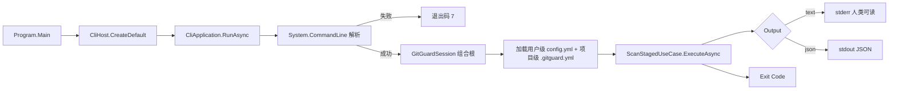
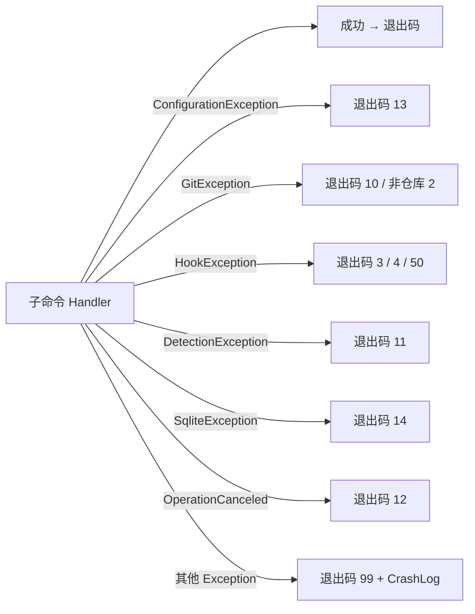

# CLI 模块设计

## 1. 模块定位

- **一句话定位**：`gitguard` 可执行文件的入口与用户交互层；负责命令解析、参数校验、调用 Application UseCase、终端 / JSON 渲染、退出码映射。
- **所属限界上下文**：Scanning Context
- **承担 FR**：全部 CLI 命令（FR-010 ~ FR-071、FR-080、FR-090）
- **承担 DR**：`DR-03`（FailClosed 全局 catch） + 与其他模块的边界约束
- **关联 ADR**：`ADR-0002`（技术栈）

## 2. 输入输出契约

### 2.1 输入

| 来源 | 内容 |
| --- | --- |
| 命令行参数 | `gitguard <command> [options]` |
| 环境变量 | `GITGUARD_SKIP`（Hook 绕过，归 `GGD-0013`）、`GITGUARD_LANG`（i18n，归 `GGD-0014`）、`NO_COLOR`（已实现） |
| stdin（仅 `scan --push`） | Git push 信息行 |
| 配置文件 | 由 Policy 模块加载 |

### 2.2 输出

| 消费方 | 内容 |
| --- | --- |
| 用户 / Git | stderr 的人类可读报告 + 退出码 |
| 脚本调用方 | stdout 的 JSON（`--format json`） |
| Audit | 一次 CLI 调用对应一个 `ScanRun` |

## 3. 核心规则

| 规则 | 要点 |
| --- | --- |
| 退出码契约 | 严格按 `06-API接口设计.md` §6 的退出码表；常量唯一来源为 `ExitCodes`，禁止就地写字面量 |
| 解析失败 | 未知命令 / 未知选项 / 受限取值非法 / 参数组合非法 → 退出码 7（`CLI_USAGE_ERROR`），在命令动作执行前返回，不触碰仓库与配置 |
| JSON Schema | 按 `gitguard.scan.v1` / `error.v1` / `install.v1` / `uninstall.v1` / `status.v1` / `version.v1` 版本号；单行紧凑、中文不转义 |
| 全局 catch | 任何未分类异常走退出码 99；并写 crash 日志（脱敏；写入失败静默跳过） |
| 彩色策略 | TTY + `NO_COLOR` 未设 + `--no-color` 未指定 时才启用 |
| 输出分流 | 文本报告走 stderr；`--format json` 的机器可读结果走 stdout，日志始终走 stderr |
| 脱敏 | 所有写往终端与日志的文本过 `MessageSanitizer`（去 ANSI / 控制字符、折行） |
| 子进程行为 | 不启动任何子进程（除 Git 和可选 Gitleaks，这些由 Infrastructure 层做） |

## 4. 外部依赖

| 依赖 | 用途 | 失败降级 |
| --- | --- | --- |
| `System.CommandLine` 2.0.x | 命令解析 | 解析失败由本层归一为退出码 7 并给出 `--help` 提示（不沿用框架默认退出码）；`InvocationConfiguration.EnableDefaultExceptionHandler = false`，异常一律由本层出口映射 |
| 控制台 | stderr / stdout | - |

## 5. 数据模型

CLI 层无独立持久化；通过 Application 层间接触达 Audit 模块。

## 6. 关键流程

### 6.1 `gitguard scan --staged` 入口

装配边界：Cli 不引用 Infrastructure；`GitGuardSession`（`GitGuard.Application.Composition`）在 Application 层完成 Infrastructure 装配并按需延迟构建（`status` / `version` 等只读命令不打开审计库、不生成指纹盐）。

### 6.2 全局异常捕获

解析期失败（未进入 Handler）由 `CliApplication` 在派发前收敛为退出码 7。

## 7. 配置项

CLI 层无独立配置；选项通过命令行参数传递。全局选项均为根命令递归选项，可出现在子命令前后任意位置。

| 全局选项 | 类型 | 默认 | 说明 |
| --- | --- | --- | --- |
| `--format` | enum `text\|json` | text | 输出格式；取值经 `AcceptOnlyFromAmong` 在解析期校验 |
| `--no-color` | bool | false | 禁用彩色 |
| `--verbose` | bool | false | 日志级别到 Debug |
| `--trace` | bool | false | 日志级别到 Trace（必须与 `--verbose` 同用，否则退出码 7） |
| `--log-file` | path? | null | 启用文件日志（JSON-lines，`~` 展开为用户主目录） |
| `--language` | string? | 环境或中文 | 覆盖输出语言（**v0.2**，归 `GGD-0014`；本版本未注册，传入将得到退出码 7） |

## 8. 质量属性

| 属性 | 目标 |
| --- | --- |
| 冷启动 | ≤ 150ms（Native AOT） |
| `--help` 响应 | 立即 |
| 终端渲染不换行乱码 | 自动检测 TTY 宽度，Finding 列表自动截断 |

## 9. 测试要点

- [x] 每条退出码都有对应测试（`GitGuard.Cli.Tests`：退出码映射单测 + 各命令端到端用例）。
- [x] JSON Schema 字段与类型断言（`--format json` 用例逐字段校验）。
- [x] 彩色关闭策略（TTY/非 TTY/NO_COLOR）。
- [x] 全局 catch 不会吞 ExitCode。
- [x] 用法错误不落盘：退出码 7 时不创建审计库 / 不写 Hook 文件。
- [ ] `--help` 覆盖所有命令（随 Shell 补全一并补测）。

## 10. 演进与扩展位

- 新增命令：新建 `Commands/*Command.cs` 并在 `CommandTree` 登记；禁止在 `Program.cs` 内写具体业务。
- Shell 自动补全：P2 启用 `System.CommandLine` 的 shell completion（`bash`、`pwsh`、`zsh`）。
- 国际化：目前只做中英（`GGD-0014`）；更多语言靠社区贡献。

## 11. 变更记录

| 版本 | 日期 | 变更说明 |
| --- | --- | --- |
| 0.1.0 | 2026-10-15 | 初始化：命令解析入口 + 全局异常映射 + 彩色策略 |
| 0.1.1 | 2026-10-16 | GGD-0009：§2.1 环境变量按实现标注归属（`NO_COLOR` 已实现，`GITGUARD_SKIP` → `GGD-0013`、`GITGUARD_LANG` → `GGD-0014`）；§3 新增「解析失败 → 退出码 7」「输出分流」「脱敏」规则，JSON Schema 补全为六种；§4 `System.CommandLine` 降级说明改为本层归一退出码 7；§6.1 流程与组合根装配对齐（`CliHost` / `GitGuardSession` 懒装配）；§6.2 异常映射补 `HookException` / `SqliteException` / 非仓库 2 与解析期 7；§7 `--language` 标注 v0.2 顺延；§9 勾选已覆盖测试项 |
