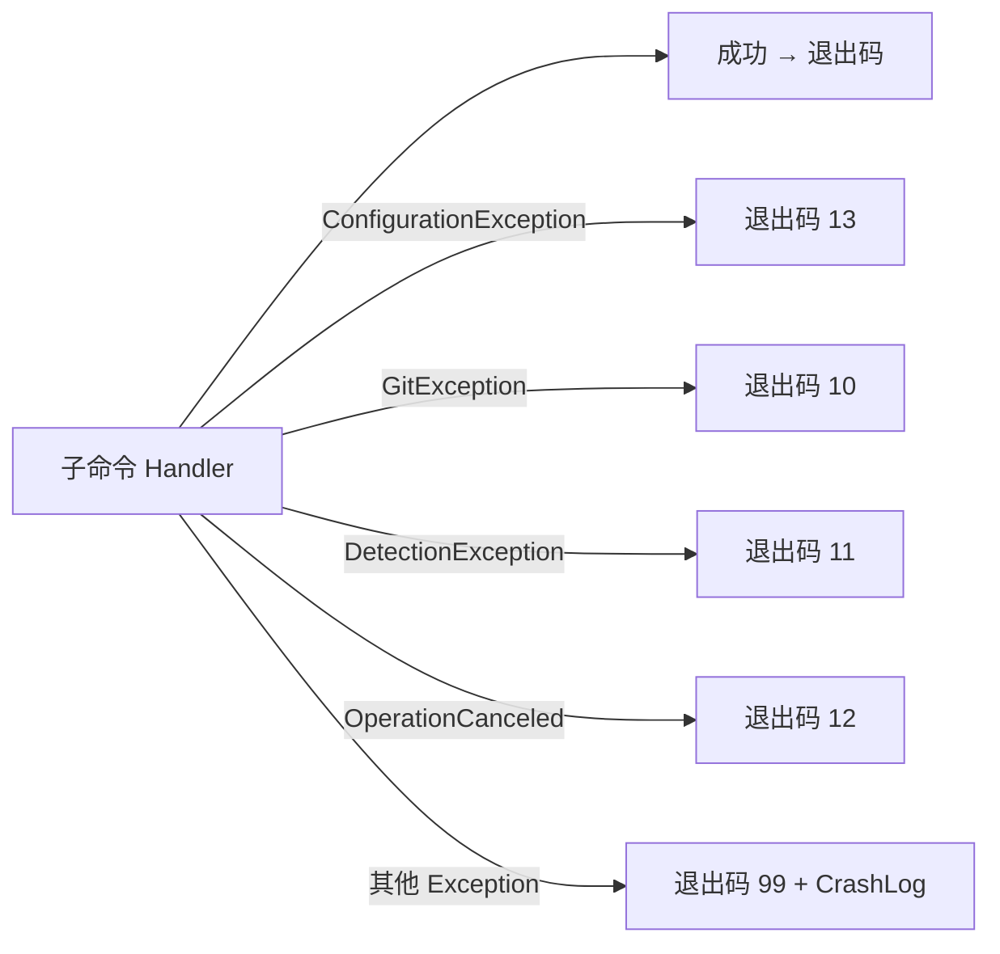

# CLI 模块设计

## 1. 模块定位

- **一句话定位**：`gitguard` 可执行文件的入口与用户交互层；负责命令解析、参数校验、调用 Application UseCase、终端 / JSON 渲染、退出码映射。
- **所属限界上下文**：Scanning Context
- **承担 FR**：全部 CLI 命令（FR-010 ~ FR-071、FR-080、FR-090）
- **承担 DR**：`DR-03`（FailClosed 全局 catch） + 与其他模块的边界约束
- **关联 ADR**：`ADR-0002`（技术栈）

## 2. 输入输出契约

### 2.1 输入

| 来源 | 内容 |
| --- | --- |
| 命令行参数 | `gitguard <command> [options]` |
| 环境变量 | `GITGUARD_SKIP`、`GITGUARD_LANG`、`NO_COLOR` |
| stdin（仅 `scan --push`） | Git push 信息行 |
| 配置文件 | 由 Policy 模块加载 |

### 2.2 输出

| 消费方 | 内容 |
| --- | --- |
| 用户 / Git | stderr 的人类可读报告 + 退出码 |
| 脚本调用方 | stdout 的 JSON（`--format json`） |
| Audit | 一次 CLI 调用对应一个 `ScanRun` |

## 3. 核心规则

| 规则 | 要点 |
| --- | --- |
| 退出码契约 | 严格按 `06-API接口设计.md` §6 的退出码表 |
| JSON Schema | 严格按 `gitguard.scan.v1` / `gitguard.error.v1` 版本号 |
| 全局 catch | 任何未分类异常走退出码 99；并写 crash 日志（脱敏） |
| 彩色策略 | TTY + `NO_COLOR` 未设 + `--no-color` 未指定 时才启用 |
| 子进程行为 | 不启动任何子进程（除 Git 和可选 Gitleaks，这些由 Infrastructure 层做） |

## 4. 外部依赖

| 依赖 | 用途 | 失败降级 |
| --- | --- | --- |
| `System.CommandLine` | 命令解析 | 解析失败由框架给出 `--help` 提示；退出码 2（框架默认，不覆盖） |
| 控制台 | stderr / stdout | - |

## 5. 数据模型

CLI 层无独立持久化；通过 Application 层间接触达 Audit 模块。

## 6. 关键流程

### 6.1 `gitguard scan --staged` 入口

```mermaid
flowchart LR
    Entry[Program.Main] --> Parse[System.CommandLine 解析]
    Parse --> Resolve[DI 容器解析 ScanStagedUseCase]
    Resolve --> Load[加载 .gitguard.yml]
    Load --> UseCase[Execute()]
    UseCase --> Render{Output}
    Render -- text --> StdErr[stderr 人类可读]
    Render -- json --> StdOut[stdout JSON]
    UseCase --> Exit[Exit Code]
```

### 6.2 全局异常捕获



## 7. 配置项

CLI 层无独立配置；选项通过命令行参数传递。

| 全局选项 | 类型 | 默认 | 说明 |
| --- | --- | --- | --- |
| `--format` | enum `text\|json` | text | 输出格式 |
| `--no-color` | bool | false | 禁用彩色 |
| `--verbose` | bool | false | 日志级别到 Debug |
| `--trace` | bool | false | 日志级别到 Trace（必须与 `--verbose` 同用） |
| `--log-file` | path? | null | 启用文件日志 |
| `--language` | string? | 环境或中文 | 覆盖输出语言 |

## 8. 质量属性

| 属性 | 目标 |
| --- | --- |
| 冷启动 | ≤ 150ms（Native AOT） |
| `--help` 响应 | 立即 |
| 终端渲染不换行乱码 | 自动检测 TTY 宽度，Finding 列表自动截断 |

## 9. 测试要点

- [ ] 每条退出码都有对应测试。
- [ ] JSON Schema 向后兼容（Golden Files）。
- [ ] 彩色关闭策略（TTY/非 TTY/NO_COLOR）。
- [ ] 全局 catch 不会吞 ExitCode。
- [ ] `--help` 覆盖所有命令。

## 10. 演进与扩展位

- 新增命令：直接新建 `CommandBuilder`；禁止在 `Program.cs` 内写具体业务。
- Shell 自动补全：P2 启用 `System.CommandLine` 的 shell completion（`bash`、`pwsh`、`zsh`）。
- 国际化：目前只做中英；更多语言靠社区贡献。

## 11. 变更记录

| 版本 | 日期 | 变更说明 |
| --- | --- | --- |
| 0.1.0 | 2026-10-15 | 初始化：命令解析入口 + 全局异常映射 + 彩色策略 |
