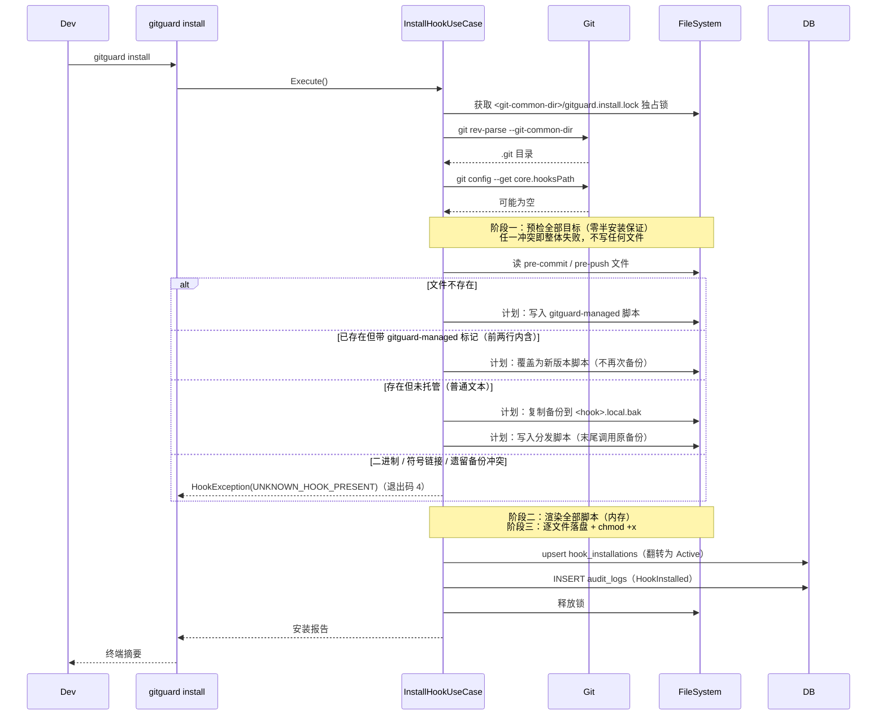
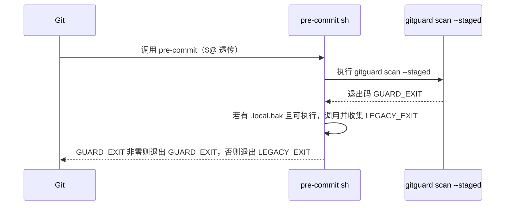
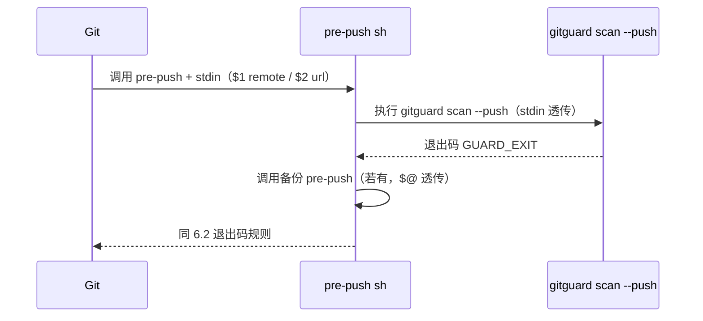

# Hook 模块设计

## 1. 模块定位

- **一句话定位**：GitGuard 与 Git Hook 系统的集成模块；负责**安装、卸载、分发、兼容已有 Hook**。
- **所属限界上下文**：Scanning Context
- **承担 FR**：`FR-010, FR-011, FR-012, FR-030, FR-050`
- **承担 DR**：`DR-04`（PreCommit 必须从 `git diff --cached` 取数据）、`DR-05`（不覆盖已有 Hook）、`DR-06`（绕过留痕）
- **关联 ADR**：`ADR-0004`（Hook 分发器方案，待新增）

## 2. 输入输出契约

### 2.1 输入

| 来源 | 内容 | 格式 | 缺失语义 |
| --- | --- | --- | --- |
| 用户 CLI 调用 | `gitguard install / uninstall / status` | 命令行参数 | - |
| Git 自身调用 | `pre-commit` 无参；`pre-push` 从 stdin 读 push info | - | 空 stdin → 无推送目标：Clean / 退出码 0（GGD-0007 决策：Git 仅在存在待推送引用时调用 pre-push，不执行「扫描所有未推送提交」的全历史降级） |
| `.git/config` | `core.hooksPath` 等 | - | 不存在 → 用默认 `.git/hooks` |

### 2.2 输出

| 消费方 | 内容 | 格式 |
| --- | --- | --- |
| 用户 | Hook 分发脚本写入磁盘；人类可读 / JSON 的安装报告 | POSIX sh + stderr |
| Audit | `HookInstallation` + `HookInstalled` / `HookUninstalled` 事件 | SQLite |
| Git | 退出码（0 放行 / 非 0 阻断） | int |

> 分发脚本仅提供 POSIX sh 形态（GGD-0008 决策）：Git for Windows 自带 MSYS2 sh，Linux / macOS 原生具备；PowerShell 变体因无法覆盖 Unix 场景且引入双份维护成本，不予交付（原「.ps1 自动选择」设想撤销）。

## 3. 核心规则

| 规则 | 来源 | 要点 |
| --- | --- | --- |
| 识别已托管 Hook | DR-05 | 分发脚本前两行内包含 `# gitguard-managed v` 标记即判定托管；渲染器保证首两行固定为 `#!/bin/sh` + 标记行 |
| 保留原 Hook | DR-05 | 覆盖前**复制**（非重命名）为 `<hook>.local.bak`（卸载还原依赖此备份存在）；非 Windows 平台显式对齐源文件 Unix 权限位（`[ -x ]` 门控依赖） |
| 分发脚本调用原 Hook | DR-05 | 不 `exec`（`exec` 会替换 shell 且跳过后续退出码合并）；直接调用并收集退出码，最终退出码 = GitGuard 非零优先，否则沿用原 Hook |
| 已托管刷新 | DR-05 | 重复安装时直接覆盖为新版本脚本，不再次备份（避免备份被覆盖失真） |
| 冲突拒绝边界 | DR-05 | 二进制（前 8192 字节含 NUL）/ 符号链接 / 「遗留备份 + 非托管目标」三类冲突抛 `UNKNOWN_HOOK_PRESENT`（退出码 4）；`--force` 仅允许接管**二进制 / 符号链接**两种，遗留备份冲突即使加 `--force` 也拒绝（防止覆盖真正的原 Hook） |
| 并发互斥 | 06-API §8 | 安装 / 卸载共用 `<git-common-dir>/gitguard.install.lock` 独占锁；获取失败 → `INSTALL_IN_PROGRESS`（退出码 50） |
| 卸载判定 | FR-011 | 托管痕迹（标记行或备份）存在才动作；无痕迹 → `NotInstalled`（不写审计，CLI 提示后退出码 5）；有备份 → 删除目标并将备份重命名还原（`RestoredLegacy`） |
| PreCommit 读数据源 | DR-04 | 必须用 `git diff --cached`；禁止读工作区 |
| 推送范围计算 | FR-030 | 新分支 `remote-sha = 0...0` → 范围为 `local-sha`；否则 `remote-sha..local-sha` |
| 显式绕过检测 | DR-06 | 轻量 `post-commit` 对比最新 HEAD 与「上次预测」；不匹配即绕过（GGD-0013） |

## 4. 外部依赖

| 依赖 | 用途 | 超时 | 失败降级 |
| --- | --- | --- | --- |
| 系统 Git | 读 `core.hooksPath` / 写入 Hook / rev-list | 30s | FailClosed（退出码 10） |
| 文件系统 | 读写 Hook 脚本 + 权限设置 | - | FailClosed（退出码 3） |
| 进程启动（Process API） | 子进程调用 Git | - | 同上 |

## 5. 数据模型

- `HookInstallation` 表（见 `05-数据库设计.md` §4.4）。写入语义为 **upsert**：主键 `(repo_path, hook_type)` 冲突时刷新版本 / 备份路径 / `installed_at` 并翻转为 `Active`；卸载时翻转为 `Uninstalled`（保留安装字段）。
- 分发脚本模板位置：`src/GitGuard.Application/Hooks/Templates/`：
  - `pre-commit.sh.template`
  - `pre-push.sh.template`
- 模板以 **EmbeddedResource 嵌入主程序集**（ADR-0004：单文件发行不做外部文件依赖），渲染时从资源流读取。
  - `<EmbeddedResource>` 必须声明 `WithCulture="false"`：MSBuild 会把文件名中的 `.sh` 段识别为区域代码（Serbo-Croatian），否则资源名被剥离并改派到附属程序集，主程序集取不到（GGD-0008 实测踩坑）。
  - 仓库内按 13-开发规范存储（UTF-8 with BOM + CRLF），渲染时归一化为 LF + 无 BOM（POSIX sh 拒绝 BOM / CR）。
- `post-commit.sh.template`（FR-050 绕过检测）推迟至 **GGD-0013**，本模块现阶段不交付。

## 6. 关键流程

### 6.1 Install



### 6.2 PreCommit 执行



> 退出码规则：GitGuard 非零优先（守卫失败必须阻断），GitGuard 为 0 时沿用原 Hook 退出码。二者均非零时结果为 GitGuard 的退出码，不做数值合并（原 `max(...)` 表述作废）。分发脚本不使用 `set -e`：GitGuard 阻断时原 Hook 仍需执行（Husky 等既有流程不因守卫失败被静默跳过）。

### 6.3 PrePush



## 7. 分发脚本模板

`pre-commit.sh.template`（`{{VERSION}}` / `{{GITGUARD_BIN}}` / `{{HOOK_NAME}}` 为渲染占位符；`pre-push.sh.template` 除 `scan --push` 外与之一致）：

```sh
#!/bin/sh
# gitguard-managed v{{VERSION}}
# This hook is managed by GitGuard. Do not edit by hand.
# The original hook (if any) is kept next to this script as {{HOOK_NAME}}.local.bak and is called at the end.
# To remove GitGuard hooks run: gitguard uninstall

GITGUARD_BIN="{{GITGUARD_BIN}}"
if [ ! -x "$GITGUARD_BIN" ]; then
    echo "GitGuard: executable not found or not executable: $GITGUARD_BIN" >&2
    exit 10
fi

HOOK_DIR=$(CDPATH= cd -- "$(dirname -- "$0")" && pwd)
LEGACY_HOOK="$HOOK_DIR/{{HOOK_NAME}}.local.bak"

GUARD_EXIT=0
"$GITGUARD_BIN" scan --staged || GUARD_EXIT=$?

LEGACY_EXIT=0
if [ -x "$LEGACY_HOOK" ]; then
    "$LEGACY_HOOK" "$@" || LEGACY_EXIT=$?
fi

if [ "$GUARD_EXIT" -ne 0 ]; then
    exit "$GUARD_EXIT"
fi

exit "$LEGACY_EXIT"
```

模板要点：

| 要点 | 说明 |
| --- | --- |
| 前两行固定 | `#!/bin/sh` + `# gitguard-managed vX.Y.Z`：托管识别的逐行精确匹配依据 |
| 备份路径相对 hook 所在目录解析 | 用 `$0` 推导 `HOOK_DIR`，同时覆盖默认 `.git/hooks` 与 `core.hooksPath` 自定义目录 |
| 无 `set -e` / 无 `exec` | 保证 GitGuard 阻断时原 Hook 仍执行、退出码可合并 |
| 脚本内消息使用英文 | POSIX 区域环境下中文可能乱码；面向开发者的双语提示由 CLI 负责 |
| 路径固化 | Windows 下反斜杠在渲染期转为正斜杠（MSYS sh 不识别 `\`） |
| 可执行文件缺失 | 退出码 10 且**不调用**原 Hook——分发链断链时宁可阻断也不静默降级 |

## 8. 配置项

| 配置项 | 类型 | 默认 | 说明 |
| --- | --- | --- | --- |
| `hooks.pre_commit` | bool | true | 是否注册 pre-commit |
| `hooks.pre_push` | bool | true | 是否注册 pre-push |
| `hooks.post_commit_bypass_detection` | bool | true | 是否注册 post-commit 检测 `--no-verify` 绕过 |
| `hooks.gitguard_executable_path` | string? | 自动探测 | 固化到分发脚本内 |

## 9. 质量属性

| 属性 | 目标 |
| --- | --- |
| 安装成功率 | 100%（Clean / Husky / lefthook / pre-commit 四种 Fixture） |
| 分发脚本可读 | 任何开发者查看脚本即能理解调用链 |
| 卸载完整性 | 卸载后 `git commit` 恢复原行为 |

## 10. 测试要点

- [x] `TC-FR-010-01` ~ `TC-FR-010-05`：安装/卸载场景（`GGD-0008`，Application.Tests + HookEndToEndTests）。
- [x] `TC-DR-05-01`：Husky 共存不破坏——真实 `git commit` 执行分发脚本，验证 GitGuard 先行、原 Hook 随后、退出码矩阵（0,0→0 / 3,0→3 / 0,7→7 / 3,7→3）。
- [ ] `TC-DR-06-01`：post-commit 绕过检测（GGD-0013）。
- [ ] 跨平台脚本可执行（Windows Git bash / Linux sh / macOS zsh）——Windows MSYS sh 与 POSIX shell 语义已在 CI 覆盖，macOS 待补。

## 11. 演进与扩展位

- 未来 Git 版本可能支持 `git config set hook.<name>.command`；安装器应优先检测新语法；检测失败时降级为传统脚本安装。
- 若引入 `commit-msg` 检查（例如阻断 commit message 中泄漏密钥），同样走 `HookDispatcher` 模型。

## 12. 变更记录

| 版本 | 日期 | 变更说明 |
| --- | --- | --- |
| 0.1.0 | 2026-10-15 | 初始化：Install/Pre-commit/Pre-push 流程 + Unix 脚本模板 |
| 0.1.1 | 2026-10-16 | 与 GGD-0007 实现同步：§2.1 pre-push 空 stdin 语义由「降级扫描所有未推送提交」改判为「无推送目标 → Clean / 退出码 0」（Git 仅在存在待推送引用时触发 pre-push） |
| 0.1.2 | 2026-10-16 | 与 GGD-0008 实现同步：§2.2 输出限定 POSIX sh（撤销 PowerShell 变体）；§3 核心规则补全托管识别 / 复制备份 / 退出码规则 / 冲突拒绝边界 / 并发锁 / 卸载判定；§5 记录 EmbeddedResource `WithCulture=false` 陷阱、post-commit 推迟 GGD-0013、upsert 语义；§6 流程补锁与三阶段安装；§6.2/6.3 退出码规则取代 `max(...)`；§7 替换为实际交付模板；§10 勾选已完成测试项 |
