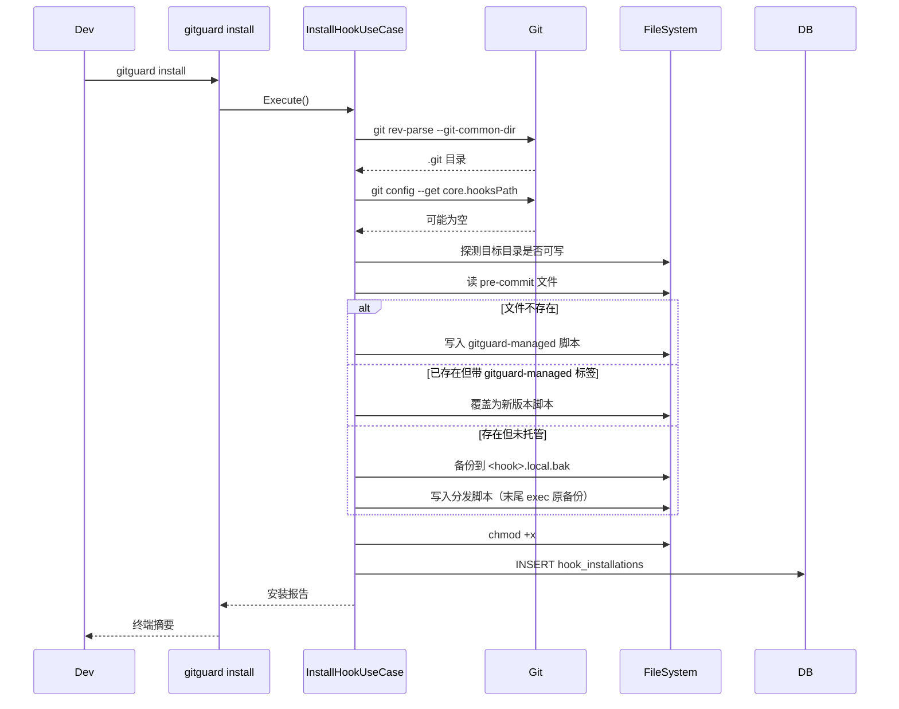
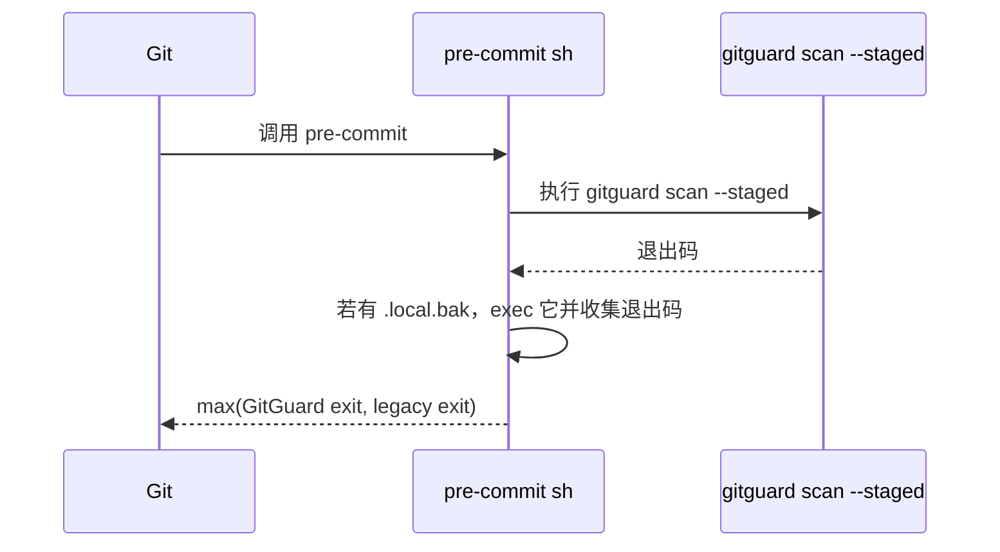
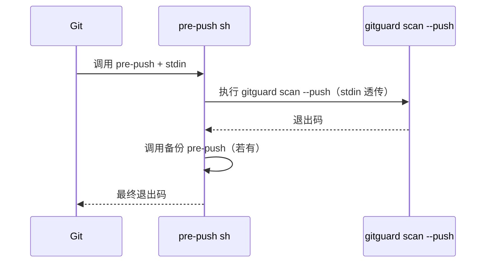

# Hook 模块设计

## 1. 模块定位

- **一句话定位**：GitGuard 与 Git Hook 系统的集成模块；负责**安装、卸载、分发、兼容已有 Hook**。
- **所属限界上下文**：Scanning Context
- **承担 FR**：`FR-010, FR-011, FR-012, FR-030, FR-050`
- **承担 DR**：`DR-04`（PreCommit 必须从 `git diff --cached` 取数据）、`DR-05`（不覆盖已有 Hook）、`DR-06`（绕过留痕）
- **关联 ADR**：`ADR-0004`（Hook 分发器方案，待新增）

## 2. 输入输出契约

### 2.1 输入

| 来源 | 内容 | 格式 | 缺失语义 |
| --- | --- | --- | --- |
| 用户 CLI 调用 | `gitguard install / uninstall / status` | 命令行参数 | - |
| Git 自身调用 | `pre-commit` 无参；`pre-push` 从 stdin 读 push info | - | 空 stdin → 走降级逻辑扫所有未推送提交 |
| `.git/config` | `core.hooksPath` 等 | - | 不存在 → 用默认 `.git/hooks` |

### 2.2 输出

| 消费方 | 内容 | 格式 |
| --- | --- | --- |
| 用户 | Hook 安装脚本写入磁盘；人类可读 / JSON 的安装报告 | sh / PowerShell + stderr |
| Audit | `HookInstallation` + `HookInstalled` 事件 | SQLite |
| Git | 退出码（0 放行 / 非 0 阻断） | int |

## 3. 核心规则

| 规则 | 来源 | 要点 |
| --- | --- | --- |
| 识别已托管 Hook | DR-05 | 分发脚本首行必须有 `# gitguard-managed vX.Y.Z` 标签 |
| 保留原 Hook | DR-05 | 覆盖前备份为 `<hook>.local.bak`；分发脚本末尾 `exec` 调用它 |
| PreCommit 读数据源 | DR-04 | 必须用 `git diff --cached`；禁止读工作区 |
| 推送范围计算 | FR-030 | 新分支 `remote-sha = 0...0` → 范围为 `local-sha`；否则 `remote-sha..local-sha` |
| 显式绕过检测 | DR-06 | 轻量 `post-commit` 对比最新 HEAD 与「上次预测」；不匹配即绕过 |

## 4. 外部依赖

| 依赖 | 用途 | 超时 | 失败降级 |
| --- | --- | --- | --- |
| 系统 Git | 读 `core.hooksPath` / 写入 Hook / rev-list | 30s | FailClosed（退出码 10） |
| 文件系统 | 读写 Hook 脚本 + 权限设置 | - | FailClosed（退出码 3） |
| 进程启动（Process API） | 子进程调用 Git | - | 同上 |

## 5. 数据模型

- `HookInstallation` 表（见 `05-数据库设计.md` §4.4）。
- 分发脚本模板位置：`src/GitGuard.Application/Hooks/Templates/`：
  - `pre-commit.sh.template`
  - `pre-push.sh.template`
  - `post-commit.sh.template`

## 6. 关键流程

### 6.1 Install



### 6.2 PreCommit 执行



### 6.3 PrePush



## 7. 分发脚本模板（Unix 示例）

```sh
#!/bin/sh
# gitguard-managed v{VERSION}
# This hook was installed by GitGuard. Do not edit by hand.
# Original hook (if any) is called at the end.

set -eu

GITGUARD_BIN="{GITGUARD_PATH}"
if [ ! -x "$GITGUARD_BIN" ]; then
    echo "GitGuard 可执行文件缺失：$GITGUARD_BIN" >&2
    exit 10
fi

"$GITGUARD_BIN" scan --staged
GUARD_EXIT=$?

if [ -x ".git/hooks/pre-commit.local.bak" ]; then
    ".git/hooks/pre-commit.local.bak" "$@"
    LEGACY_EXIT=$?
else
    LEGACY_EXIT=0
fi

if [ "$GUARD_EXIT" -ne 0 ]; then
    exit "$GUARD_EXIT"
fi
exit "$LEGACY_EXIT"
```

> Windows PowerShell 变体位于同目录；Git for Windows 下 `sh` 版本仍优先（因为 MSYS2 bash 可用）。

## 8. 配置项

| 配置项 | 类型 | 默认 | 说明 |
| --- | --- | --- | --- |
| `hooks.pre_commit` | bool | true | 是否注册 pre-commit |
| `hooks.pre_push` | bool | true | 是否注册 pre-push |
| `hooks.post_commit_bypass_detection` | bool | true | 是否注册 post-commit 检测 `--no-verify` 绕过 |
| `hooks.gitguard_executable_path` | string? | 自动探测 | 固化到分发脚本内 |

## 9. 质量属性

| 属性 | 目标 |
| --- | --- |
| 安装成功率 | 100%（Clean / Husky / lefthook / pre-commit 四种 Fixture） |
| 分发脚本可读 | 任何开发者查看脚本即能理解调用链 |
| 卸载完整性 | 卸载后 `git commit` 恢复原行为 |

## 10. 测试要点

- [ ] `TC-FR-010-01` ~ `TC-FR-010-05`：安装/卸载场景。
- [ ] `TC-DR-05-01`：Husky 共存不破坏。
- [ ] `TC-DR-06-01`：post-commit 绕过检测。
- [ ] 跨平台脚本可执行（Windows Git bash / Linux sh / macOS zsh）。

## 11. 演进与扩展位

- 未来 Git 版本可能支持 `git config set hook.<name>.command`；安装器应优先检测新语法；检测失败时降级为传统脚本安装。
- 若引入 `commit-msg` 检查（例如阻断 commit message 中泄漏密钥），同样走 `HookDispatcher` 模型。

## 12. 变更记录

| 版本 | 日期 | 变更说明 |
| --- | --- | --- |
| 0.1.0 | 2026-10-15 | 初始化：Install/Pre-commit/Pre-push 流程 + Unix 脚本模板 |
