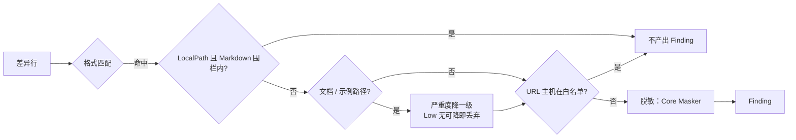

# LocalPath / Url 模块设计

> **范围说明**：本文件承载 **LocalPath 检测器** 和 **Url 检测器** 两类规则。它们规则特征相近（环境/网络类），放在一起更利于维护；代码上仍是两个独立的 `IDetector` 实现。

## 1. 模块定位

- **一句话定位**：识别开发者本地绝对路径泄漏（如 `C:/Users/rushe/Desktop/project`、`C:\Users\rushe\Desktop`）与可疑 URL（含凭据、含 Token 查询参数、内网保留地址），命中后按配置输出 Finding；Markdown 围栏代码块内的路径视为示例内容，不参与 LocalPath 判定。
- **所属限界上下文**：Scanning Context
- **承担 FR**：`FR-021`
- **承担 DR**：`DR-02`（脱敏）
- **关联 ADR**：无

## 2. 输入输出契约

同 Secret / Privacy 模块：输入差异 Hunk，输出 `IAsyncEnumerable<Finding>`（ADR-0003 流式契约）。

## 3. 核心规则

### 3.1 LocalPath 规则

| RuleId | 名称 | 严重度 | 判定要点 |
| --- | --- | --- | --- |
| `GGD/LOCALPATH/UNIX-HOME` | Unix 用户主目录绝对路径 | Low | `/home/[\w-]+/` 或 `/Users/[\w.-]+/` |
| `GGD/LOCALPATH/WIN-USER` | Windows 用户目录绝对路径 | Low | `[A-Z]:\\Users\\[\w.-]+\\` |
| `GGD/LOCALPATH/WIN-DRIVE` | Windows 驱动器盘符 | Low | 行首 `[A-Z]:\\` 后跟路径分隔 |
| `GGD/LOCALPATH/TEMP-WORK` | 常见临时/工作区绝对路径 | Low | `/workspace/volumes/`、`/mnt/d/`、`~/workspace/` |
| `GGD/LOCALPATH/UNC-SHARE` | Windows UNC 共享路径 | Medium | `\\<server>\<share>` 及任意深度子路径（共享名支持 `$` 管理共享） |
| `GGD/LOCALPATH/DEV-DIRS` | POSIX 部署目录绝对路径 | Low | `/opt/<目录>/`、`/srv/<目录>/`、`/data/<目录>/` |
| `GGD/LOCALPATH/HOME-TILDE` | 用户主目录 `~` 路径 | Low | `~/<目录>/<子目录>`（可出现在引号、空格或 `=` 之后） |
| `GGD/LOCALPATH/MAC-VOLUME` | macOS 挂载卷绝对路径 | Low | `(?<![\w.-])/Volumes/<卷名>/` |
| `GGD/LOCALPATH/ROOT-HOME` | root 用户主目录绝对路径 | Low | `(?<![\w.-])/root/<目录>/` |
| `GGD/LOCALPATH/VAR-WWW` | Web 站点部署绝对路径 | Low | `(?<![\w.-])/var/www/<站点>/` |
| `GGD/LOCALPATH/CYGWIN-DRIVE` | Cygwin 盘符绝对路径 | Low | `(?<![\w.-])/cygdrive/<盘符>/<目录>/`；`Users` 首段交由 UNIX-HOME |
| `GGD/LOCALPATH/WIN-INLINE` | Windows 行内盘符绝对路径 | Low | 引号 / 空白 / `=` / `(` 后的 `<盘符>:\<目录>\`；行首与 `Users` 交由 WIN-DRIVE / WIN-USER |

**降级策略**：

- 在 `.gitignore`、`README.md`、`docs/**` 中出现时自动降级一级（Low 规则无可降级即不命中）。
- Markdown 围栏代码块感知（GGD-0040）：`.md` / `.markdown` 中位于围栏内的变更行整行跳过 LocalPath 规则，不产出 Finding（不再降级）。围栏支持反引号（```` ``` ````）与波浪线（`~~~`）、最多 3 个前导空格；闭合围栏须同字符且长度 ≥ 开标记，仅允许尾随空白。反引号围栏的信息串不得含反引号。
- 保守策略：差异为 unified-0，仅含变更行。围栏开标记与目标行之间出现行号缺口时无法确认块状态，重置为围栏外并正常检测（宁可多报，不可漏报）；未闭合围栏覆盖至当前连续差异段末尾。非 Markdown 文件不做围栏解析，Url 检测器也不受围栏影响。

### 3.2 Url 规则

| RuleId | 名称 | 严重度 | 判定要点 |
| --- | --- | --- | --- |
| `GGD/URL/CREDENTIALS-IN-URL` | URL 带用户名密码 | High | `(https?\|ftp)://[^/\s:]+:[^@\s/]+@` |
| `GGD/URL/TOKEN-IN-QUERY` | 查询参数含 token/apikey | High | `[?&](token\|apikey\|access_token\|api_key)=[^&\s]+` |
| `GGD/URL/PRIVATE-IP` | 私有 / 环回 IP | Medium | `10.\d+.\d+.\d+`、`172.(1[6-9]\|2[0-9]\|3[0-1]).\d+.\d+`、`192.168.\d+.\d+`、`127.\d+.\d+.\d+` |
| `GGD/URL/LOCAL-HOSTNAME` | 内网域名 | Medium | `*.local`、`*.internal`、`*.corp`、`*.lan`（在非文档上下文） |
| `GGD/URL/SLACK-WEBHOOK` | Slack Webhook URL | High | `https://hooks.slack.com/services/T.../B.../<secret>` |
| `GGD/URL/DISCORD-WEBHOOK` | Discord Webhook URL | High | `https://discord.com` / `discordapp.com` / `canary` / `ptb` 的 `/api/webhooks/<id>/<token>` |
| `GGD/URL/PASSWORD-QUERY` | 查询参数含密码 | High | 查询参数 `password` / `passwd` / `pwd` / `secret` 且值非空 |
| `GGD/URL/AWS-SIGNED-URL` | AWS 预签名 URL | High | `X-Amz-Signature=` 或 `X-Amz-Credential=` 查询参数 |
| `GGD/URL/GCP-SIGNED-URL` | Google Cloud 签名 URL | High | `X-Goog-Signature=` 或 `X-Goog-Credential=` 查询参数 |
| `GGD/URL/AZURE-SAS-URL` | Azure SAS 令牌 URL | High | 同时含 `sv=YYYY-MM-DD` 与 `sig=`（≥16 字符），参数顺序不限 |
| `GGD/URL/DB-URL-CREDENTIALS` | 数据库 URL 内嵌凭据 | High | `mysql` / `mariadb` / `postgres(ql)` / `mongodb(+srv)` / `redis(s)` / `amqp(s)` / `mssql` / `sqlserver` 的 `://user:pass@` |
| `GGD/URL/OAUTH-REFRESH-TOKEN` | OAuth 刷新令牌 URL 参数 | High | `?` / `&` / `#` 后的 `refresh_token=`（值 ≥16 字符） |
| `GGD/URL/FEISHU-WEBHOOK` | 飞书 Webhook URL | High | `open.feishu.cn/open-apis/bot/v2/hook/<UUID>` |

**降级策略**：

- URL 出现在以 `example`、`sample`、`demo` 开头的文件名（大小写不敏感）中 → 命中但严重度降一级（Low 保持 Low，命中记录保留）。
- 公共文档类 URL（`github.com`、`api.github.com` 等）不触发命中：由规则集本身保证（无凭据 / Token / 内网特征即不命中）。
- 公共主机名白名单（`rules.url.public_hostname_whitelist`，GGD-0039）：命中行可解析出所属 URL 主机且主机在列表中时，该条 Finding 不产出。支持精确主机（`github.com`）与 `*.` 通配（`*.example.com` 覆盖任意层级子域，不覆盖裸域）；比较大小写不敏感。主机解析取命中位置之前最近的 `scheme://`，跳过用户信息与端口；无法解析主机（裸 IP / 内网域名等）时保持原判定，避免误抑制。默认空列表不改变现有行为。

## 4. 外部依赖

| 依赖 | 用途 | 失败降级 |
| --- | --- | --- |
| Regex 引擎 | 格式判定 | 单规则禁用 + FailClosed |
| Uri 解析器（System.Uri） | 可选深度解析 token 位置 | 解析失败回退纯 Regex 判定 |

## 5. 数据模型

脱敏输出（由 Core `Masker` 统一承担：保留命中值前后各 2 字符、中间 `*`，总长 ≤ 32）：

- LocalPath：`/Users/alice/` → `/U*********e/`。
- Url：凭据 `user:pass` → `us*****ss`。

## 6. 关键流程



## 7. 配置项

| 配置项 | 类型 | 默认 | 说明 |
| --- | --- | --- | --- |
| `rules.local_path.enabled` | bool | true | - |
| `rules.local_path.disabled_rules` | string[] | [] | - |
| `rules.url.enabled` | bool | true | - |
| `rules.url.disabled_rules` | string[] | [] | - |
| `rules.url.public_hostname_whitelist` | string[] | `[]` | 公共文档主机白名单：精确主机或 `*.example.com` 通配，大小写不敏感；命中主机的 URL 规则 Finding 不产出。项目级声明整体替换用户级列表；空白项或含协议 / 端口 / 路径的非法项 → 退出码 13 |

## 8. 质量属性

| 属性 | 目标 |
| --- | --- |
| 内网 IP 命中召回率 | ≥ 95%（已知样本集） |
| 本地路径误报率 | ≤ 10%（在包含文档的真实项目） |
| 单规则 P95 耗时 | ≤ 20ms |

## 9. 测试要点

- [x] Windows / Unix 路径分别覆盖。
- [x] 文档文件（`.gitignore` / `README.md` / `docs/**`）中 Low 规则不命中。
- [x] URL 带 Token 的脱敏输出不含原 Token。
- [x] 每条规则 ≥3 正例 / ≥3 反例 / 边界命中与不命中各 ≥1（`BuiltinRuleFixtureTests`，12 条 LocalPath + 13 条 Url 规则全覆盖）。
- [x] 公共 URL 主机白名单（GGD-0039）：精确 / 通配主机抑制、大小写与端口无关、仅关联最近的前置 URL；配置加载期规范化与非法项 FailClosed（`DetectorTests` / `GitGuardConfigLoaderTests` / `CliScanCommandTests`）。
- [x] Markdown 围栏代码块感知（GGD-0040）：围栏内 Low / Medium 路径均不产出 Finding、围栏外仍命中；反引号 / 波浪线围栏、≤3 空格缩进、闭合长度、未闭合围栏、`~~` 不闭合；跨差异缺口保守回落；非 Markdown 文件与 Url 检测器不受影响（`DetectorTests` / `CliScanCommandTests`）。

## 10. 演进与扩展位

- 项目级自定义 IP / 路径白名单（P2）。
- 更丰富的内网域名识别（`*.k8s.local` 等）。
- v1.0 已补 macOS 挂载卷、root 主目录、Web 部署目录、Cygwin 盘符与 Windows 行内盘符路径（`GGD-0050`），后续可按真实项目误报数据继续细分平台路径。
- v1.0 已补 Google Cloud / Azure 签名 URL、数据库 URL 内嵌凭据、OAuth 刷新令牌与飞书 Webhook（`GGD-0051`），云厂商签名参数与 IM Webhook 可按需继续扩展。

## 11. 变更记录

| 版本 | 日期 | 变更说明 |
| --- | --- | --- |
| 0.1.0 | 2026-10-15 | 初始化：4 条 LocalPath + 4 条 Url 规则 |
| 0.1.1 | 2026-10-16 | 与 GGD-0006 实现同步：输出契约定为 `IAsyncEnumerable<Finding>`（ADR-0003）；文档文件降级明确为 glob（`.gitignore` / `README.md` / `docs/**`）+ Low 丢弃；示例文件降级明确为文件名前缀匹配；脱敏统一由 Core `Masker` 承担（§5 示例对齐）；公开 URL 主机白名单与 Markdown 代码块感知记为 P2（本版本未实现） |
| 0.1.2 | 2026-10-22 | GGD-0033：LocalPath 扩充至 7 条（UNC-SHARE / DEV-DIRS / HOME-TILDE），Url 扩充至 8 条（Slack / Discord Webhook、密码查询参数、AWS 预签名 URL）；§9 勾选样本覆盖项 |
| 0.1.3 | 2026-10-23 | GGD-0039：实现 `rules.url.public_hostname_whitelist`（§3.2 / §6 / §7 / §9）——精确主机与 `*.` 通配、大小写不敏感、按命中位置最近的 URL 解析主机并抑制 Finding；默认空列表不改变行为；Markdown 代码块感知仍为 P2 |
| 0.1.4 | 2026-10-23 | GGD-0040：实现 Markdown 围栏代码块感知（§1 / §3.1 / §6 / §9）——`.md` / `.markdown` 中围栏内行跳过 LocalPath 规则；支持反引号 / 波浪线、≤3 空格缩进与闭合长度校验；unified-0 跨差异缺口保守回落为正常检测；仅作用于 LocalPath，Url 与白名单行为不变 |
| 0.1.5 | 2026-10-24 | GGD-0050：LocalPath 扩充至 12 条（MAC-VOLUME / ROOT-HOME / VAR-WWW / CYGWIN-DRIVE / WIN-INLINE），§3.1 / §9 / §10 同步；Url 规则保持 8 条 |
| 0.1.6 | 2026-10-25 | GGD-0051：Url 扩充至 13 条（GCP-SIGNED-URL / AZURE-SAS-URL / DB-URL-CREDENTIALS / OAUTH-REFRESH-TOKEN / FEISHU-WEBHOOK），§3.2 / §9 / §10 同步 |
