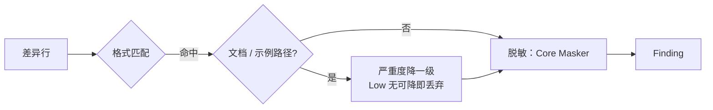

# LocalPath / Url 模块设计

> **范围说明**：本文件承载 **LocalPath 检测器** 和 **Url 检测器** 两类规则。它们规则特征相近（环境/网络类），放在一起更利于维护；代码上仍是两个独立的 `IDetector` 实现。

## 1. 模块定位

- **一句话定位**：识别开发者本地绝对路径泄漏（如 `C:/Users/rushe/Desktop/project`、`C:\Users\rushe\Desktop`）与可疑 URL（含凭据、含 Token 查询参数、内网保留地址），命中后按配置输出 Finding。
- **所属限界上下文**：Scanning Context
- **承担 FR**：`FR-021`
- **承担 DR**：`DR-02`（脱敏）
- **关联 ADR**：无

## 2. 输入输出契约

同 Secret / Privacy 模块：输入差异 Hunk，输出 `IAsyncEnumerable<Finding>`（ADR-0003 流式契约）。

## 3. 核心规则

### 3.1 LocalPath 规则

| RuleId | 名称 | 严重度 | 判定要点 |
| --- | --- | --- | --- |
| `GGD/LOCALPATH/UNIX-HOME` | Unix 用户主目录绝对路径 | Low | `/home/[\w-]+/` 或 `/Users/[\w.-]+/` |
| `GGD/LOCALPATH/WIN-USER` | Windows 用户目录绝对路径 | Low | `[A-Z]:\\Users\\[\w.-]+\\` |
| `GGD/LOCALPATH/WIN-DRIVE` | Windows 驱动器盘符 | Low | 行首 `[A-Z]:\\` 后跟路径分隔 |
| `GGD/LOCALPATH/TEMP-WORK` | 常见临时/工作区绝对路径 | Low | `/workspace/volumes/`、`/mnt/d/`、`~/workspace/` |
| `GGD/LOCALPATH/UNC-SHARE` | Windows UNC 共享路径 | Medium | `\\<server>\<share>` 及任意深度子路径（共享名支持 `$` 管理共享） |
| `GGD/LOCALPATH/DEV-DIRS` | POSIX 部署目录绝对路径 | Low | `/opt/<目录>/`、`/srv/<目录>/`、`/data/<目录>/` |
| `GGD/LOCALPATH/HOME-TILDE` | 用户主目录 `~` 路径 | Low | `~/<目录>/<子目录>`（可出现在引号、空格或 `=` 之后） |

**降级策略**：

- 在 `.gitignore`、`README.md`、`docs/**` 中出现时自动降级一级（Low 规则无可降级即不命中）。
- （P2）示例代码块（Markdown 的三反引号段落）感知：本版本未实现，代码块内路径仍按普通文本行扫描。

### 3.2 Url 规则

| RuleId | 名称 | 严重度 | 判定要点 |
| --- | --- | --- | --- |
| `GGD/URL/CREDENTIALS-IN-URL` | URL 带用户名密码 | High | `(https?\|ftp)://[^/\s:]+:[^@\s/]+@` |
| `GGD/URL/TOKEN-IN-QUERY` | 查询参数含 token/apikey | High | `[?&](token\|apikey\|access_token\|api_key)=[^&\s]+` |
| `GGD/URL/PRIVATE-IP` | 私有 / 环回 IP | Medium | `10.\d+.\d+.\d+`、`172.(1[6-9]\|2[0-9]\|3[0-1]).\d+.\d+`、`192.168.\d+.\d+`、`127.\d+.\d+.\d+` |
| `GGD/URL/LOCAL-HOSTNAME` | 内网域名 | Medium | `*.local`、`*.internal`、`*.corp`、`*.lan`（在非文档上下文） |
| `GGD/URL/SLACK-WEBHOOK` | Slack Webhook URL | High | `https://hooks.slack.com/services/T.../B.../<secret>` |
| `GGD/URL/DISCORD-WEBHOOK` | Discord Webhook URL | High | `https://discord.com` / `discordapp.com` / `canary` / `ptb` 的 `/api/webhooks/<id>/<token>` |
| `GGD/URL/PASSWORD-QUERY` | 查询参数含密码 | High | 查询参数 `password` / `passwd` / `pwd` / `secret` 且值非空 |
| `GGD/URL/AWS-SIGNED-URL` | AWS 预签名 URL | High | `X-Amz-Signature=` 或 `X-Amz-Credential=` 查询参数 |

**降级策略**：

- URL 出现在以 `example`、`sample`、`demo` 开头的文件名（大小写不敏感）中 → 命中但严重度降一级（Low 保持 Low，命中记录保留）。
- 公共文档类 URL（`github.com`、`api.github.com` 等）不触发命中：由规则集本身保证（无凭据 / Token / 内网特征即不命中）；显式主机白名单 `rules.url.public_hostname_whitelist` 为 P2，本版本未实现。

## 4. 外部依赖

| 依赖 | 用途 | 失败降级 |
| --- | --- | --- |
| Regex 引擎 | 格式判定 | 单规则禁用 + FailClosed |
| Uri 解析器（System.Uri） | 可选深度解析 token 位置 | 解析失败回退纯 Regex 判定 |

## 5. 数据模型

脱敏输出（由 Core `Masker` 统一承担：保留命中值前后各 2 字符、中间 `*`，总长 ≤ 32）：

- LocalPath：`/Users/alice/` → `/U*********e/`。
- Url：凭据 `user:pass` → `us*****ss`。

## 6. 关键流程

## 7. 配置项

| 配置项 | 类型 | 默认 | 说明 |
| --- | --- | --- | --- |
| `rules.local_path.enabled` | bool | true | - |
| `rules.local_path.disabled_rules` | string[] | [] | - |
| `rules.url.enabled` | bool | true | - |
| `rules.url.disabled_rules` | string[] | [] | - |
| `rules.url.public_hostname_whitelist` | string[] | 见默认 | 公共文档 TLD/域名白名单 |

## 8. 质量属性

| 属性 | 目标 |
| --- | --- |
| 内网 IP 命中召回率 | ≥ 95%（已知样本集） |
| 本地路径误报率 | ≤ 10%（在包含文档的真实项目） |
| 单规则 P95 耗时 | ≤ 20ms |

## 9. 测试要点

- [x] Windows / Unix 路径分别覆盖。
- [x] 文档文件（`.gitignore` / `README.md` / `docs/**`）中 Low 规则不命中。
- [x] URL 带 Token 的脱敏输出不含原 Token。
- [x] 每条规则 ≥3 正例 / ≥3 反例 / 边界命中与不命中各 ≥1（`BuiltinRuleFixtureTests`，7 条 LocalPath + 8 条 Url 规则全覆盖）。
- [ ] （P2）Markdown 代码块感知与公共 URL 主机白名单。

## 10. 演进与扩展位

- 项目级自定义 IP / 路径白名单（P2）。
- 更丰富的内网域名识别（`*.k8s.local` 等）。

## 11. 变更记录

| 版本 | 日期 | 变更说明 |
| --- | --- | --- |
| 0.1.0 | 2026-10-15 | 初始化：4 条 LocalPath + 4 条 Url 规则 |
| 0.1.1 | 2026-10-16 | 与 GGD-0006 实现同步：输出契约定为 `IAsyncEnumerable<Finding>`（ADR-0003）；文档文件降级明确为 glob（`.gitignore` / `README.md` / `docs/**`）+ Low 丢弃；示例文件降级明确为文件名前缀匹配；脱敏统一由 Core `Masker` 承担（§5 示例对齐）；公开 URL 主机白名单与 Markdown 代码块感知记为 P2（本版本未实现） |
| 0.1.2 | 2026-10-22 | GGD-0033：LocalPath 扩充至 7 条（UNC-SHARE / DEV-DIRS / HOME-TILDE），Url 扩充至 8 条（Slack / Discord Webhook、密码查询参数、AWS 预签名 URL）；§9 勾选样本覆盖项 |
