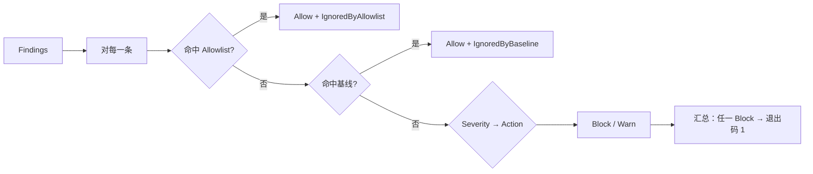
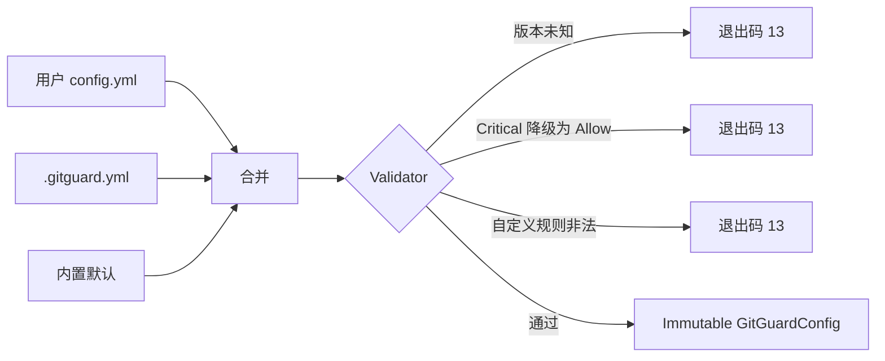

# Policy 模块设计

## 1. 模块定位

- **一句话定位**：策略引擎——把 Finding 的严重度映射为「阻断 / 警告 / 放行」动作，并应用白名单；承载 `.gitguard.yml` 的 Schema 定义与校验。
- **所属限界上下文**：Scanning Context
- **承担 FR**：`FR-022, FR-040, FR-041, FR-070, FR-071, FR-080`
- **承担 DR**：`DR-03`（FailClosed）、`DR-05`（硬下限：Critical 不可降级）
- **关联 ADR**：无

## 2. 输入输出契约

### 2.1 输入

| 来源 | 内容 |
| --- | --- |
| YAML 解析器 | `.gitguard.yml`（项目级） |
| YAML 解析器 | `~/.config/gitguard/config.yml`（用户级） |
| Detection 模块 | `IAsyncEnumerable<Finding>`（ADR-0003 流式契约） |
| Allowlist Store | `AllowlistEntry` 列表 |

### 2.2 输出

| 消费方 | 内容 |
| --- | --- |
| Application UseCase | `PolicyDecision { Action, IgnoredByAllowlist, IgnoredByBaseline, Severity }` |
| CLI 层 | 最终退出码 |
| Audit | `PolicyOverride` 事件（配置相对默认策略发生降级；GGD-0015） |

## 3. 核心规则

| 规则 | 要点 |
| --- | --- |
| 默认映射 | `Critical → Block, High → Block, Medium → Warn, Low → Warn` |
| 用户覆写 | 允许改映射，但 `Critical → Allow` 禁止（启动期拒绝） |
| 禁用内置规则 | `enabled: false` 或类别 `enabled: false` 允许，但记录 `PolicyOverride` 审计（`<rule_id>`，`To = Allow`） |
| 降级审计 | 严重度映射低于默认值（如 `high: warn`）记 `SEVERITY/<Severity>` 降级；仅记录实际降级，同进程只写一次；未知 `disabled_rules` ID 只告警、不写覆盖 |
| 白名单匹配 | 对单条 Finding，命中任一 AllowlistEntry 即视作 ignored（但仍记录到报告）；声明的 rule / path / fingerprint 条件全部匹配，过期条目忽略 |
| 白名单来源 | `.gitguard.yml` 的 `allowlist.entries` 与 SQLite `allowlist` 表合并参与判定（`GitGuardSession.BuildScanPolicy`，GGD-0030）；SQLite 读取失败按 FailClosed 传播（退出码 14） |
| 基线覆盖 | `scan --all` 消费 `.gitguard-baseline.json` 时，`ScanExecutor` 在策略评估后按指纹把未命中白名单的 Finding 覆盖为 `Allow + IgnoredByBaseline`；白名单优先（GGD-0032） |
| 排除匹配 | `exclude.paths` 以仓库相对路径匹配，`exclude.files` 以文件名在任意深度匹配；命中文件不进入扫描、不产生 Finding，也不计入 `skipped_files` |
| 配置文件合并 | 项目级覆盖用户级；深度合并 map，列表则替换 |
| 自定义规则 | `rules.custom` 在加载期校验（`USR/` 前缀、类别、必填字段、正则可编译、列表内 ID 唯一），非法即退出码 13；编译后以 `RuleSource.User` 追加在内置规则之后，参与四类检测与「有效启用」计算（`GGD-0034`） |
| Schema 版本 | `.gitguard.yml` 必须有 `version: 1`；未知版本 FailClosed |

## 4. 外部依赖

| 依赖 | 用途 | 失败降级 |
| --- | --- | --- |
| YamlDotNet | YAML 解析 | 解析失败 → FailClosed（退出码 13） |
| SQLite（Allowlist 表） | 白名单读取 | 读失败 → FailClosed |

## 5. 数据模型

- `AllowlistEntry` 表见 `05-数据库设计.md` §4.3。
- 配置文件以 `GitGuardConfig` 聚合在内存中表示：

```csharp
public sealed record GitGuardConfig(
    int Version,
    ScanConfig Scan,
    LoggingConfig Logging,
    IReadOnlyDictionary<string, RuleConfig> Rules,
    IReadOnlyDictionary<Severity, PolicyAction> Policy,
    ExcludeConfig Exclude,
    PrivacyConfig Privacy);
```

## 6. 关键流程

### 6.1 策略评估



### 6.2 配置加载



## 7. 配置文件 Schema（`.gitguard.yml`）

> **稳定契约**：Schema 一经发布不得破坏兼容性；新字段追加时保持默认值与旧行为一致。

```yaml
version: 1

scan:
  pre_commit: true   # Hook 模式扫描开关；手动 scan --staged 不受影响
  pre_push: true     # Hook 模式扫描开关；手动 scan --push 不受影响
  fail_closed: true
  max_file_bytes: 1048576  # 1 MiB
  timeout_ms: 30000

hooks:
  pre_commit: true                  # install 缺省是否注册 pre-commit
  pre_push: true                    # install 缺省是否注册 pre-push
  post_commit_bypass_detection: true  # install 缺省是否注册 post-commit 绕过检测
  gitguard_executable_path: null    # 可省略；覆盖固化到脚本内的可执行文件路径

logging:
  verbose: false
  file:
    enabled: false
    # 省略 path 时跟随平台数据目录（UserDataPaths.LogFilePath）：
    # Windows %LOCALAPPDATA%\GitGuard\logs\gitguard.log；macOS ~/Library/Application Support/GitGuard/logs/gitguard.log；
    # Linux $XDG_DATA_HOME/gitguard/logs/gitguard.log（未设置时 ~/.local/share/gitguard/logs/gitguard.log）
    max_bytes: 10485760
    max_files: 5

rules:
  secrets:
    enabled: true
    disabled_rules: []
    use_gitleaks: false
    gitleaks_path: null              # 可省略；支持 ~ 与 PATH 裸名称，空白值 → 13
    min_entropy: 4.0

  privacy:
    enabled: true
    disabled_rules: []
    require_context: true
    test_file_patterns:
      - "**/*test*/**"
      - "**/*spec*/**"
      - "**/fixtures/**"

  local_path:
    enabled: true
    disabled_rules: []

  url:
    enabled: true
    disabled_rules: []
    public_hostname_whitelist: []    # 精确主机或 *.example.com；命中主机的 URL 规则 Finding 不产出

  custom:
    - id: USR/SECRET/INTERNAL-TOKEN   # 必须以 USR/ 开头；类别段仅限 SECRET/PRIVACY/LOCALPATH/URL
      name: 内部令牌
      severity: High                  # Critical / High / Medium / Low（大小写不敏感）
      pattern: "INT-[A-Z0-9]{8}"      # .NET 正则，加载期编译
      context_keywords:               # 可选；任一关键字命中即通过（大小写不敏感子串）
        - token
      file_path_globs:                # 可选；仓库相对路径 glob
        - "src/**"
      enabled: true                   # 可选，默认 true

policy:
  critical: block   # 不可改为 allow
  high: block
  medium: warn
  low: warn

exclude:
  paths:
    - "**/bin/**"
    - "**/obj/**"
    - "**/node_modules/**"
  files:
    - "*.min.js"
    - "*.lock"
    - "package-lock.json"

allowlist:
  # 简单配置方式；复杂方式用 CLI 的 gitguard allowlist add
  entries:
    - rule_id: GGD/PRIVACY/EMAIL
      path_pattern: "docs/example/*"
      reason: "示例文档中的邮箱非真实用户"
```

**排除语义（GGD-0019）**：`exclude.paths` 的 glob 与仓库相对路径（`/` 分隔）匹配；`exclude.files` 的 glob 与文件名（路径最后一段）匹配，因而对所有目录深度生效。glob 支持 `*`（段内任意字符）、`?`（段内单字符）、`**`（独立段，匹配零或多层目录），大小写敏感。命中文件在扫描分区阶段直接丢弃：不调用检测器、不产生 Finding、不计入 `files_scanned`、也不登记到 `skipped_files`（与「因二进制 / 超限跳过」相区分）。列表项空白 → `CONFIG_INVALID`（退出码 13）。

**自定义规则语义（GGD-0034）**：`rules.custom` 为列表，项目级声明整体替换用户级列表。`id` 必须以 `USR/` 开头并满足规则 ID 命名契约；`name` / `severity` / `pattern` 必填；同一列表内 ID 重复、正则在加载期编译失败、`context_keywords` / `file_path_globs` 含空白项 → `CONFIG_INVALID`（退出码 13）。规则按声明顺序追加在内置规则之后（`RuleSource.User`），受 `disabled_rules` 与所属类别 `enabled` 共同约束；`enabled: false` 仅关闭该规则。上下文关键字为大小写不敏感子串，声明多个时任一命中即通过；文件 glob 使用与 `exclude` 相同的 `GlobMatcher`。自定义规则与内置规则共用 200ms 正则超时（超时 FailClosed），且自定义 SECRET 规则在超长行（> 2048 字符）不跳过。

**Gitleaks 适配器语义（GGD-0035）**：`rules.secrets.use_gitleaks` 默认 `false`，开启后 `DetectorAssembly` 在内置 SECRET 检测器之后装配 `GitleaksAdapter`（检测顺序 `Secret → Gitleaks → Privacy → LocalPath → Url`）。`gitleaks_path` 支持 `~` 展开；未配置或仅裸名称时按 PATH 查找（Windows 自动补 `.exe`），空白字符串 → `CONFIG_INVALID`（退出码 13），项目级与用户级按字段覆盖。启动期探测失败（文件缺失 / 无法执行 / `version` 探测失败）→ 警告并禁用适配器，扫描继续使用内置规则；可运行但非 8.x 的版本 → 警告但仍可用。扫描期非零退出码（0 / 1 除外）、报告缺失或 JSON 非法 → `DETECTOR_FAILED`（退出码 11），不重试。Gitleaks 规则 ID 映射为 `GLK/SECRET/*`；`disabled_rules` 同时接受原始 ID 与 GLK 命名空间写法（大小写不敏感），`GGD/` / `USR/` 条目由内置规则选择消费。多引擎命中按（提交、文件、行、指纹）去重，优先级 `USR > GLK > GGD`，严重度取最高。

**URL 公共主机名白名单语义（GGD-0039）**：`rules.url.public_hostname_whitelist` 默认 `[]`，项目级声明整体替换用户级列表。列表项支持精确主机名（`github.com`）与 `*.example.com` 通配（覆盖任意层级子域，不覆盖裸域 `example.com`）；加载期去空白 / 末尾根点、转小写并去重，空白项或含协议、端口、路径、空白、非法通配的项 → `CONFIG_INVALID`（退出码 13）。`UrlDetector` 在严重度调整后、产出 Finding 前按命中位置向前最近的 `scheme://` 解析主机（跳过用户信息与端口），命中白名单则抑制该条 Finding；无法解析主机时保持原判定。白名单仅作用于 URL 类别规则，且不产生 `PolicyOverride`（属于检测器级降噪，而非策略降级）。

## 8. 质量属性

| 属性 | 目标 |
| --- | --- |
| 配置加载耗时 | ≤ 20ms |
| Schema 版本演进向后兼容 | 所有 MINOR 版本仍能加载旧配置 |
| 硬下限 100% 生效 | 单测 `TC-DR-05-02`（Critical→Allow 拒绝）必过 |

## 9. 测试要点

- [x] 默认映射正确性（`GitGuardConfigLoaderTests.Load_NoConfigFiles_UsesBuiltinDefaults`，TC-FR-070-02）。
- [x] Critical → Allow 被拒绝（启动期退出码 13）。
- [x] 白名单三条件（规则 / 路径 / 指纹）单独与组合匹配（`AllowlistMatcherTests` + 加载器条目用例）。
- [x] SQLite 白名单管理（GGD-0030）：`allowlist add/remove/list` 持久化与退出码 20 / 21、`AllowlistChanged` 审计事件、配置与 SQLite 条目合并后扫描放行（`CliAllowlistCommandTests` / `SqliteAuditStoreAllowlistTests` / `AllowlistUseCaseTests`）。
- [x] 配置合并：项目覆盖用户（标量覆盖、列表整体替换，TC-FR-070-01）。
- [x] 未知字段：警告但不阻断（宽松解析；含未知顶层键与未知段落内键）。
- [x] 未知 `version` 值：阻断（TC-FR-070-04）。
- [x] 排除规则：`exclude.paths` 命中路径、`exclude.files` 命中任意深度文件名 → 不扫描且不产生 Finding；项目级按字段覆盖用户级；空白列表项 → 退出码 13（TC-FR-070-05）。
- [x] 降级审计：`policy.high: warn` 与 `disabled_rules: [GGD/SECRET/AWS-AKID]` 首次装配各写一条 `PolicyOverride`，同 Session 多次装配不重复；本地路径规则不被误判为禁用（`AuditEventWiringTests`，GGD-0015）。
- [x] 自定义规则（GGD-0034）：加载期编译与校验（`USR/` 前缀、类别、必填字段、非法正则、重复 ID、空白上下文关键字 → 13）、项目级整体替换用户级；规则目录追加顺序与 `User` 来源；`enabled` / `disabled_rules` / 类别开关对有效启用的组合；检测器命中、上下文 / glob 过滤与 200ms 超时 FailClosed（`GitGuardConfigLoaderTests` / `RuleCatalogTests` / `CustomRuleDetectorTests`）。
- [x] Hook 配置（GGD-0038）：`hooks.*` 默认值 / 解析 / 项目级按字段覆盖、未知子键警告、空白 `gitguard_executable_path` → 13；安装期按子集注册与显式 `--hook` 覆盖、全禁用 → 13、可执行文件缺失 → 13；`scan.pre_commit` / `scan.pre_push` 仅 Hook 模式生效且跳过不产生绕过事件（`GitGuardConfigLoaderTests` / `CliHookLifecycleTests` / `CliScanCommandTests` / `HookScriptBuilderTests`）。
- [x] URL 公共主机名白名单（GGD-0039）：默认空；规范化（trim / 末尾根点 / 小写 / 去重）与项目级列表替换；空白 / 协议 / 端口 / 路径 / 非法通配 → 13；精确主机与 `*.` 通配的抑制边界、大小写与端口无关、仅关联最近前置 URL；CLI 端到端验证白名单内 Clean、白名单外仍阻断（`GitGuardConfigLoaderTests` / `DetectorTests` / `CliScanCommandTests`）。

## 10. 演进与扩展位

- 组织级配置 `.gitguard.org.yml`（P3）：三层合并（org > user > project 的顺序由团队管理员决定）。
- 规则引用：允许在 YAML 中声明「启用某个来自 Gitleaks 的规则但覆写严重度」。

## 11. 变更记录

| 版本 | 日期 | 变更说明 |
| --- | --- | --- |
| 0.1.0 | 2026-10-15 | 初始化：Schema v1 + 硬下限 + 白名单三条件匹配 |
| 0.1.1 | 2026-10-16 | 与 GGD-0006 实现同步：§2.1 输入契约 Detection 模块输出改为 `IAsyncEnumerable<Finding>`（ADR-0003 流式） |
| 0.1.2 | 2026-10-16 | 与 GGD-0007 实现同步：`PolicyEvaluator` 落地于 `GitGuard.Core.Policy`——逐条 Finding 先查白名单（命中且未过期 → `Allow` + `IgnoredByAllowlist`），否则按 `SeverityPolicy` 映射；聚合规则：任一 `Block` → 退出码 1，仅 `Warn` → 退出码 0（§6.1 流程图同步为 `Allow + IgnoredByAllowlist`） |
| 0.1.3 | 2026-10-16 | 与 GGD-0009 实现同步：FR-070 / FR-071 落地为 `GitGuard.Application.Configuration.GitGuardConfigLoader`（用户级 `~/.config/gitguard/config.yml` + 项目级 `.gitguard.yml`；深度合并：map 递归、列表整体替换；`version: 1` 必填；`policy.critical: allow` 硬下限；取值越界与 `use_gitleaks: true` FailClosed → 退出码 13）。新增宽松解析实现说明：反序列化忽略未知属性、由 YAML 语法树比对已知键产生警告（`warnings`）；白名单条目由配置声明时 `created_by` / `created_at` 取注入时钟与当前 OS 用户名。§9 勾选已覆盖项；§10 登记 `exclude` 消费顺延 |
| 0.1.4 | 2026-10-21 | GGD-0019：`exclude` 接线——`GitGuardConfigLoader` 映射 `exclude.paths` / `exclude.files`（trim、空项 FailClosed），`ScanPolicy.IsExcluded` 基于 `GlobMatcher` 判定，`ScanExecutor` 在二进制 / 体积检查前静默丢弃命中文件（无 Finding、不计 `files_scanned`、不登记 `skipped_files`）；项目级按字段覆盖用户级。§3 新增排除规则，§7 补充排除语义，§9 增补 TC-FR-070-05，§10 移除顺延项 |
| 0.1.5 | 2026-10-22 | GGD-0015：§2.2 / §3 落地 `PolicyOverride` 审计——严重度降级使用 `SEVERITY/<Severity>` 合成 ID、禁用规则记 `To = Allow`、同进程去重、未知 ID 不写事件；§9 增补降级审计用例 |
| 0.1.6 | 2026-10-22 | GGD-0016：§7 `logging.file.path` 缺省值改为跟随 `UserDataPaths.LogFilePath`，与平台数据目录一致 |
| 0.1.7 | 2026-10-22 | GGD-0030：§3 新增白名单来源规则（配置文件与 SQLite 条目合并、读取失败 FailClosed）；§9 增补 SQLite 白名单管理测试项 |
| 0.1.8 | 2026-10-22 | GGD-0032：§2.2 / §3 / §6.1 补基线覆盖（`ScanExecutor` 按指纹覆盖为 `Allow + IgnoredByBaseline`，白名单优先）与 `PolicyDecision.IgnoredByBaseline` 字段 |
| 0.1.9 | 2026-10-22 | GGD-0034：§1 承担 FR 补 `FR-080`；§3 / §6.2 / §7 新增 `rules.custom` 自定义规则（加载期校验、列表替换、`RuleSource.User` 追加、有效启用语义、200ms 超时与超长行不跳过）；§9 增补配置 / 目录 / 检测测试项 |
| 0.1.10 | 2026-10-22 | GGD-0035：§7 Schema 补 `rules.secrets.gitleaks_path`，并新增 Gitleaks 适配器配置语义（开关、路径解析、启动期降级 / 扫描期 FailClosed、`GLK/` 过滤与跨引擎去重） |
| 0.1.11 | 2026-10-23 | GGD-0038：§7 Schema 新增 `hooks` 段（安装期 Hook 子集与可执行文件路径覆盖），标注 `scan.pre_commit` / `scan.pre_push` 为 Hook 模式专用；§9 增补 Hook 配置测试项 |
| 0.1.12 | 2026-10-23 | GGD-0039：§7 Schema 新增 `rules.url.public_hostname_whitelist` 与配置语义（规范化、非法项 FailClosed、按最近前置 URL 主机抑制 Finding、不产生 PolicyOverride）；§9 增补白名单测试项 |
