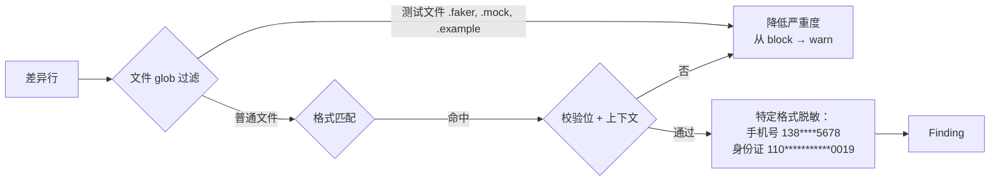

# Privacy 模块设计

## 1. 模块定位

- **一句话定位**：识别可能的个人隐私信息，重点覆盖**中国大陆场景**：手机号、身份证、银行卡、邮箱（含上下文校验，降低误报）。
- **所属限界上下文**：Scanning Context
- **承担 FR**：`FR-021`
- **承担 DR**：`DR-02`（零明文留存，个人数据严格脱敏）
- **关联 ADR**：无（规则级实现，不涉及架构决策）

## 2. 输入输出契约

### 2.1 输入

| 来源 | 内容 | 格式 | 缺失语义 |
| --- | --- | --- | --- |
| 差异 Hunk | 新增 / 修改行 | UTF-8 | 空跳过 |
| 规则库 | `privacy` 分类规则 | DetectionRule | - |

### 2.2 输出

同 Secret 模块：返回 `IReadOnlyList<Finding>`。

## 3. 核心规则

| RuleId | 名称 | 严重度 | 判定要点 |
| --- | --- | --- | --- |
| `GGD/PRIVACY/CN-MOBILE` | 中国大陆手机号 | Medium | `(?<![\d])(1[3-9]\d{9})(?![\d])` + 上下文含 `phone|mobile|tel|手机` 或在测试文件中标签为 `fake` 则不命中 |
| `GGD/PRIVACY/CN-IDCARD-18` | 18 位身份证 | High | 符合校验位的 18 位；上下文含 `id|idcard|身份证` |
| `GGD/PRIVACY/CN-IDCARD-15` | 15 位身份证 | Medium | 格式匹配 + 上下文 |
| `GGD/PRIVACY/CN-BANKCARD` | 银行卡号 | High | 符合 Luhn 校验 + 长度 16-19 位 |
| `GGD/PRIVACY/EMAIL` | 邮箱 | Low | RFC 5322 简化版正则；默认 `warn` |
| `GGD/PRIVACY/CN-NAME-ADDRESS` | 姓名 + 地址组合（P2） | Medium | NER-like 启发（关键字 `姓名`、`住址` + 具体值） |

> MVP 落地 1 ~ 5；`CN-NAME-ADDRESS` 在 P2 启用。

## 4. 外部依赖

| 依赖 | 用途 | 失败降级 |
| --- | --- | --- |
| Regex 引擎 | 格式判定 | 单规则禁用 + FailClosed |
| Luhn 算法实现（内置纯 C#） | 银行卡号校验 | - |

## 5. 数据模型

无独立持久化。Finding 的 `snippet_masked` 对手机号强制脱敏为 `138****5678` 风格。

## 6. 关键流程

**降级策略**：

- 文件路径包含 `test`、`spec`、`fixture`、`mock`、`sample`、`example` → 严重度自动降一级（block → warn）。
- 但仍保留命中记录供用户复盘。

## 7. 配置项

| 配置项 | 类型 | 默认 | 说明 |
| --- | --- | --- | --- |
| `rules.privacy.enabled` | bool | true | 全局开关 |
| `rules.privacy.disabled_rules` | string[] | [] | 禁用的规则 ID |
| `rules.privacy.test_file_patterns` | string[] | 见默认 | 哪些 glob 视为测试文件自动降级 |
| `rules.privacy.require_context` | bool | true | 是否要求上下文关键字（关掉可提升召回但增加误报） |

## 8. 质量属性

| 属性 | 目标 |
| --- | --- |
| 手机号识别误报率 | ≤ 5%（随机 100 个「11 位数字」样本） |
| 身份证校验位实现正确性 | 100% 符合 GB 11643-1999 校验算法 |
| 单规则 P95 耗时 | ≤ 30ms |

## 9. 测试要点

- [ ] 所有身份证样本必须是合成 + 校验位正确（禁用真实身份证作为测试样本）。
- [ ] 验证 `require_context = true` 下，裸的 11 位数字不触发手机号命中。
- [ ] 验证测试文件路径自动降级。
- [ ] 验证脱敏输出格式稳定（供用户肉眼识别）。

## 10. 演进与扩展位

- `CN-NAME-ADDRESS`：P2 启用。
- 国际化隐私数据（美国 SSN、欧盟 IBAN）：三期按需。
- NER 模型：**不**引入，保持纯规则（避免模型依赖和 DR-01 风险）。

## 11. 变更记录

| 版本 | 日期 | 变更说明 |
| --- | --- | --- |
| 0.1.0 | 2026-10-15 | 初始化：5 条 MVP 规则 + 测试文件自动降级策略 |
