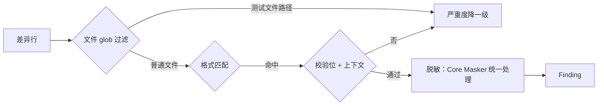

# Privacy 模块设计

## 1. 模块定位

- **一句话定位**：识别可能的个人隐私信息，重点覆盖**中国大陆场景**：手机号、身份证、银行卡、邮箱（含上下文校验，降低误报）。
- **所属限界上下文**：Scanning Context
- **承担 FR**：`FR-021`
- **承担 DR**：`DR-02`（零明文留存，个人数据严格脱敏）
- **关联 ADR**：无（规则级实现，不涉及架构决策）

## 2. 输入输出契约

### 2.1 输入

| 来源 | 内容 | 格式 | 缺失语义 |
| --- | --- | --- | --- |
| 差异 Hunk | 新增 / 修改行 | UTF-8 | 空跳过 |
| 规则库 | `privacy` 分类规则 | DetectionRule | - |

### 2.2 输出

同 Secret 模块：返回 `IAsyncEnumerable<Finding>`（ADR-0003 流式契约）。

## 3. 核心规则

| RuleId | 名称 | 严重度 | 判定要点 |
| --- | --- | --- | --- |
| `GGD/PRIVACY/CN-MOBILE` | 中国大陆手机号 | Medium | `(?<![0-9])1[3-9][0-9]{9}(?![0-9])` + 上下文含 `phone` / `mobile` / `tel` / `手机`；测试文件路径命中降一级（Medium → Low） |
| `GGD/PRIVACY/CN-IDCARD-18` | 18 位身份证 | High | 符合校验位的 18 位；上下文含 `id|idcard|身份证` |
| `GGD/PRIVACY/CN-IDCARD-15` | 15 位身份证 | Medium | 格式匹配 + 上下文 |
| `GGD/PRIVACY/CN-BANKCARD` | 银行卡号 | High | 符合 Luhn 校验 + 长度 16-19 位 |
| `GGD/PRIVACY/EMAIL` | 邮箱 | Low | RFC 5322 简化版正则；默认 `warn` |
| `GGD/PRIVACY/CN-PASSPORT` | 中国护照号 | High | `E` / `G` + 8 位数字或 `[A-Z]` + 7~8 位数字；上下文含 `passport` / `护照` |
| `GGD/PRIVACY/CN-LANDLINE` | 中国大陆座机号 | Medium | `0` 开头区号 + 7~8 位号码（分隔符可选）；上下文含 `phone` / `tel` / `电话` / `座机` |
| `GGD/PRIVACY/US-SSN` | 美国社会安全号（SSN） | Medium | `3-2-4` 位数字；上下文含 `ssn` / `social security` / `社保号` |
| `GGD/PRIVACY/CN-NAME-ADDRESS` | 姓名 + 地址组合（P2） | Medium | 关键字 `姓名` / `住址` / `地址` + 冒号 + ≥2 字符具体值 |

> v0.2（GGD-0033）在 MVP 5 条基础上新增护照、座机、SSN 与姓名地址组合，共 9 条；`CN-NAME-ADDRESS` 按 P2 计划提前启用。

## 4. 外部依赖

| 依赖 | 用途 | 失败降级 |
| --- | --- | --- |
| Regex 引擎 | 格式判定 | 单规则禁用 + FailClosed |
| Luhn 算法实现（内置纯 C#） | 银行卡号校验 | - |

## 5. 数据模型

无独立持久化。Finding 的 `snippet_masked` 经 Core `Masker` 统一脱敏（保留命中值前后各 2 字符、中间 `*`，总长 ≤ 32），如手机号 `13812345678` → `13*******78`。

## 6. 关键流程

**降级策略**：

- 文件路径包含 `test`、`spec`、`fixture`、`mock`、`sample`、`example`（大小写不敏感的子串匹配）→ 严重度自动降一级。
- 但仍保留命中记录供用户复盘。

## 7. 配置项

| 配置项 | 类型 | 默认 | 说明 |
| --- | --- | --- | --- |
| `rules.privacy.enabled` | bool | true | 全局开关 |
| `rules.privacy.disabled_rules` | string[] | [] | 禁用的规则 ID |
| `rules.privacy.test_file_patterns` | string[] | `["test","spec","fixture","mock","sample","example"]` | 哪些路径子串视为测试文件自动降级 |
| `rules.privacy.require_context` | bool | true | 是否要求上下文关键字（关掉可提升召回但增加误报） |

## 8. 质量属性

| 属性 | 目标 |
| --- | --- |
| 手机号识别误报率 | ≤ 5%（随机 100 个「11 位数字」样本） |
| 身份证校验位实现正确性 | 100% 符合 GB 11643-1999 校验算法 |
| 单规则 P95 耗时 | ≤ 30ms |

## 9. 测试要点

- [x] 所有身份证样本必须是合成 + 校验位正确（禁用真实身份证作为测试样本）。
- [x] 验证 `require_context = true` 下，裸的 11 位数字不触发手机号命中。
- [x] 验证测试文件路径自动降级。
- [x] 验证脱敏输出格式稳定（供用户肉眼识别）。
- [x] 每条规则 ≥3 正例 / ≥3 反例 / 边界命中与不命中各 ≥1（`BuiltinRuleFixtureTests`，9 条 Privacy 规则全覆盖）。

## 10. 演进与扩展位

- `CN-NAME-ADDRESS`：已于 v0.2（GGD-0033）提前启用。
- 国际化隐私数据（欧盟 IBAN 等）：三期按需；美国 SSN 已于 v0.2 启用。
- NER 模型：**不**引入，保持纯规则（避免模型依赖和 DR-01 风险）。

## 11. 变更记录

| 版本 | 日期 | 变更说明 |
| --- | --- | --- |
| 0.1.0 | 2026-10-15 | 初始化：5 条 MVP 规则 + 测试文件自动降级策略 |
| 0.1.1 | 2026-10-16 | 与 GGD-0006 实现同步：输出契约定为 `IAsyncEnumerable<Finding>`（ADR-0003）；CN-MOBILE 正则改用 ASCII `[0-9]`（防全角数字误报）、移除 `fake` 标签语义（改为测试文件路径降一级）；脱敏统一由 Core `Masker` 承担；`test_file_patterns` 明确为路径子串（大小写不敏感） |
| 0.1.2 | 2026-10-22 | GGD-0033：规则库扩充至 9 条（新增 CN-PASSPORT / CN-LANDLINE / US-SSN / CN-NAME-ADDRESS）；§10 同步 P2 规则启用状态；§9 勾选样本覆盖项 |
