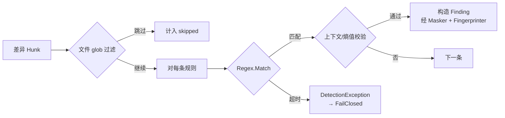

# Secret 模块设计

## 1. 模块定位

- **一句话定位**：扫描暂存区 / 推送差异文本中的凭据与密钥（API Key、Token、JWT、数据库连接串、SSH 私钥等），命中即输出高严重度 Finding。
- **所属限界上下文**：Scanning Context
- **承担 FR**：`FR-021`（四类检测器之一）、`FR-090`（GitleaksAdapter 挂接，v0.2 已实现）
- **承担 DR**：`DR-01, DR-02, DR-03, DR-04`
- **关联 ADR**：`ADR-0003`（检测引擎适配器策略）

## 2. 输入输出契约

### 2.1 输入

| 来源 | 内容 | 格式 | 单位 | 缺失语义 |
| --- | --- | --- | --- | --- |
| `ScanStagedUseCase` / `ScanPushUseCase` | 差异文本 Hunk（新增/修改行） | `FileChange { Path, Lines[ChangedLine] }` | UTF-8 字符串 | 行列表为空时空跑 |
| 规则库 | 内置规则集 `BuiltinRules.yaml` 的 `secret` 分类 | DetectionRule | - | 为空时模块空跑 |
| 可选：GitleaksAdapter（`GGD-0035`） | 外部进程输出 | JSON | - | 启动期不可用时告警降级；扫描期失败 FailClosed |

### 2.2 输出

| 消费方 | 内容 | 格式 | 异常响应 |
| --- | --- | --- | --- |
| `PolicyEvaluator` | `IAsyncEnumerable<Finding>`（ADR-0003 流式契约） | Finding | 抛 `DetectionException` 由上层 FailClosed |

## 3. 核心规则（内置清单，21 条）

| RuleId | 名称 | 严重度 | 判定要点 |
| --- | --- | --- | --- |
| `GGD/SECRET/AWS-AKID` | AWS Access Key ID | Critical | 正则 `\bAKIA[0-9A-Z]{16}\b` |
| `GGD/SECRET/AWS-SECRET` | AWS Secret（弱启发） | Critical | 40 字符高熵 Base64 + 上下文含 `aws_secret` / `secret_access_key` |
| `GGD/SECRET/GITHUB-TOKEN` | GitHub PAT | Critical | 正则 `\bgh[pousr]_[A-Za-z0-9_]{36,}\b` |
| `GGD/SECRET/SLACK-TOKEN` | Slack Token | High | 正则 `\bxox[baprs]-[A-Za-z0-9-]{10,}\b` |
| `GGD/SECRET/JWT` | JWT | Medium | `(?<![A-Za-z0-9_-])eyJ[A-Za-z0-9_-]*\.eyJ[A-Za-z0-9_-]+\.[A-Za-z0-9_-]+(?![A-Za-z0-9_-])` |
| `GGD/SECRET/PRIVATE-KEY` | PEM 私钥块 | Critical | 匹配 `-----BEGIN [A-Z ]*PRIVATE KEY-----` |
| `GGD/SECRET/GENERIC-PASSWORD` | 代码中硬编码密码 | High | 关键字 `(password|passwd|pwd)` + `=` + 引号包裹的 ≥ 6 字符值；排除 `password = args.password` 等变量赋值 |
| `GGD/SECRET/DB-CONN-STRING` | 带密码的连接串 | High | `(Server|Host|Data Source)=...;Password=\S+` |
| `GGD/SECRET/GOOGLE-API-KEY` | Google API Key | High | `AIza` + 35 位 Base64Url 字符（`\bAIza[0-9A-Za-z_-]{35}\b`） |
| `GGD/SECRET/STRIPE-KEY` | Stripe 密钥 | Critical | `sk` / `rk` + `live` / `test` + ≥ 24 位字母数字（`\b(?:sk\|rk)_(?:live\|test)_[0-9A-Za-z]{24,}\b`） |
| `GGD/SECRET/NPM-TOKEN` | npm Access Token | High | `npm_` + 36 位字母数字 |
| `GGD/SECRET/GITLAB-TOKEN` | GitLab PAT | Critical | `glpat-` + ≥ 20 位字母数字 / `_` / `-` |
| `GGD/SECRET/OPENAI-KEY` | OpenAI API Key | Critical | `sk-` / `sk-proj-` / `sk-svcacct-` + ≥ 20 位密钥字符 |
| `GGD/SECRET/SENDGRID-KEY` | SendGrid API Key | High | `SG.` + 22 位 + `.` + 43 位字母数字 / `_` / `-` |
| `GGD/SECRET/HUGGINGFACE-TOKEN` | Hugging Face Token | High | `hf_` + ≥ 34 位字母数字 |
| `GGD/SECRET/AZURE-STORAGE-KEY` | Azure Storage Account Key | High | 86 位 Base64 + `==`，且同行含 `accountkey` / `azure` / `storage` / `存储账户` 上下文 |
| `GGD/SECRET/DIGITALOCEAN-TOKEN` | DigitalOcean Personal Access Token | Critical | `dop_v1_` + 64 位小写十六进制 |
| `GGD/SECRET/HASHICORP-VAULT-TOKEN` | HashiCorp Vault Token | Critical | `hvs.` / `hvb.` / `hvr.` + ≥24 位字母数字 / `_` / `-` |
| `GGD/SECRET/POSTMAN-TOKEN` | Postman API Key | High | `PMAK-` + 24 位十六进制 + `-` + 34 位十六进制 |
| `GGD/SECRET/SHOPIFY-TOKEN` | Shopify Access Token | Critical | `shpat_` / `shpca_` / `shppa_` / `shpss_` + 32 位十六进制 |
| `GGD/SECRET/PYPI-TOKEN` | PyPI API Token | Critical | `pypi-AgEIcHlwaS5vcmc` + ≥50 位 Base64URL 字符 |

> v0.2 规则升级（GGD-0033）在 MVP 8 条基础上新增 8 条高置信度平台 Token 规则；Azure 存储密钥依赖上下文关键字控制误报。v1.0 第一批（`GGD-0048`）再新增 5 条带固定前缀的高置信度平台 Token 规则，降低对弱启发式的依赖。GitleaksAdapter 已作为可选引擎接入（`GGD-0035`），默认关闭，启用后与内置 SECRET 规则并行检测并按指纹去重。

## 4. 外部依赖

| 依赖 | 用途 | 许可 / 成本 | 超时 | 失败降级 |
| --- | --- | --- | --- | --- |
| Regex 引擎（.NET 内置） | 正则匹配 | 内置 | 200ms / 规则 | 禁用该规则并 FailClosed |
| Gitleaks CLI（可选，`GGD-0035`） | 补强召回率 | MIT | 10s / 调用 | 启动期缺失 / 不可执行 → 整体适配器禁用（告警，不阻断）；扫描期异常 → `DETECTOR_FAILED`（不重试） |

## 5. 数据模型

本模块不引入独立持久化；输出 Finding 由 Core 聚合统一持久化（见 `05-数据库设计.md`）。

## 6. 关键流程

**关键细节**：

- 文件后缀过滤：`.lock`、`.min.js`、`.min.css` 整文件跳过；二进制文件过滤由上游差异收集（`FR-020`）承担。
- 行长 > 2048 字符的行按「可能是 minified」处理，仅做高置信度规则（`AWS-AKID` / `GITHUB-TOKEN` / `SLACK-TOKEN` / `PRIVATE-KEY` 及新增的 Google / Stripe / npm / GitLab / OpenAI / SendGrid / Hugging Face / DigitalOcean / HashiCorp Vault / Postman / Shopify / PyPI 平台 Token 规则；跳过 `GENERIC-PASSWORD` / `AWS-SECRET` / `AZURE-STORAGE-KEY` 这类低置信度或依赖上下文的规则）。自定义 `USR/SECRET/*` 规则由用户显式声明，视为高置信度，超长行不跳过（`GGD-0034`）。
- 熵值用来辅助判定 `AWS-SECRET`：仅在 Shannon 熵 > 4.0 时命中。

## 7. 配置项

| 配置项 | 类型 | 默认 | 说明 |
| --- | --- | --- | --- |
| `rules.secrets.enabled` | bool | true | 全局启用/禁用本模块 |
| `rules.secrets.disabled_rules` | string[] | [] | 禁用的规则 ID（Critical 规则禁用需审计登记） |
| `rules.secrets.min_entropy` | float | 4.0 | 用于高熵判定（AWS-SECRET 等） |
| `rules.secrets.use_gitleaks` | bool | false | 启用 GitleaksAdapter（`GGD-0035`） |
| `rules.secrets.gitleaks_path` | string? | null | Gitleaks 可执行路径（支持 `~`；未配置或裸名称时按 PATH 查找）；空白值 → 退出码 13 |

## 8. 质量属性

| 属性 | 目标 | 测量方式 |
| --- | --- | --- |
| 单规则 P95 耗时 | ≤ 30ms（500 行差异） | `gitguard scan --staged --verbose` 的 `Scan.RuleTiming`（`duration_us`，`GGD-0020` 提供采集；尚未作为门禁断言） |
| 内置规则 Critical 命中召回率 | ≥ 90%（已知样本集） | Fixtures 回归 |
| 误报率 | 单仓库首周 ≤ 5% | 真实项目灰度统计 |

## 9. 测试要点

- [x] 每条规则 ≥ 3 条 positive + 3 条 negative（`BuiltinRuleFixtureTests`，21 条 Secret 规则全覆盖）。
- [x] `TC-FR-021-S-*` 测试全部通过。
- [ ] ReDoS 用例集对正则进行回溯测试。
- [x] GitleaksAdapter（`GGD-0035`）契约测试：Mock 子进程映射 / 行号还原 / 禁用规则 / 缺失报告 / 非法 JSON / 路径逃逸 / 临时目录清理（`GitleaksAdapterTests`），以及探测、路径定位与进程超时（`GitleaksProbeTests` / `GitleaksExecutableLocatorTests` / `GitleaksProcessRunnerTests`）。
- [ ] 金丝雀 Token 自检（DR-02）。

## 10. 演进与扩展位

- `IDetector` 接口是扩展位：
  - v0.2：已接入 Gitleaks → `GitleaksAdapter : IDetector`（`GGD-0035`，默认关闭）。
  - 三期：可接入自定义正则列表 → `UserRegexDetector : IDetector`。
- 规则升级策略：
  - 新规则默认 `enabled: false`，经过一轮灰度再默认启用。
  - 旧规则废弃：标记 `deprecated: true`，命中仍提醒但不阻断；两个 MINOR 后移除。

## 11. 变更记录

| 版本 | 日期 | 变更说明 |
| --- | --- | --- |
| 0.1.0 | 2026-10-15 | 初始化：8 条 MVP 内置规则 + GitleaksAdapter 扩展位 |
| 0.1.1 | 2026-10-16 | 与 GGD-0006 实现同步：输出契约定为 `IAsyncEnumerable<Finding>`（ADR-0003 流式）；AWS-AKID 移除「行长 ≤ 256」表述（长行策略统一见 §6）；JWT 正则改为边界断言式（规则按行匹配、无 Multiline，`^`/`$` 不适用）；整文件跳过后缀定为 `.lock` / `.min.js` / `.min.css`；脱敏统一由 Core `Masker` 承担 |
| 0.1.2 | 2026-10-16 | 与 GGD-0007 实现同步：上游差异解析落地（`UnifiedDiffParser` 将 `git diff --cached -U0` / `git diff-tree -p -U0` 输出按行号展开为逐文件变更）；§2.1 输入格式修正为 `FileChange { Path, Lines[ChangedLine] }` |
| 0.1.3 | 2026-10-21 | GGD-0020：§8 单规则耗时测量方式改为 `--verbose` 的 `Scan.RuleTiming`（`duration_us`），替换未落地的 BenchmarkDotNet 引用 |
| 0.1.4 | 2026-10-22 | GGD-0033：规则库扩充至 16 条 Secret 规则（新增 Google API Key / Stripe / npm / GitLab / OpenAI / SendGrid / Hugging Face / Azure Storage Key）；§6 长行高置信度规则集同步扩充；§9 勾选样本覆盖项 |
| 0.1.5 | 2026-10-22 | GGD-0034：§6 明确自定义 `USR/SECRET/*` 规则视为高置信度，超长行不跳过（`SecretDetector` 按 `RuleSource.User` 保持求值） |
| 0.1.6 | 2026-10-22 | GGD-0035：GitleaksAdapter 由扩展位转为已实现可选引擎——§1 / §2 / §3 / §4 去除 P2 表述并补充启动期降级与扫描期 FailClosed 语义；§7 明确 `gitleaks_path` 支持 `~`、PATH 查找与空白值 FailClosed；§9 勾选契约测试；§10 标注 v0.2 接入 |
| 0.1.7 | 2026-10-24 | GGD-0048：§3 规则库扩充至 21 条（新增 DigitalOcean / HashiCorp Vault / Postman / Shopify / PyPI）；§6 长行高置信度规则集同步扩充；§9 样本覆盖更新为 21 条 |
