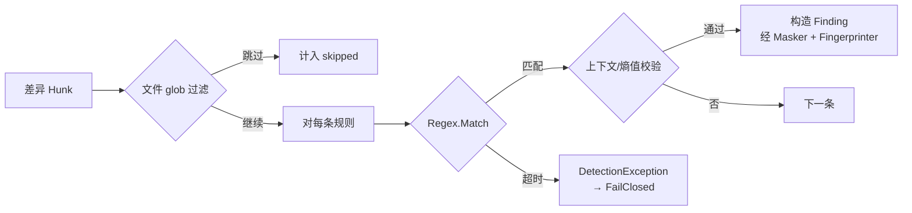

# Secret 模块设计

## 1. 模块定位

- **一句话定位**：扫描暂存区 / 推送差异文本中的凭据与密钥（API Key、Token、JWT、数据库连接串、SSH 私钥等），命中即输出高严重度 Finding。
- **所属限界上下文**：Scanning Context
- **承担 FR**：`FR-021`（四类检测器之一）、`FR-090`（P2 的 GitleaksAdapter 挂接）
- **承担 DR**：`DR-01, DR-02, DR-03, DR-04`
- **关联 ADR**：`ADR-0003`（检测引擎适配器策略）

## 2. 输入输出契约

### 2.1 输入

| 来源 | 内容 | 格式 | 单位 | 缺失语义 |
| --- | --- | --- | --- | --- |
| `ScanStagedUseCase` / `ScanPushUseCase` | 差异文本 Hunk（新增/修改行） | `FileChange { Path, Hunks[Line] }` | UTF-8 字符串 | 空 Hunk 跳过 |
| 规则库 | 内置规则集 `BuiltinRules.yaml` 的 `secret` 分类 | DetectionRule | - | 为空时模块空跑 |
| 可选：GitleaksAdapter（P2） | 外部进程输出 | JSON | - | 不可用时降级 |

### 2.2 输出

| 消费方 | 内容 | 格式 | 异常响应 |
| --- | --- | --- | --- |
| `PolicyEvaluator` | `IReadOnlyList<Finding>` | Finding | 抛 `DetectionException` 由上层 FailClosed |

## 3. 核心规则（内置清单，MVP）

| RuleId | 名称 | 严重度 | 判定要点 |
| --- | --- | --- | --- |
| `GGD/SECRET/AWS-AKID` | AWS Access Key ID | Critical | 正则 `\bAKIA[0-9A-Z]{16}\b` + 行长 ≤ 256 |
| `GGD/SECRET/AWS-SECRET` | AWS Secret（弱启发） | Critical | 40 字符高熵 Base64 + 上下文含 `aws_secret` / `secret_access_key` |
| `GGD/SECRET/GITHUB-TOKEN` | GitHub PAT | Critical | 正则 `\bgh[pousr]_[A-Za-z0-9_]{36,}\b` |
| `GGD/SECRET/SLACK-TOKEN` | Slack Token | High | 正则 `\bxox[baprs]-[A-Za-z0-9-]{10,}\b` |
| `GGD/SECRET/JWT` | JWT | Medium | `^eyJ[A-Za-z0-9_-]+?\.eyJ[...]+?\.[A-Za-z0-9_-]+$` |
| `GGD/SECRET/PRIVATE-KEY` | PEM 私钥块 | Critical | 匹配 `-----BEGIN [A-Z ]*PRIVATE KEY-----` |
| `GGD/SECRET/GENERIC-PASSWORD` | 代码中硬编码密码 | High | 关键字 `(password|passwd|pwd)` + `=` + 引号包裹的 ≥ 6 字符值；排除 `password = args.password` 等变量赋值 |
| `GGD/SECRET/DB-CONN-STRING` | 带密码的连接串 | High | `(Server|Host|Data Source)=...;Password=\S+` |

> MVP 阶段先聚焦以上 8 条高置信度规则；二期通过 GitleaksAdapter 大幅扩展覆盖。

## 4. 外部依赖

| 依赖 | 用途 | 许可 / 成本 | 超时 | 失败降级 |
| --- | --- | --- | --- | --- |
| Regex 引擎（.NET 内置） | 正则匹配 | 内置 | 200ms / 规则 | 禁用该规则并 FailClosed |
| Gitleaks CLI（P2） | 补强召回率 | MIT | 10s / 调用 | 整体适配器禁用 |

## 5. 数据模型

本模块不引入独立持久化；输出 Finding 由 Core 聚合统一持久化（见 `05-数据库设计.md`）。

## 6. 关键流程

**关键细节**：

- 文件扩展名过滤：`.lock`、`.min.js`、二进制扩展名跳过。
- 行长 > 2048 字符的行按「可能是 minified」处理，仅做高置信度规则（跳过 `GENERIC-PASSWORD` 这类低置信度规则）。
- 熵值用来辅助判定 `AWS-SECRET`：仅在 Shannon 熵 > 4.0 时命中。

## 7. 配置项

| 配置项 | 类型 | 默认 | 说明 |
| --- | --- | --- | --- |
| `rules.secrets.enabled` | bool | true | 全局启用/禁用本模块 |
| `rules.secrets.disabled_rules` | string[] | [] | 禁用的规则 ID（Critical 规则禁用需审计登记） |
| `rules.secrets.min_entropy` | float | 4.0 | 用于高熵判定（AWS-SECRET 等） |
| `rules.secrets.use_gitleaks` | bool | false | 启用 GitleaksAdapter（P2） |
| `rules.secrets.gitleaks_path` | string? | null | Gitleaks 可执行路径（默认 PATH 查找） |

## 8. 质量属性

| 属性 | 目标 | 测量方式 |
| --- | --- | --- |
| 单规则 P95 耗时 | ≤ 30ms（500 行差异） | BenchmarkDotNet |
| 内置规则 Critical 命中召回率 | ≥ 90%（已知样本集） | Fixtures 回归 |
| 误报率 | 单仓库首周 ≤ 5% | 真实项目灰度统计 |

## 9. 测试要点

- [ ] 每条规则 ≥ 3 条 positive + 3 条 negative。
- [ ] `TC-FR-021-S-*` 测试全部通过。
- [ ] ReDoS 用例集对正则进行回溯测试。
- [ ] GitleaksAdapter（P2）在 Mock 模式下的契约测试。
- [ ] 金丝雀 Token 自检（DR-02）。

## 10. 演进与扩展位

- `IDetector` 接口是扩展位：
  - 二期：接入 Gitleaks → `GitleaksAdapter : IDetector`。
  - 三期：可接入自定义正则列表 → `UserRegexDetector : IDetector`。
- 规则升级策略：
  - 新规则默认 `enabled: false`，经过一轮灰度再默认启用。
  - 旧规则废弃：标记 `deprecated: true`，命中仍提醒但不阻断；两个 MINOR 后移除。

## 11. 变更记录

| 版本 | 日期 | 变更说明 |
| --- | --- | --- |
| 0.1.0 | 2026-10-15 | 初始化：8 条 MVP 内置规则 + GitleaksAdapter 扩展位 |
